<p align="center"></p>
<h1 align="center">Git Cloner 3.4</h1>
<p align="center">Deine Repositories. Auf deinem Laufwerk. Nach deinem Zeitplan.</p>
<p align="center"><a href="https://github.com/Ujap1994/Git-Cloner/actions/workflows/ci.yml"></a> <a href="https://github.com/Ujap1994/Git-Cloner/releases">Downloads</a> · <a href="docs/ANLEITUNG.md">Anonymisierte Anleitung</a> · <a href="docs/GUIDE.en.md">English guide</a></p>

Git Cloner ist eine Electron-Desktop-App für macOS, Windows und Linux. Sie sichert GitHub-Konten, GitLab-Gruppen und Forgejo-Konten oder ausgewählte Repositories auf eigenen Laufwerken. **Beim ersten Start sind keine Konten oder Repositories eingetragen.** Die Oberfläche konzentriert sich auf Sicherungsstatus, nächste Prüfung und wichtige Meldungen; erweiterte Funktionen bleiben in eigenen Einstellungsbereichen.

> [!IMPORTANT]
> **Open Source – Nutzung ohne Gewähr.** Dieses Projekt wird unter der [MIT-Lizenz](LICENSE) bereitgestellt. Trotz sorgfältiger Entwicklung und Tests kann es Fehler enthalten; Sicherungen können unvollständig sein oder fehlschlagen, und Datenverluste lassen sich nicht ausschließen. Es gibt keine Garantie für Fehlerfreiheit oder Eignung für einen bestimmten Zweck. Teste Sicherung und Wiederherstellung zunächst mit unkritischen Daten und bewahre zusätzliche, unabhängige Backups auf. Gewährleistung und Haftung richten sich nach der Lizenz und dem geltenden Recht. Fehlerberichte und Verbesserungsvorschläge sind über [GitHub Issues](https://github.com/Ujap1994/Git-Cloner/issues) willkommen.

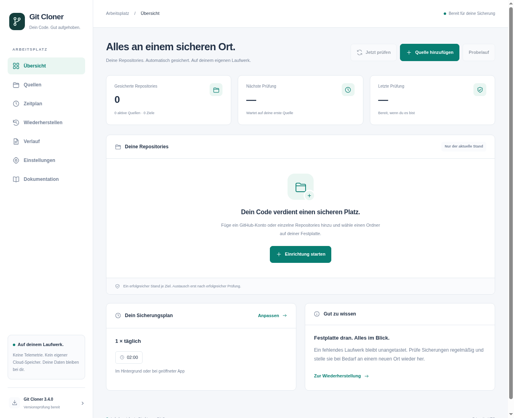

## Funktionen

| Bereich | Verhalten |
| --- | --- |
| Quellen | GitHub, GitLab und Forgejo: mehrere Konten und Repositories zeilenweise eintragen; eigene Zugangsdaten und bis zu zehn Speicherorte je Quelle. |
| Filter | Forks und archivierte Repositories einschließen oder ausschließen; Namensmuster mit `*` und `?` verwenden. |
| Git | Schnelle flache Arbeitskopie des aktuellen Standardbranches oder vollständiger Mirror mit allen Branches und Tags. Optional echte LFS-Dateien und rekursive Submodule. |
| Metadaten | Optional Issues und Kommentare, Pull-/Merge-Requests mit den verfügbaren Review-/Kommentar- und Dateiänderungsdaten, Releases samt Dateien und Wiki-Mirrors exportieren. Anbieterabhängige Details stehen in der Anleitung. |
| Schutz | Laufwerkskennung, Schutz fremder Ordner, Speicherreserve und Austausch erst nach erfolgreicher Prüfung. Ein erfolgreicher Stand je Ziel. |
| Integrität | Git-Objekte und SHA256-Dateimanifeste prüfen, standardmäßig wöchentlich; beschädigte verwaltete Sicherungen beim nächsten Prüflauf neu erstellen. |
| Verschlüsselung | Optional passwortgeschützte AES-256-GCM-Archive mit scrypt-Schlüsselableitung; Passwort auf Wunsch im OS-Schlüsselspeicher merken. |
| Wiederherstellung | Assistent für verifizierte Kopien an einem neuen Arbeitsort, auch aus einer einzelnen GCB-Datei ohne GitHub-Anmeldung. |
| Zeitplan | 1–24 tägliche Prüfzeiten, Nachholen der letzten verpassten Tagesprüfung, Hintergrundbetrieb, Autostart und optionale unabhängige OS-Zeitplanung. |
| Laufwerke | Auf Wunsch konfigurierte Laufwerke beim Verbinden innerhalb von etwa 30 Sekunden erkennen. Mehrere Ziele einer Quelle bleiben getrennte Sicherungen. |
| Komfort | Suche, Statusfilter, paginierte Listen, Import/Export der Einstellungen ohne Geheimnisse und anonymisierte Diagnoseprotokolle. |
| Darstellung | Deutsch und Englisch, Hell-/Dunkelmodus oder Systemeinstellung sowie drei Schriftgrößen, hohen Kontrast und Tastenkürzel mit ausgerichteten Eingabefeldern. |

## Neu in Version 3.4

| Erweiterung | Verhalten |
| --- | --- |
| Release-Dateien lokal wiederverwenden | Passende vorhandene Dateien anhand von Manifest, Kennung und verfügbaren SHA256-Werten prüfen und lokal übernehmen. Änderungen an Downloadzählern lösen keine neue Sicherung aus. Verschlüsselte Archive werden für die Wiederverwendung authentifiziert und vorübergehend entsperrt. |
| Architektur- und Dateitypfilter | Alle, eigene oder gezielt ARM64/x64/x86/ARMv7 wählen; mehrere Formate wie DMG, ZIP oder AppImage kombinieren. Universal-Pakete und gemeinsame Prüfsummen berücksichtigen. Global und je Quelle einstellbar. |
| Downloads & Speicher | Temporäre Teile samt Größe, Quelle und Verschlüsselungsstatus anzeigen. Ausgewählte Teile erst nach einer Vorschau bereinigen; geänderte Vorschauen, laufende Zugriffe und fremde Dateien bleiben geschützt. |
| Programme automatisch installieren | Ausdrücklich je einzelnem Repository aktivieren, getrennten Programmordner wählen und optional den Release-Dateinamen eingrenzen. Nach erfolgreicher Sicherung die aktuelle Programmkopie ersetzen. Unterstützt macOS-App-Bundles aus DMG/ZIP, Windows Portable-EXE/ZIP und Linux AppImage. |

Die Programminstallation startet **keine heruntergeladenen Apps** und verwendet keine automatischen Administratorrechte. macOS-Bundles werden auf Signatur und Prozessorarchitektur geprüft; laufende Mac-Programme werden später erneut versucht. Systeminstaller wie MSI, PKG, DEB oder RPM sind kein unterstützter automatischer Installationsweg. Git Cloner selbst zeigt weiterhin nur Versionshinweise an.

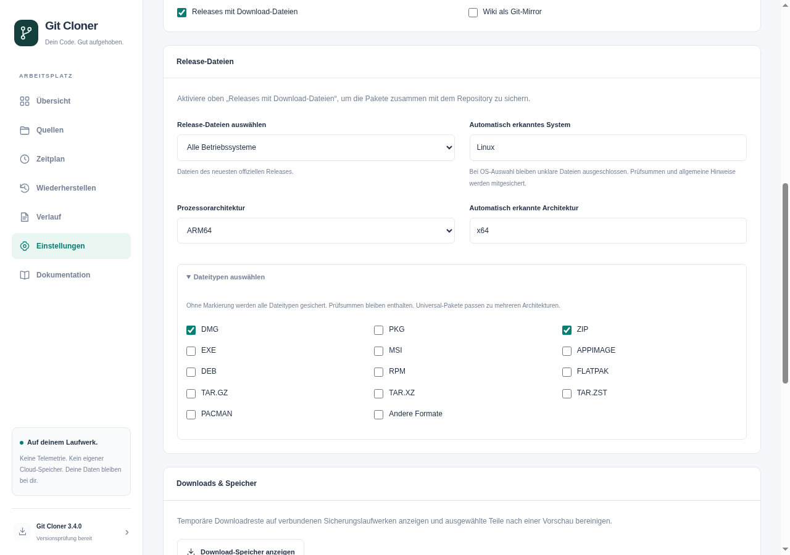

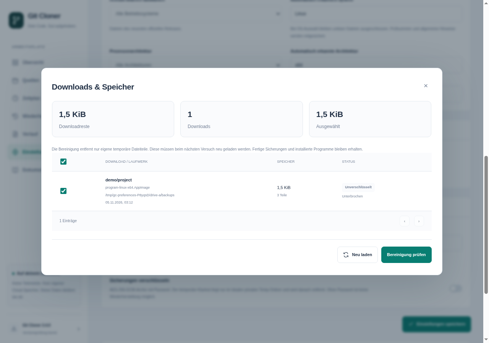

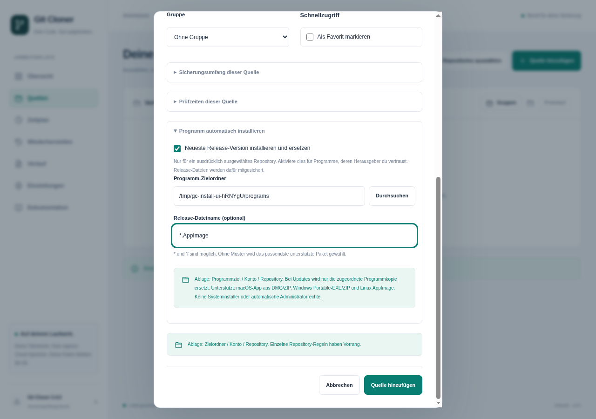

Die [anonymisierte Anleitung ab Abschnitt 32](docs/ANLEITUNG.md#32-vorhandene-release-dateien-lokal-übernehmen) beschreibt Einrichtung, Ablage und Grenzen.

## Bereits enthalten: Version 3.3

Die vier empfohlenen nächsten Schritte sind umgesetzt. Quellen und Gruppen bleiben beim ersten Start leer.

| Erweiterung | Verhalten |
| --- | --- |
| Repository-Browser | GitHub-, GitLab- und Forgejo-Repositories beim Anbieter suchen, seitenweise laden und per Checkbox auswählen. Die Auswahl bleibt über Suchbegriffe und Seiten hinweg erhalten. Einen gemeinsamen Speicherort, eine Gruppe und Favoritenstatus vor dem Hinzufügen festlegen. |
| Gruppen und Favoriten | Bis zu 30 eigene Gruppen, Favoritenfilter, Quellensuche und Seiten mit jeweils 25 Quellen. Die Organisation funktioniert auch während einer Sicherung oder bei abgezogenem Laufwerk. |
| Fortsetzbare Release-Downloads | Geprüfte Dateiteile über Unterbrechungen und Neustarts behalten. HTTP-Range, ETag beziehungsweise sichere Änderungsdaten und vorhandene SHA256-Angaben prüfen. Bei ungeeigneten Serverantworten kontrolliert neu beginnen. Bei verschlüsselten Backups bleiben auch gespeicherte Download-Teile verschlüsselt. |
| Gemeinsam bearbeiten | Ausgewählte Quellen mit gezielten Änderungen an Gruppe, Favoriten, Aktivierung, Ziel, Zugangsdaten, Filtern, Sicherungsumfang und Prüfzeiten bearbeiten. Erst die Vorschau mit **Bisher / Danach** prüfen, dann gemeinsam speichern. Zwischenzeitliche Änderungen machen eine alte Vorschau ungültig. |

GitHub-Adressen werden beim Einfügen auf **Owner/Repository** gekürzt. Konto- und Organisationshauptseiten öffnen die Einzelliste als **Sammelquelle**: neue Repositories automatisch entdecken, bestehende Einzelregeln erhalten und wiederholte Eingaben ohne Duplikate übernehmen. Eine feste Auswahl bleibt möglich.

**Release-Dateien finden:** Heruntergeladene Dateien liegen sichtbar in `Zielordner/Owner/Repository/Git-Cloner-Releases/`. Die Übersicht zeigt den Ort und öffnet ihn direkt. Ältere versteckte Ablagen wechseln bei der nächsten erfolgreichen Prüfung; verschlüsselte Sicherungen behalten die Dateien im Archiv. Siehe die [anonymisierte Anleitung](docs/ANLEITUNG.md#4-sicherungsumfang-wählen).

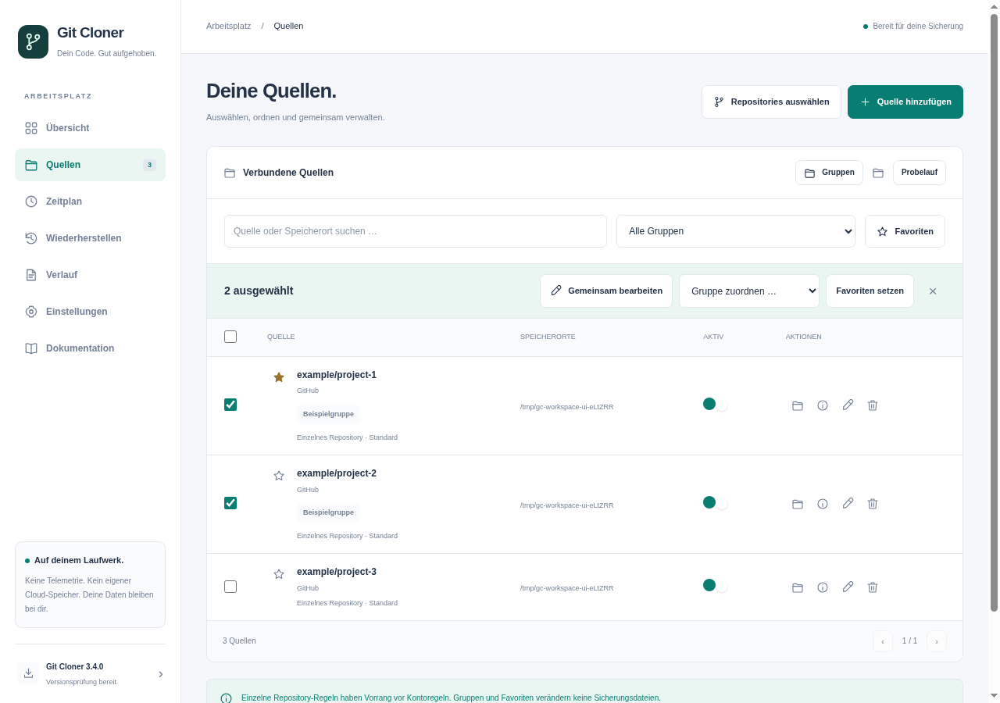

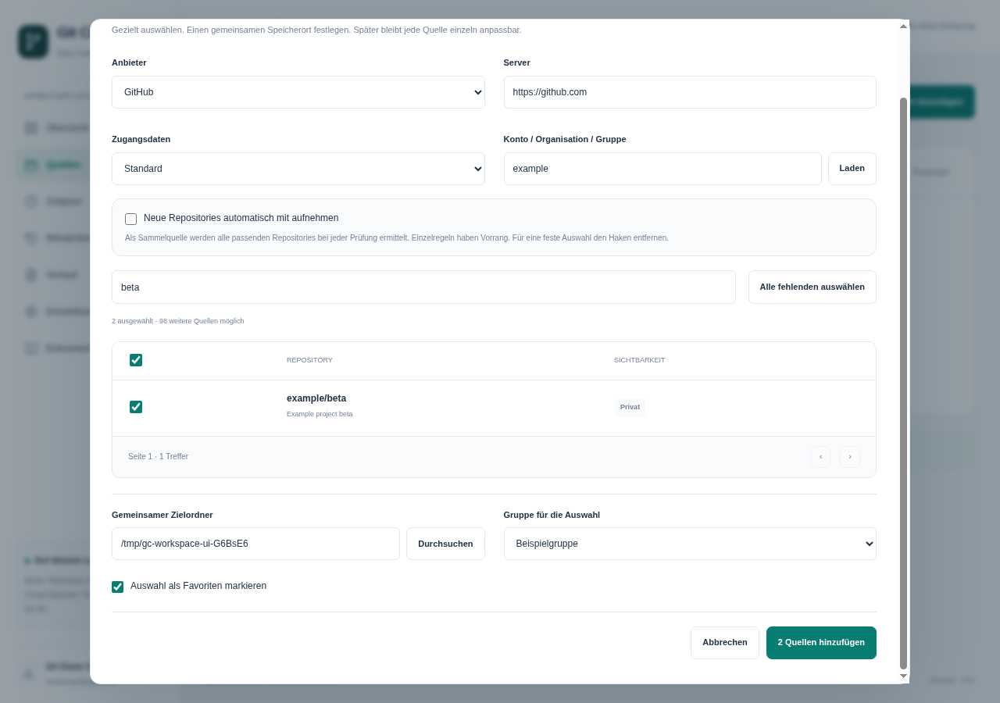

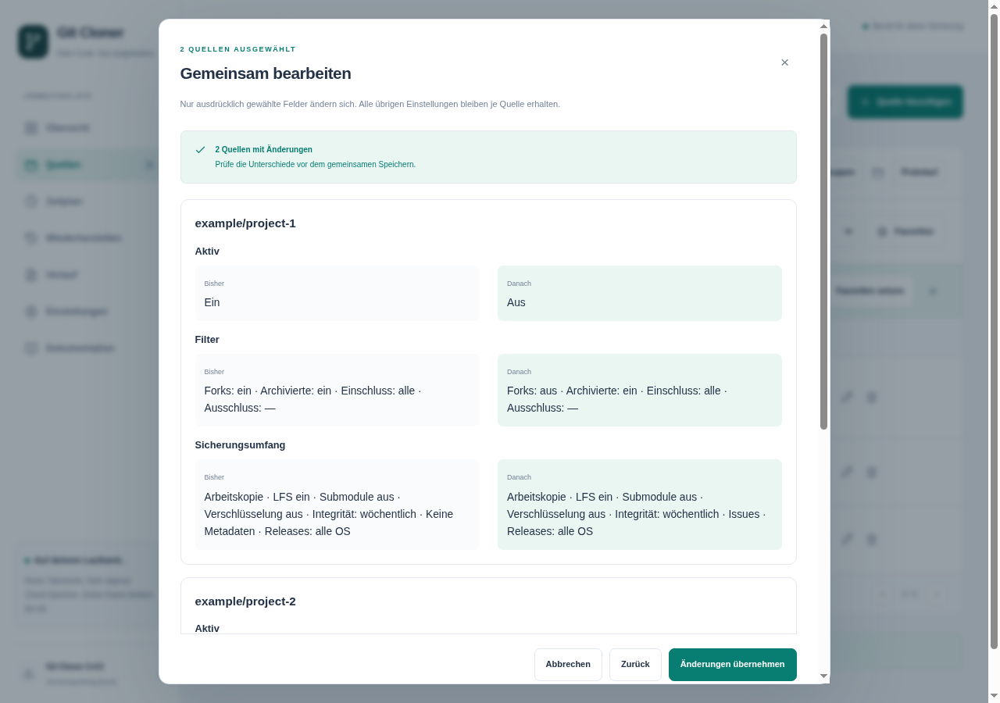

Die [anonymisierte Anleitung ab Abschnitt 28](docs/ANLEITUNG.md#28-repositories-mit-checkboxen-auswählen) beschreibt die Bedienung und die Bedingungen für fortsetzbare Downloads. Der [geplante Aufbau weiterer Detailansichten](docs/DETAILANSICHTEN.md) ist als Konzept dokumentiert; die übrigen Feature-Ideen sind damit noch nicht implementiert.

## Weiterhin enthalten: Version 3.2

Die sechs Erweiterungen aus Version 3.2 sind umgesetzt:

| Erweiterung | Verhalten |
| --- | --- |
| Verlauf durchsuchen | Nach Repository, lokalem Zeitraum und Fehlern/Änderungen filtern, Details seitenweise öffnen und gewählte Läufe anonymisiert exportieren. |
| Konkrete Fehlerhilfe | Passende nächste Schritte für Zugriffsrechte, Netzwerk, API-Limits, Laufwerke, Speicherplatz, Git und Archivpasswörter direkt aus einer Fehlermeldung öffnen. |
| Auf Speicher warten | Volle Datenträger pausieren die Warteschlange dauerhaft. Bei ausreichend freiem Platz automatisch fortsetzen und bereits abgeschlossene Ziele überspringen. Vorhandene Backups bleiben erhalten. |
| Passwortwechsel-Assistent | Gewählte verschlüsselte Archive geprüft neu verschlüsseln, zwischen Archiven stoppen und unterbrochene Austausche wieder aufnehmen. Ältere benötigte Passwörter auf Wunsch im OS-Schlüsselspeicher behalten. |
| GitLab und Forgejo | GitLab API v4 einschließlich Untergruppen und Forgejo API v1 als Quellen. Server und Zugangsdaten bleiben getrennt; identische Repository-Namen verschiedener Server erhalten getrennte Ablagen. |
| LFS-/Submodul-Empfehlungen | Git-Dateibäume und kleine Attributdateien prüfen, Hinweise anzeigen und Optionen erst nach deiner Auswahl für diese Quelle übernehmen. |

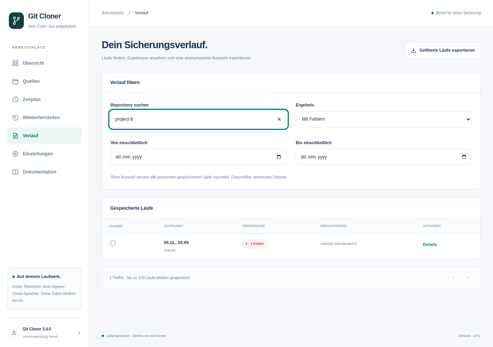

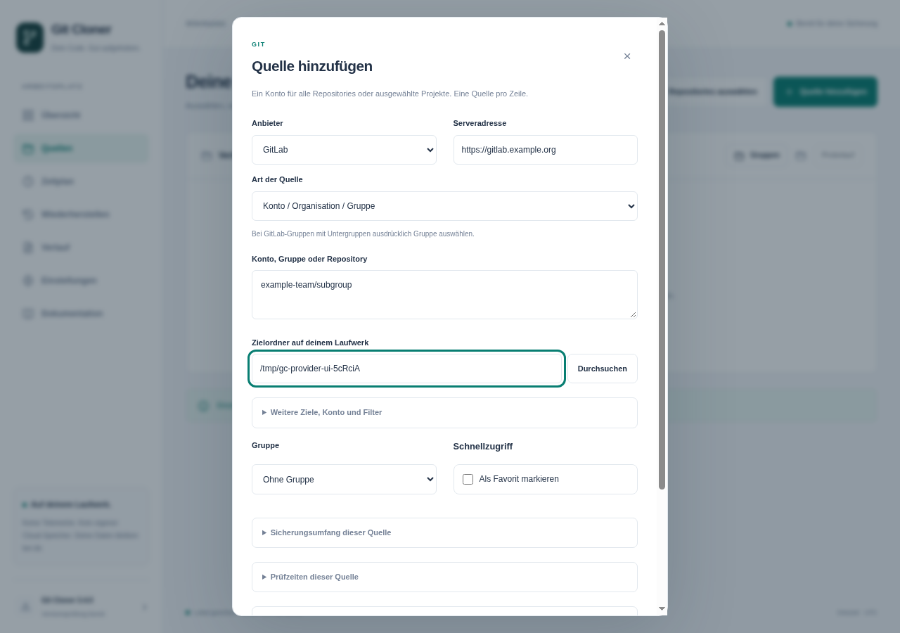

Die [anonymisierte Anleitung ab Abschnitt 22](docs/ANLEITUNG.md#22-gitlab-und-forgejo-als-quellen) erläutert diese Abläufe einschließlich Passwortwechsel und Speicherpausen. Der erste Start bleibt ohne Quellen. Die Versionsüberwachung vergleicht weiterhin ausschließlich mit den offiziellen GitHub-Releases dieses Projekts und erlaubt das dauerhafte Überspringen einer Version.

## Weiterhin enthalten: Version 3.1

| Erweiterung | Verhalten |
| --- | --- |
| Eigene Prüfzeiten je Quelle | Allgemeine Zeiten übernehmen oder 1–24 eigene tägliche Uhrzeiten festlegen. Jede Quelle behält ihren eigenen Prüfstand; eine globale Pause gilt für alle Quellen. |
| Änderungsvorschau | Gespeicherten Git-Stand vor dem Sichern mit dem aktuellen Standardbranch vergleichen. Dateiliste und Text-Diffs werden bei Bedarf geladen; vorhandene Backups bleiben unverändert. |
| Bekannte Laufwerke wiederfinden | Ordnerkennungen auf verbundenen Laufwerken prüfen und geänderte Mountpfade beziehungsweise Laufwerksbuchstaben eindeutig neu zuordnen. Auch pausierte Warteschlangen bleiben nutzbar. |
| Gezielte Benachrichtigungen | Alle Prüfungen, nur Fehler, Änderungen und Fehler oder keine Sicherungsmeldungen. Versionsmeldungen separat einstellen und tägliche Ruhezeiten über Mitternacht festlegen. |
| Release-Dateien mit OS-Auswahl | Dateien des neuesten offiziellen Releases mitsichern: **alle Betriebssysteme** oder **nur das automatisch erkannte Windows, macOS oder Linux**. Funktioniert auch mit eigenen Optionen je Quelle. |
| Release-Dateien wiederherstellen | Heruntergeladene Pakete gezielt auswählen und an einen neuen Ort kopieren, auch aus verschlüsselten Sicherungen und Mirrors. |

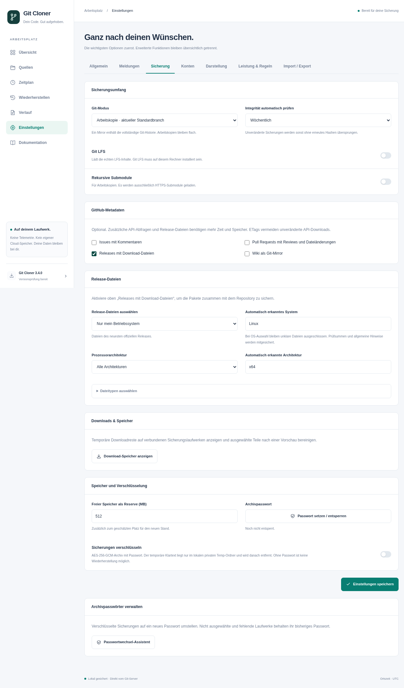

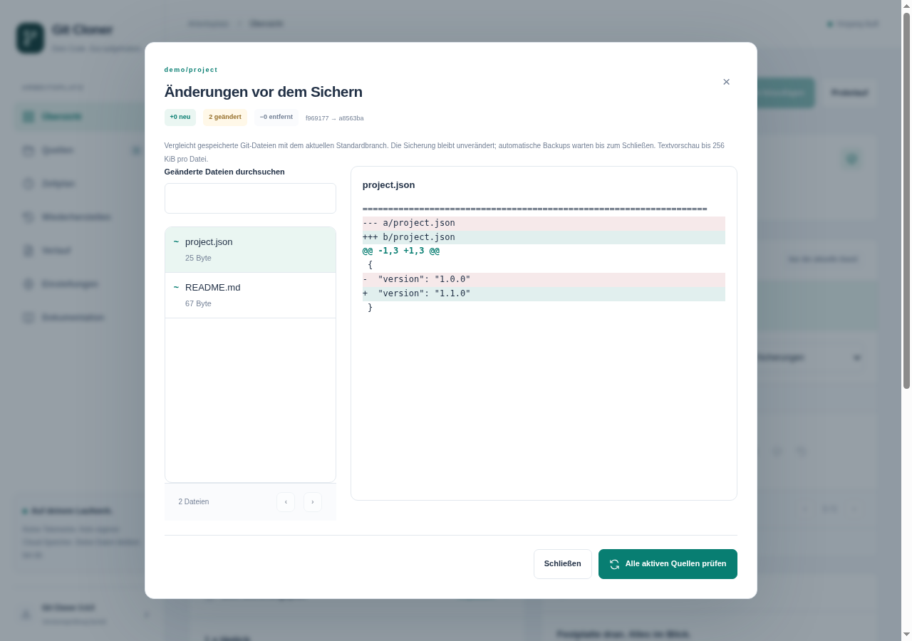

Die OS-Zuordnung verwendet Paketnamen und Dateiendungen. Nicht eindeutig zuordenbare Dateien bleiben bei „Nur mein Betriebssystem“ ausgeschlossen; allgemeine Prüfsummen und Hinweise werden mitgesichert. Alle Architekturen des erkannten Betriebssystems bleiben enthalten. Die Release-Auswahl betrifft Sicherungsquellen; die Versionsüberwachung der App informiert weiterhin ausschließlich und installiert nichts automatisch.

Weitere Bilder und Schritt-für-Schritt-Erklärungen: [Eigene Prüfzeiten, Releases, Vorschau, Laufwerkswechsel und Ruhezeiten](docs/ANLEITUNG.md#17-eigene-prüfzeiten-je-quelle).

## Weitere Funktionen aus Version 3

| Erweiterung | Verhalten |
| --- | --- |
| Einrichtungsassistent | Drei Schritte für eigene Quellen, Laufwerk und Prüfzeiten; keine voreingestellten Repositories. |
| Vorschau und Probelauf | Gefundene und ausgeschlossene Repositories, Zielpfade und Speicherbedarf anzeigen, ohne Backup-Dateien oder Laufwerkskennungen anzulegen. |
| Pause und Fortsetzen | Nach laufenden Repositories pausieren, Warteschlange über Neustarts behalten und nur ausstehende Aufgaben fortsetzen. |
| Einzeldateien wiederherstellen | Dateien und Ordner aus Snapshots, verschlüsselten Archiven oder dem HEAD eines Mirrors auswählen und einzeln verifizieren. |
| Eigene Quellenoptionen | Mirror/Snapshot, LFS, Submodule, Metadaten, Integrität und Verschlüsselung je Quelle wählen oder die globalen Optionen übernehmen. |
| Intelligente Warteschlange | Standardmäßig zwei kleine Repositories parallel, maximal vier konfigurierbar und höchstens zwei je erkanntem Datenträger. Große oder aufwendige Sicherungen laufen exklusiv. |
| Netzwerkfehler wiederholen | Zunehmende Wartezeiten und begrenzte Wiederholungen; keine Wiederholung permanenter Berechtigungsfehler; Speicherknappheit wartet gezielt auf ausreichenden Platz. |
| Ressourcenregeln | Gemeinsames Download-Limit, optional nur am Netzteil und nur in exakt benannten WLANs sichern. |
| Dashboard | Laufzeit, geschätzte Restzeit, gemessene Downloads, Datenumfang, freier Speicher und Hinweise auf überfällige Sicherungen. |
| Bedienung | Hoher Kontrast, Tastenkürzel, Überspringlink, Statusansagen und Tastaturnavigation in Einstellungsreitern. |

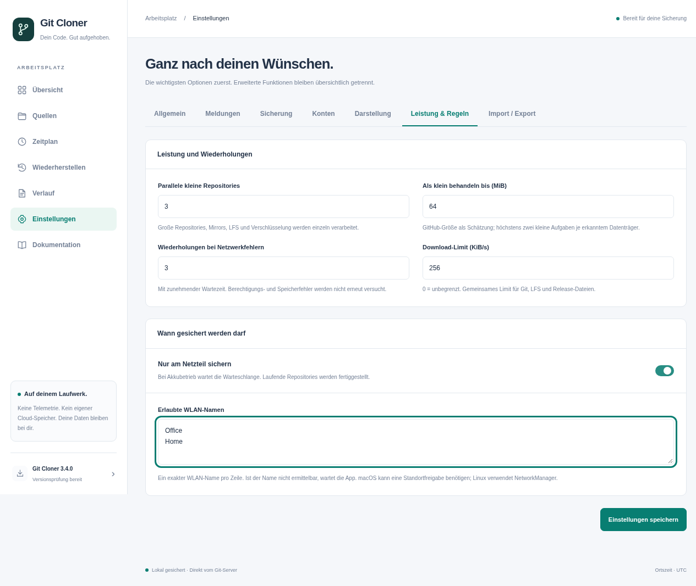

Der Assistent ist über **Einrichtung starten** erreichbar. **Probelauf** zeigt die geplante Ablage. Erweiterte Regeln liegen unter **Einstellungen → Leistung & Regeln**. Bestehende Einstellungen werden mit sicheren Standardwerten weiterverwendet; die Quellenliste bleibt beim ersten Start leer.

## Neue Versionen: informieren statt installieren

Die App vergleicht beim Start und alle sechs Stunden ihre laufende Version mit dem **letzten offiziellen stabilen Release dieses Repositorys**. Ist eine neuere Version vorhanden, erscheint ein Hinweis mit einem Link zur offiziellen Release-Seite. Bei aktivierten Benachrichtigungen kommt einmalig eine Systemmeldung hinzu.

**„Diese Version überspringen“** speichert die Auswahl dauerhaft, auch über Neustarts hinweg. Dieselbe oder eine niedrigere Version löst danach keine erneute Update-Info aus. Erst eine höhere Version zeigt wieder einen Hinweis. Unter **Einstellungen → Allgemein** lässt sich die übersprungene Version zurücksetzen.

Es gibt **keine automatische Update-Installation, keinen automatischen Download und keine erforderliche Einrichtung von Signierzertifikaten**. Der ursprüngliche Roadmap-Punkt zu verifizierter Signierung und automatischen Updates ist ausdrücklich ausgenommen. macOS-Builds verwenden lediglich die technisch nötige Ad-hoc-Signatur; sie sind nicht notarisiert und haben keine verifizierte Herausgeberidentität.

## Erste Sicherung

1. Git installieren, die externe Festplatte verbinden und dort einen Sicherungsordner anlegen.
2. **Einrichtung starten** oder **Quellen → Quelle hinzufügen** öffnen und eigene Quellen eintragen. Neutrale Beispiele sind `beispiel-konto` oder `anderes-konto/projekt`; diese werden nicht automatisch angelegt.
3. Einen vorhandenen Zielordner auswählen. Die Ablage erfolgt unter `Zielordner/Konto/Repository`.
4. **Jetzt prüfen** starten und anschließend den **Zeitplan** speichern.
5. Zusätzliche Daten, Verschlüsselung und Integritätsintervalle bei Bedarf unter **Einstellungen → Sicherung** auswählen.

Die Anleitung und die Dokumentationsbilder verwenden ausschließlich neutrale Beispiele. Es werden keine persönlichen Konto- oder Laufwerksdaten voreingestellt.

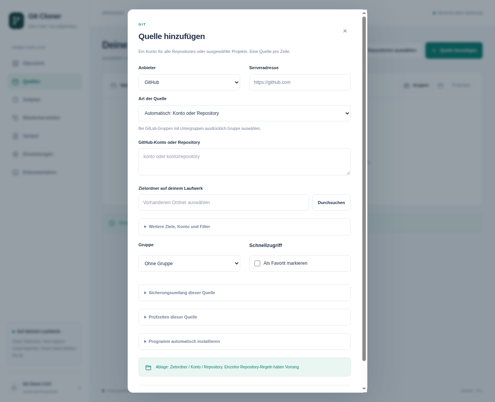

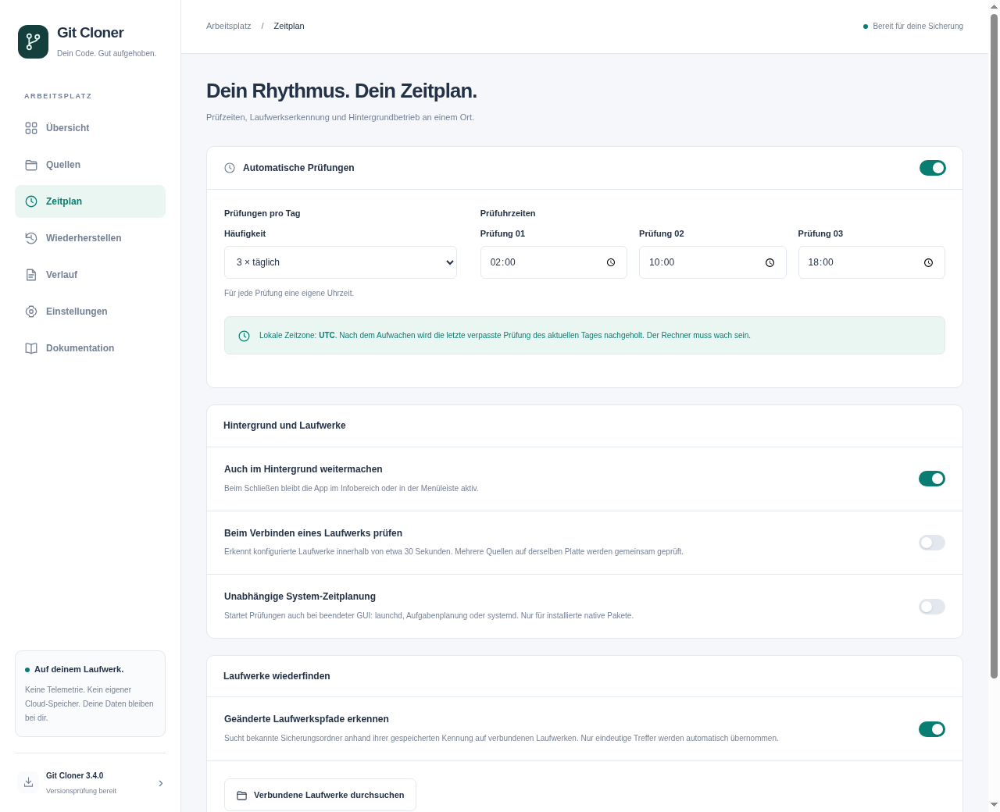

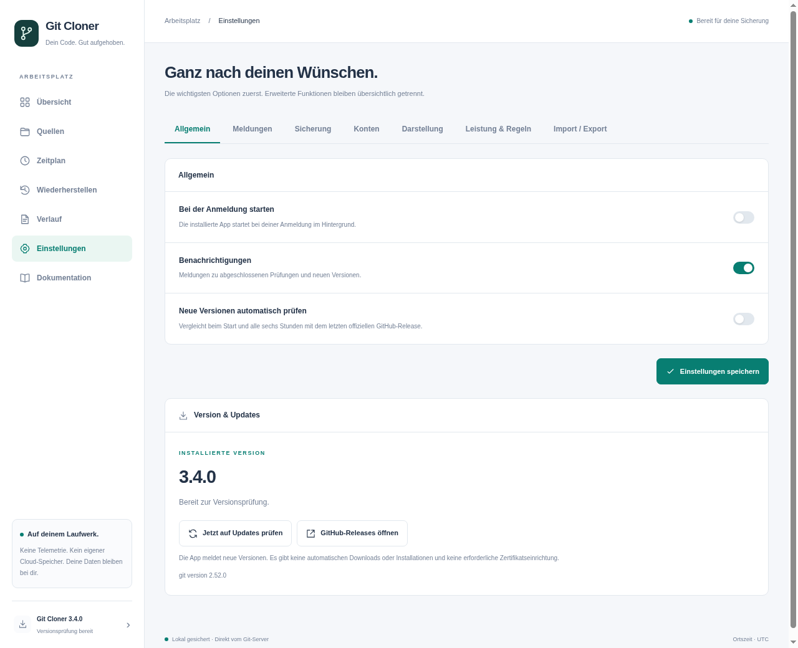

## Installation und Pakete

Lade passende Pakete von den [offiziellen GitHub-Releases](https://github.com/Ujap1994/Git-Cloner/releases). Eine fertige App benötigt kein separat installiertes Node.js. **Git muss im PATH erreichbar sein**, für die LFS-Option außerdem Git LFS. Das Flatpak enthält beides.

| Betriebssystem | Architektur | Formate |
| --- | --- | --- |
| Windows | x64, ARM64 | NSIS-Installer und Portable `.exe` |
| macOS | Universal, ARM64, x64 | `.dmg`, `.zip` |
| Ubuntu / Mint | x64, ARM64 | `.deb` |
| Fedora | x64, ARM64 | `.rpm` |
| Arch / CachyOS | x86_64, aarch64¹ | `.pkg.tar.zst` |
| Linux allgemein | x64, ARM64 | `.AppImage`, `.tar.gz` |
| Flatpak | x64 | `.flatpak` mit Git und Git LFS |

¹ ARM64 richtet sich an passende Arch-ARM-Systeme; CachyOS verwendet hauptsächlich x86_64. Paketbau ist keine Garantie für jedes historische Betriebssystemrelease. Die CI umfasst native Intel-/ARM64-Runner sowie Fedora-, Mint-, Arch- und CachyOS-Container. Tatsächliche Runner-Ergebnisse und manuelle Installationstests sind von der bloßen Workflow-Konfiguration zu unterscheiden.

Die Pakete haben zunächst keine verifizierte Entwicklersignatur. macOS kann eine Freigabe unter **Systemeinstellungen → Datenschutz & Sicherheit** verlangen; Windows kann SmartScreen anzeigen. Prüfe Downloadquelle und `SHA256SUMS.txt`. Details zu Installation, Dateinamen und Berechtigungen stehen in der [anonymisierten Anleitung](docs/ANLEITUNG.md).

Zu jedem vollständig gebauten Release erzeugt die Pipeline Homebrew-, winget-, AUR- und Flathub-Vorlagen mit echten Prüfsummen. Die Dateien liegen als zusätzliches Release-Artefakt vor. Eine öffentliche Aufnahme in diese Verzeichnisse benötigt deren Veröffentlichung beziehungsweise Annahme; sie entsteht nicht allein durch das Erzeugen einer Vorlage. Siehe [Paketverzeichnisse](docs/PAKETVERZEICHNISSE.md).

## Performance und Verlässlichkeit

- Kleine Aufgaben werden begrenzt parallel abgearbeitet; Mirrors, LFS, Metadaten und Verschlüsselung bleiben exklusiv.
- Unveränderte Git-Stände werden nicht erneut geklont. Auch Änderungen an Tags und anderen Branches werden bei Mirrors erkannt.
- Mirrors verwenden lokale Daten und holen Änderungen inkrementell nach. Copy-on-Write-Kopien werden genutzt, wenn das Dateisystem sie unterstützt.
- Bedingte GitHub-Anfragen mit ETags vermeiden unveränderte JSON-Downloads. Metadaten sind optional, weil sie zusätzliche API-Abfragen und Dateidownloads erfordern.
- Dateimanifeste werden nicht bei jeder unveränderten Prüfung neu gehasht; das Standardintervall ist eine Woche. Manuelle und vollständige Prüfungen sind jederzeit möglich.
- Fortschrittsmeldungen aktualisieren nur den Fortschrittsbereich. Tabellen bleiben stehen; Suche und Tastaturfokus werden erhalten. Listen zeigen höchstens 75 Zeilen gleichzeitig.
- Statusdateien werden gebündelt geschrieben; der Verlauf liegt separat. Protokolle behalten bis zu 100 Läufe und maximal 500 Einzelergebnisse je Lauf, mit Fehlern zuerst. Gesamtsummen und die vollständige aktuelle Statusübersicht bleiben erhalten.
- Warteschlangen werden gemeinsam mit dem Zustand gespeichert. Nach einem harten Absturz können die letzten noch nicht gespeicherten Prüfungen wiederholt werden; vorhandene Backup-Marker verhindern unnötige neue Klone.
- Eine neue Sicherung wird zuerst separat aufgebaut, geprüft und gegebenenfalls verschlüsselt. Erst danach ersetzt sie den bisherigen Stand. Temporär muss Platz für zwei Stände vorhanden sein.

Backups sind **keine Arbeitsverzeichnisse**: Lokale Änderungen können beim nächsten Austausch verworfen werden. Entfernte Quellen oder auf GitHub gelöschte Repositories werden lokal nicht automatisch gelöscht. Spiegelungen enthalten die Git-Historie innerhalb eines einzigen Mirror-Ordners; es gibt keine zusätzliche historische Ordnerrotation.

## Zeitplanung und Verschlüsselung

Strom- und WLAN-Regeln greifen vor der ersten GitHub-Abfrage eines Sicherungslaufs. Eine automatische Regelpause wird bei wieder erlaubten Bedingungen fortgesetzt, solange die App läuft; ausdrücklich von dir pausierte Läufe warten auf **Fortsetzen**. Bei unbekanntem erforderlichem Zustand wartet die App. macOS kann WLAN-Namen aus Datenschutzgründen verbergen; Linux benötigt NetworkManager. Im Flatpak ist die WLAN-Erkennung möglicherweise nicht verfügbar. Eine leere WLAN-Liste erlaubt alle Netzwerke. Das gemeinsame Download-Limit gilt für Git/LFS und Release-Dateien einschließlich Transportdaten; API-JSON und andere Programme sind ausgenommen. TLS wird unverändert geprüft.

Ohne unabhängige OS-Zeitplanung muss die App geöffnet oder im Infobereich aktiv sein. Native installierte Pakete können zusätzlich **launchd**, die **Windows-Aufgabenplanung** oder einen **systemd-Benutzertimer** einrichten und dadurch mit beendeter GUI prüfen. Das läuft im Benutzerkontext nach der Anmeldung. Der Rechner muss eingeschaltet und wach sein; die App weckt ihn nicht. Flatpak und Entwicklungsfassungen verwenden den App-Zeitplan. Die Laufwerkserkennung arbeitet, während die App läuft, auch im Infobereich.

Verschlüsselte Archive verwenden AES-256-GCM mit zufälligem Salt und IV und scrypt-Schlüsselableitung. Archive werden vollständig authentifiziert, bevor daraus Dateien extrahiert werden. Klartext-Zwischenstände liegen in privaten lokalen Temp-Ordnern und werden nach dem Vorgang entfernt. Das ist keine Garantie für forensisch sicheres Löschen auf dem internen Laufwerk; Betriebssystem-Laufwerksverschlüsselung bleibt sinnvoll.

Ein vergessenes Archivpasswort ist nicht wiederherstellbar. Bewahre es unabhängig von der App auf. Ohne gespeichertes Passwort muss es nach einem Neustart erneut eingegeben werden. Für unabhängige verschlüsselte Hintergrundsicherungen wird ein funktionierender OS-Schlüsselspeicher mit gespeichertem Passwort benötigt. **Beim Passwortwechsel benötigen ältere Archive bis zum nächsten erfolgreichen Austausch noch das bisherige Passwort.**

## Konten und Datenschutz

Öffentliche Quellen funktionieren ohne Token. Mehrere Konten können getrennte Tokens erhalten; jede Quelle wählt ihre Zugangsdaten. Device Flow ist implementiert und benötigt die öffentliche Client-ID einer GitHub-OAuth-App mit aktiviertem Device Flow, ohne Client-Secret. Ein Personal Access Token ist die Alternative ohne OAuth-App-Registrierung.

Tokens und optional das Archivpasswort werden mit Electron `safeStorage` verschlüsselt gespeichert. Der unsichere Linux-`basic_text`-Fallback wird abgelehnt. Geheimnisse stehen nicht in exportierten Einstellungen, gespeicherten Repository-URLs oder Git-Argumenten. Unverschlüsselte Sicherungen und Metadaten bleiben normale Dateien auf dem Laufwerk. Die App verwendet keine Telemetrie und keinen eigenen Backup-Server. Optionale Submodule und Release-Dateien können zusätzliche HTTPS-Hosts kontaktieren.

## Entwicklung und Tests

Benötigt werden Node.js ab 22.12, empfohlen 24 LTS, npm, Git und für LFS-Tests Git LFS:

```sh
git clone https://github.com/Ujap1994/Git-Cloner.git
cd Git-Cloner
npm ci
npm run check
npm run test:e2e
npm start
```

Unter Linux benötigen GUI-Tests eine grafische Sitzung, beispielsweise `xvfb-run -a npm run test:e2e`. Tests verwenden temporäre lokale Git-Repositories und isolierte Profile. Es werden keine privaten GitHub-Zugänge benötigt.

| Befehl | Ergebnis |
| --- | --- |
| `npm run check` | ESLint sowie Logik-, Sicherheits-, Katalog- und echte Git-Integrationstests |
| `npm run test:forgejo` | Privaten lokalen Forgejo-Server über echtes HTTPS prüfen; benötigt eine separat geprüfte Testserver-Binärdatei in `FORGEJO_BIN` (nur für Entwicklung/CI) |
| `npm run test:e2e` | Echte Electron-Oberfläche, Versionsignorierung über Neustarts, Layout, Tastatur, Einrichtung, Probelauf, Pause über Neustarts und vollständige/selektive verschlüsselte Wiederherstellung |
| `npm run test:coverage` | Node-Abdeckungsbericht |
| `npm run screenshots` | Alle anonymisierten App-Screenshots aus den Screenshot- und neuen GUI-Abläufen |
| `npm run build:dir` | Entpackte Anwendung für die aktuelle Plattform |
| `npm run build:mac` | macOS DMG/ZIP für Universal, ARM64 und x64 auf macOS |
| `npm run build:win` | Windows Installer und Portable für x64/ARM64 |
| `npm run build:linux` | Linux AppImage, DEB, RPM und TAR.GZ |
| `npm run catalogs -- --assets ORDNER --output ORDNER --commit SHA` | Paketverzeichnis-Vorlagen mit tatsächlichen Release-Prüfsummen |

## CI, Releases und Projektstatus

[CI](.github/workflows/ci.yml) prüft Linux, Windows x64/ARM64 und macOS Intel/ARM64, zusätzlich Node 22 und vier Linux-Distributionen. Container-GUI-Tests verwenden den üblichen testbezogenen Chromium-Schalter innerhalb des Containers; installierte Apps behalten ihre Sandbox-Einstellungen. Die [Release-Pipeline](.github/workflows/release.yml) startet nach erfolgreicher CI auf `main`, baut die Pakete des zugehörigen Commits und veröffentlicht eine noch nicht vorhandene Paketversion einschließlich Prüfsummen und Katalogvorlagen.

Für weitere Releases zunächst Version und Lockfile aktualisieren, Release-Notizen pflegen und den Commit nach `main` übertragen. Ein bereits veröffentlichtes `vX.Y.Z` wird nicht erneut angelegt. Öffentliche CI-/Release-Ergebnisse setzen Schreibzugriff auf das GitHub-Repository voraus. Vorbereitete Workflows sind ohne ausgeführten Lauf kein Nachweis erfolgreicher Mac-/Windows-Hardwaretests.

[Umsetzungsstand der Roadmap](docs/ROADMAP.md) · [Chat und Projekt auf dem Mac verwenden](docs/MAC-START.md) · [GitHub-Schreibzugriff](docs/GITHUB-ZUGRIFF.md) · [Architektur](docs/ENTWICKLUNG.md) · [Paketverzeichnisse](docs/PAKETVERZEICHNISSE.md) · [MIT-Lizenz](LICENSE)
