# Anonymisierte Anleitung für Git Cloner 3

Alle Konto-, Repository- und Laufwerksnamen in dieser Anleitung sind Platzhalter. Die App trägt **keine Standardquellen** ein. Die Bilder zeigen echte App-Fenster mit einem isolierten Testprofil. Zugangsdaten sind weder erforderlich noch abgebildet.

## 1. Installation

Verwende ausschließlich die [offiziellen GitHub-Releases](https://github.com/Ujap1994/Git-Cloner/releases) und kontrolliere die Download-Prüfsumme aus `SHA256SUMS.txt`. Eine vorbereitete Paketart bedeutet noch nicht, dass bereits ein entsprechendes Release veröffentlicht wurde.

Die fertige App benötigt kein separates Node.js. **Git muss erreichbar sein**, für die optionale LFS-Sicherung zusätzlich **Git LFS**. Flatpak enthält beides. Nach einer Git-Installation die App neu starten.

| System | Passendes Paket und Installation |
| --- | --- |
| macOS | Universal für Intel und Apple Silicon, alternativ x64 oder ARM64. DMG öffnen und App nach „Programme“ ziehen. Git bei Bedarf über `xcode-select --install` installieren. |
| Windows | Git for Windows installieren und die PATH-Integration für andere Programme wählen. Danach x64-/ARM64-Installer oder Portable starten. |
| Ubuntu / Mint | Git installieren; dann `sudo apt install ./DATEINAME.deb`. |
| Fedora | `sudo dnf install git ./DATEINAME.rpm`. |
| Arch / CachyOS | `sudo pacman -U ./DATEINAME.pkg.tar.zst`. Die Abhängigkeiten werden vom Paketmanager aufgelöst. |
| AppImage | Git installieren, Datei ausführbar machen (`chmod +x ./DATEINAME.AppImage`) und starten. Je nach Distribution ist FUSE erforderlich; alternativ `--appimage-extract` verwenden. |
| Linux TAR.GZ | An einem festen Ort entpacken und die enthaltene Anwendung starten; Git und die Desktop-Laufzeitbibliotheken müssen installiert sein. |

`DATEINAME` steht jeweils für den tatsächlichen Dateinamen aus dem Release. Für ARM64 ein entsprechendes Paket wählen. CachyOS verwendet hauptsächlich x86_64; Linux-aarch64-Pakete richten sich an kompatible ARM-Systeme.

Die Pakete besitzen keine verifizierte Herausgebersignatur. macOS verwendet eine technisch erforderliche Ad-hoc-Signatur und ist nicht notarisiert. Nach Kontrolle von Quelle und Prüfsumme kann eine Freigabe unter **Systemeinstellungen → Datenschutz & Sicherheit** nötig sein; Windows kann SmartScreen anzeigen. Einrichten von Signierzertifikaten oder automatischen Update-Installern gehört ausdrücklich nicht zum Funktionsumfang.

Lege Portable- und AppImage-Dateien vor dem Einrichten von Autostart oder OS-Zeitplan an ihrem endgültigen Ort ab. Nach einem Verschieben diese Optionen aus- und wieder einschalten. Portable speichert die Einstellungen weiterhin im normalen Benutzerprofil.

### Flatpak

Das Release kann ein x64-Bundle enthalten. Ein Bundle ist noch kein öffentlicher Flathub-Eintrag:

```sh
flatpak remote-add --user --if-not-exists flathub https://flathub.org/repo/flathub.flatpakrepo
flatpak install --user ./DATEINAME.flatpak
flatpak run io.github.Ujap1994.GitCloner
```

Home und übliche Mount-Pfade `/media`, `/run/media` und `/mnt` sind freigegeben. Für einen anderen Pfad gezielt Zugriff erlauben, beispielsweise:

```sh
flatpak override --user --filesystem=/backups io.github.Ujap1994.GitCloner
```

Flatpak nutzt App-Zeitplan und Autostart, keinen unabhängigen systemd-Worker. Für gespeicherte Zugangsdaten wird ein funktionierender Secret-Service benötigt. Die reguläre Anwendung schaltet ihre Chromium-Sandbox nicht ab; bei Problemen mit AppImage vorzugsweise ein natives Paket oder Flatpak verwenden.

## 2. Laufwerk und Quellen einrichten

Verbinde die externe Festplatte und lege einen Sicherungsordner an. Beispiele:

| System | Neutraler Zielpfad |
| --- | --- |
| macOS | `/Volumes/BackupDisk/GitHub` |
| Windows | `E:\GitHub-Backups` |
| Linux | `/media/backup-disk/GitHub` |

Der Ordner muss vorhanden und beschreibbar sein. Unter macOS kann die Erlaubnis für Wechselmedien notwendig sein. Die App speichert dort eine zufällige Laufwerkskennung in `.git-cloner-volume.json`. Diese Datei erhalten: Ein fehlendes oder ausgetauschtes Laufwerk darf nicht versehentlich durch einen neuen lokalen Ordner ersetzt werden.

Öffne **Quellen → Quelle hinzufügen** und trage eigene Konten oder Repositories ein, eine Quelle pro Zeile:

```text
beispiel-konto
anderes-konto/werkzeug
```

`beispiel-konto` sichert die für deine Zugangsdaten sichtbaren eigenen Repositories dieses Kontos oder dieser Organisation. `anderes-konto/werkzeug` sichert nur dieses Repository. Vollständige GitHub-HTTPS-Adressen funktionieren ebenfalls. Die Beispiele werden nicht automatisch übernommen.

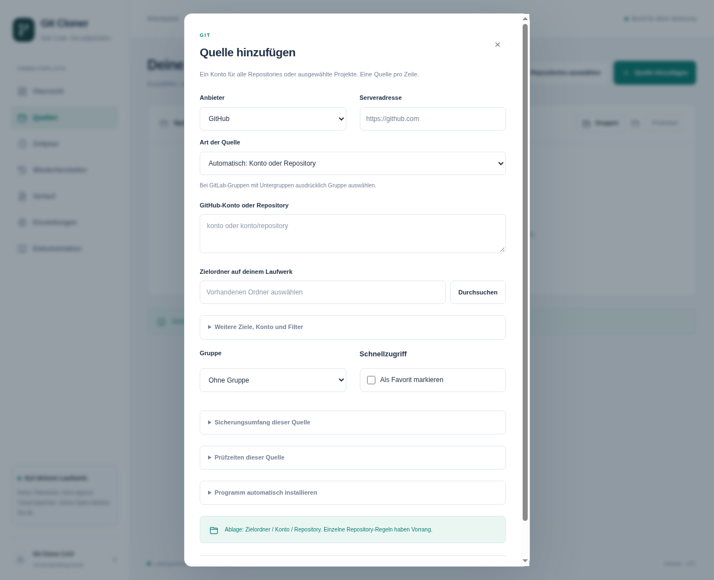

Wähle den Zielordner. Mehrere gemeinsam eingegebene Quellen teilen ihn zunächst; anschließend kannst du jede Quelle einzeln bearbeiten. Die Ablage ist `Ziel/Konto/Repository`. Eine aktive Einzelregel hat Vorrang vor einer gleichzeitig vorhandenen Kontoregel für dasselbe Repository.

Unter **Weitere Ziele, Konto und Filter** stehen zusätzliche Optionen bereit:

- Bis zu neun weitere Speicherorte, insgesamt zehn je Quelle. Jedes Ziel erhält eine unabhängige Sicherung und Laufwerkskennung.
- Ein GitHub-Zugang aus deinen gespeicherten Konten. „Standard“ funktioniert bei öffentlichen Quellen auch ohne Token.
- Forks und archivierte Repositories einschließen oder ausschließen.
- Namensmuster zum Ein- und Ausschließen: `web-*`, `*-alt` oder `beispiel-konto/projekt?`. `*` steht für beliebig viele Zeichen, `?` für genau eines. Ausschlüsse haben Vorrang.

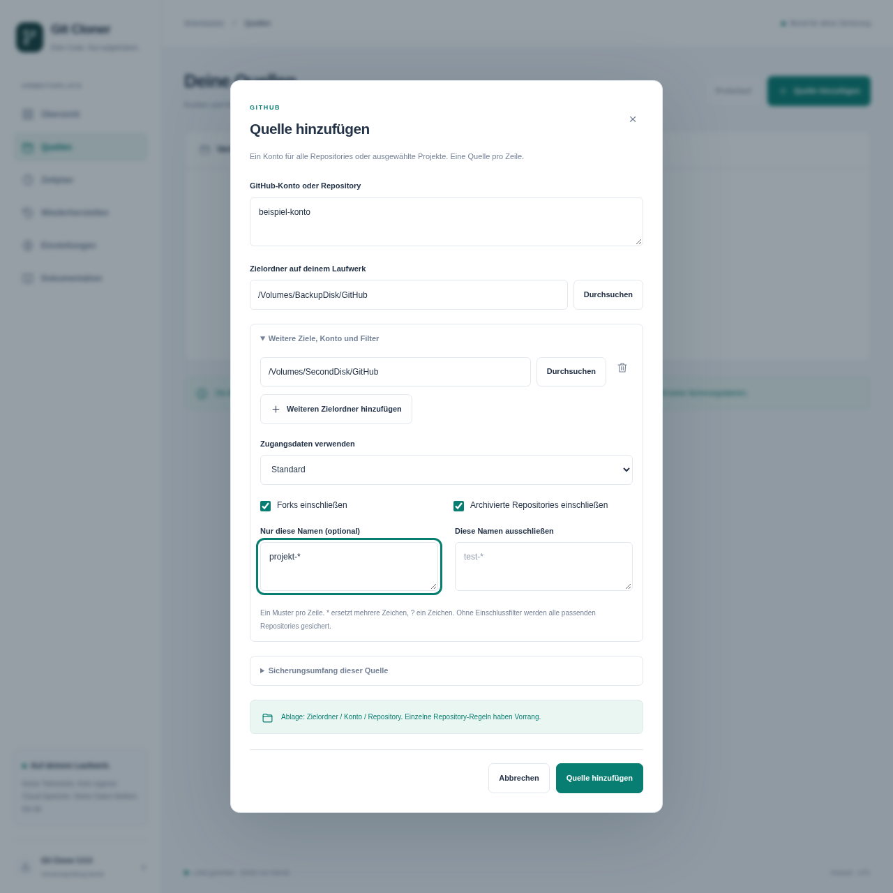

Quellen lassen sich pausieren oder entfernen. Vorhandene Sicherungen bleiben erhalten. Auch auf GitHub gelöschte oder umbenannte Repositories werden lokal nicht automatisch entfernt.

## 3. Erste Prüfung und Status

Wähle **Jetzt prüfen**. Neue Stände werden zunächst separat aufgebaut und geprüft. Erst danach ersetzen sie den bisherigen Stand. Ein Fehler lässt den vorherigen Stand bestehen; andere Quellen werden weiter bearbeitet. Nach Abschluss gibt es je Ziel genau einen erfolgreichen Stand, keine historische Ordnerrotation.

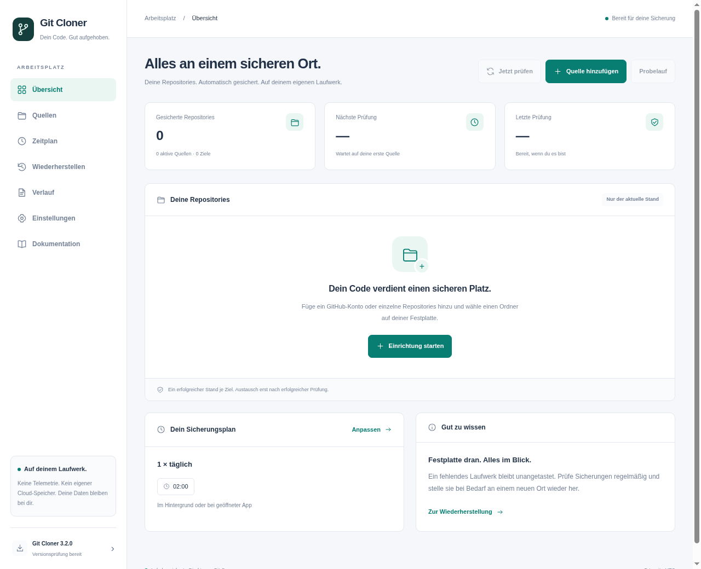

| Status | Bedeutung |
| --- | --- |
| Gesichert | Erste Sicherung angelegt. |
| Aktualisiert | Veränderte Git-Daten oder Metadaten übernommen. |
| Aktuell | Der geprüfte Remote-Stand entspricht der Sicherung. |
| Repariert | Beschädigte verwaltete Sicherung erfolgreich neu aufgebaut. |
| Leer | Das Git-Repository enthält noch keinen Commit. |
| Fehler | Der Vorgang war nicht erfolgreich; Meldung im Verlauf prüfen. |

Suche und Statusfilter helfen bei vielen Repositories. Die Liste zeigt bis zu 75 Zeilen pro Seite. Einträge bieten Integritätsprüfung und Wiederherstellung. Ein Integritätsfehler bleibt sichtbar und erzwingt beim nächsten Sicherungslauf eine erneute Prüfung beziehungsweise Reparatur.

Die App verarbeitet standardmäßig bis zu zwei kleine Repositories parallel. Aufwendige Sicherungen laufen einzeln; die Grenzen lassen sich unter „Leistung & Regeln“ einstellen. Während einer Sicherung bleiben Navigation, Suche und Statusanzeige nutzbar; Änderungen an Quellen und Sicherungseinstellungen warten auf das Ende des Vorgangs. Temporär muss Platz für den bisherigen und den neuen Stand vorhanden sein.

## 4. Sicherungsumfang wählen

Unter **Einstellungen → Sicherung** sind Zusatzfunktionen standardmäßig ausgeschaltet:

| Option | Wirkung |
| --- | --- |
| Aktueller Stand | Schnelle flache Arbeitskopie des aktuellen Standardbranches. Keine vollständige Git-Historie. |
| Vollständiger Mirror | Bare-Repository mit vollständiger Git-Historie, allen Branches und Tags. Kein ausgecheckter Arbeitsordner. Änderungen werden inkrementell geholt. |
| Git LFS | Echte LFS-Inhalte herunterladen; zusätzlich installiertes Git LFS erforderlich. |
| Submodule | Im Snapshot rekursiv auschecken. Nur sichere HTTPS-Remotes; GitHub-SSH-Adressen werden auf HTTPS umgesetzt. Nicht mit Mirror kombinierbar. |
| Issues | Issues und Kommentare als JSON. |
| Pull Requests | PRs, Reviews, Kommentare und Änderungsinformationen als JSON. |
| Releases | Release-Daten und zugehörige Dateien. Große Dateien benötigen entsprechend Platz und Zeit. |
| Wiki | Separater Git-Mirror des Wikis. Ein nicht zugängliches Wiki wird ausdrücklich gemeldet. |

Release-Dateien liegen ab Version 3.3 sichtbar unter **`Zielordner / Konto / Repository / Git-Cloner-Releases`**, mit ihren ursprünglichen Dateinamen. Die Übersicht nennt diesen Ordner und bietet **Release-Ordner öffnen**. Besitzt das Repository bereits einen gleichnamigen Ordner, verwendet die App einen freien nummerierten Namen und erhält die Repository-Dateien. Bei verschlüsselten Sicherungen liegt der Release-Ordner innerhalb von `backup.gcb`; zum Zugriff **Release-Dateien wiederherstellen** wählen und entsperren. Ältere Sicherungen mit Dateien im versteckten `.git/git-cloner-metadata/release-assets` bleiben wiederherstellbar und wechseln bei der nächsten erfolgreichen Prüfung in die sichtbare Ablage.

Die Metadaten liegen im Verwaltungsordner `git-cloner-metadata` innerhalb von `.git` beziehungsweise im Bare-Mirror. Sie sind Exporte, kein automatischer Rückimport in GitHub. Der Wiki-Zugriff kann bei nicht angelegten Wikis scheitern. Hat eine vorhandene Sicherung bereits ein Wiki, verhindert ein späterer Abruffehler den Austausch dieses Stands.

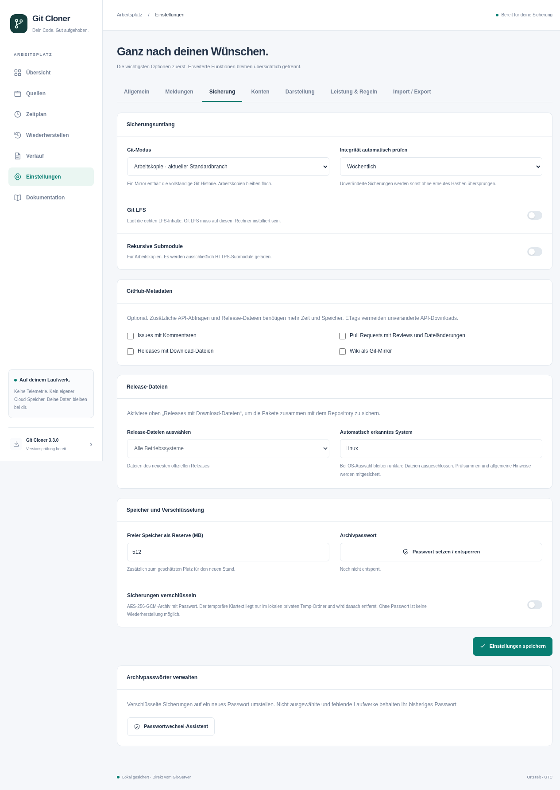

Die Speicherreserve ist zusätzlich zum geschätzten Repository-Bedarf vorgesehen. Die GitHub-Größenangabe ist eine Schätzung; sehr große LFS- und Release-Dateien können darüber liegen. Bei Platzmangel wird kein vorhandenes Backup vorsorglich gelöscht.

## 5. Integrität und Verschlüsselung

Neue Sicherungen werden mit Git-Prüfung und SHA256-Dateimanifest versehen. Bereits unveränderte Sicherungen werden standardmäßig wöchentlich vollständig geprüft. Alternativ **bei jeder Prüfung** oder **nur manuell** wählen. Eine manuelle Prüfung ist in Übersicht und Wiederherstellung möglich.

Für verschlüsselte Sicherungen:

1. Unter **Einstellungen → Sicherung** ein eigenes Archivpasswort mit mindestens zwölf Zeichen setzen.
2. Optional das Passwort im sicheren Betriebssystem-Schlüsselspeicher merken.
3. Verschlüsselung aktivieren, Einstellungen speichern und **Jetzt prüfen** starten.
4. Anschließend eine Wiederherstellung an einem anderen Ort testen.

Im Ziel liegen dann `backup.gcb` und eine Verwaltungsdatei. Git-Inhalte, Dateinamen und Metadaten innerhalb des Archivs werden mit AES-256-GCM und scrypt verschlüsselt. Der umgebende Pfad verrät weiterhin Konto- und Repository-Namen; die Verwaltungsdatei enthält Statusdaten. Für vollständigen Schutz des Datenträgers dessen Laufwerksverschlüsselung verwenden.

**Ein vergessenes Passwort ist nicht wiederherstellbar.** Bewahre es unabhängig von der App auf. Nach einem Passwortwechsel benötigen noch nicht erfolgreich ausgetauschte Archive das alte Passwort. Ohne „merken“ gilt das Passwort nur für die aktuelle Sitzung; nach einem Neustart erneut eingeben. Der unabhängige Worker benötigt ein sicher gespeichertes Passwort und einen entsperrbaren OS-Schlüsselspeicher.

Während der Verarbeitung liegen entschlüsselte Daten in einem privaten lokalen Temp-Ordner, der anschließend entfernt wird. Das ist kein forensisch sicheres Löschen. Die regelmäßige Prüfung verschlüsselter Archive kontrolliert ihren SHA256-Wert; die manuelle Prüfung entschlüsselt zusätzlich und prüft Git sowie alle Dateien. Ein falsches Passwort oder veränderte Archivdaten verhindern die Extraktion.

## 6. Zeitplan, Autostart und Laufwerke

Unter **Zeitplan** automatische Prüfungen aktivieren und **1 bis 24 Prüfungen pro Tag** einstellen. Pro Prüfung erscheint ein eigenes Uhrzeitfeld. Beispielsweise sind 02:00, 10:00 und 18:00 möglich. Doppelte oder ungültige Zeiten werden abgelehnt. Alle Zeiten beziehen sich auf die lokale Systemzeitzone.

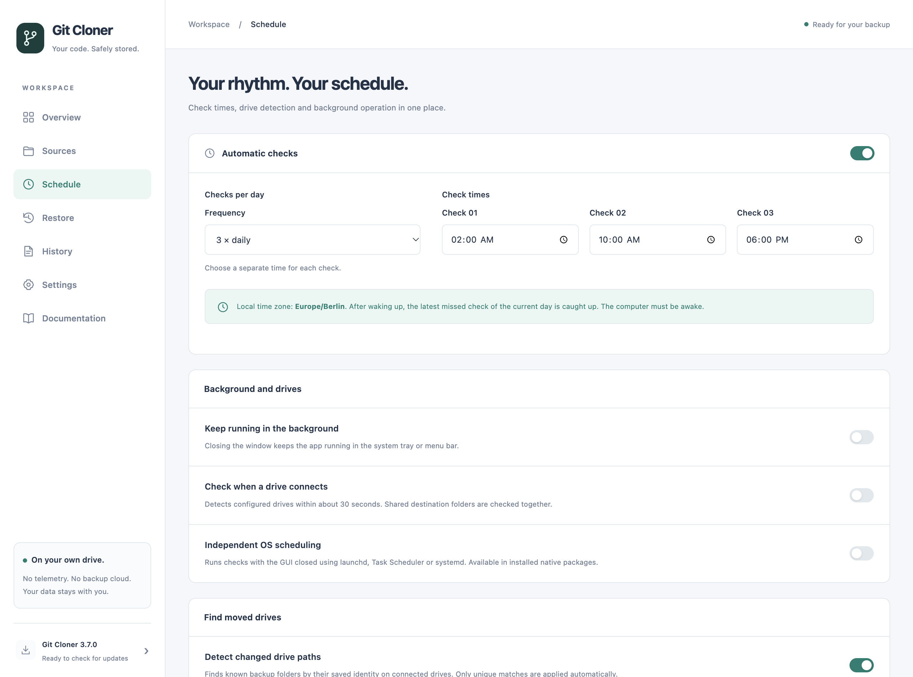

**Beim Schließen im Hintergrund weiterlaufen** lässt den App-Zeitplan im Tray beziehungsweise in der Menüleiste aktiv. Fehlt ein verfügbarer Tray, bleibt das Fenster offen. **Bei der Anmeldung starten** richtet den Autostart der installierten App ein. In einer Entwicklungsfassung ist dies deaktiviert.

Optional **Unabhängige OS-Zeitplanung** einschalten: Native installierte Pakete richten einen macOS-LaunchAgent, eine Windows-Aufgabe oder einen systemd-Benutzertimer unter Linux ein. Damit prüft ein GUI-freier Worker auch bei beendeter Oberfläche. Eine laufende Oberfläche und ein Worker überschreiben sich durch eine gemeinsame Sperre nicht gegenseitig. Deaktivieren entfernt den von der App angelegten Eintrag. Entwicklungsfassungen und Flatpak unterstützen diese Option nicht.

**Der Rechner muss eingeschaltet und wach sein, der Benutzer angemeldet.** Die App weckt ihn nicht auf. Beim Aufwachen beziehungsweise Start holt der App-Zeitplan die letzte verpasste Prüfung des aktuellen Tages einmal nach; ältere Tage werden nicht einzeln abgearbeitet. Native Dienste können zusätzlich verpasste Termine gemäß ihren OS-Regeln nachholen.

**Beim Verbinden eines Laufwerks prüfen** erkennt zuvor konfigurierte Zielpfade innerhalb von ungefähr 30 Sekunden, während die App läuft. Nur wieder angeschlossene Ziele werden angefragt. Ein fehlendes Laufwerk erzeugt einen Fehler, keinen Ausweichordner. Diese Erkennung startet eine vollständig beendete App nicht selbst.

## 7. Mehrere GitHub-Konten und Anmeldung

Öffentliche Quellen funktionieren ohne Anmeldung. GitHub erlaubt anonym typischerweise 60 API-Anfragen pro Stunde. Private Repositories oder größere Mengen benötigen passende Leserechte.

Ist das API-Kontingent aufgebraucht, pausiert die Warteschlange mit **Wartet auf API-Limit · automatische Fortsetzung** und zeigt den voraussichtlichen Freigabezeitpunkt. Bereits gesicherte Repositories bleiben erledigt. Nach der Freigabe setzt die App automatisch fort; vorher stellt sie keine neuen automatischen Anfragen. Nach dem Hinterlegen eines Lesetokens kann **Fortsetzen** sofort gewählt werden. Das gilt auch, wenn das Limit erst beim Herunterladen einer Release-Datei auftritt; bereits geladene Teile bleiben für die Fortsetzung erhalten.

Während die App läuft – auch nur im Infobereich bzw. in der Menüleiste –, prüft sie alle 30 Sekunden und setzt nach dem Freigabezeitpunkt selbstständig fort. Der GUI-freie OS-Worker wartet ebenfalls selbst bis zur Freigabe, wenn diese höchstens etwa eine Stunde entfernt ist, und arbeitet die Warteschlange dann weiter ab. Längere Wartezeiten übernimmt der nächste geplante Lauf. Wird die App während eines Worker-Laufs geöffnet, erscheint das Fenster, sobald der Worker beendet ist; eine laufende Wartezeit wird dafür abgebrochen und von der App fortgeführt.

Unter **Einstellungen → Konten** lassen sich mehrere benannte Zugänge anlegen. Jede Quelle wählt ihren Zugang in den erweiterten Einstellungen.

### Personal Access Token

Über den angebotenen GitHub-Link ein Token mit minimal erforderlichen Leserechten erstellen. Bei Fine-grained Tokens benötigt Quelltext `Contents: Read`; für optionale Metadaten zusätzlich die jeweiligen Lese-Berechtigungen für Issues und Pull Requests. Organisationen können Freigabe oder SSO verlangen. Das Token ausschließlich in das Passwortfeld der App einfügen und speichern. Es wird nicht wieder angezeigt.

### Device Flow

Die App unterstützt GitHubs Device Flow. Dafür ist die öffentliche **Client-ID einer GitHub-OAuth-App mit aktiviertem Device Flow** nötig. Es wird kein Client-Secret benötigt. Eine allgemeine OAuth-App wird von diesem Projekt nicht bereitgestellt. Ohne eine solche Client-ID stattdessen öffentliche Quellen oder ein Personal Access Token nutzen.

Nach Eingabe der Client-ID beim gewünschten Konto die Geräteanmeldung starten, den angezeigten Code auf GitHub bestätigen und zur App zurückkehren. Anmeldungen lassen sich abbrechen; abgelaufene Codes neu erzeugen.

Tokens und optional das Archivpasswort speichert Electron `safeStorage` verschlüsselt. Ein unsicherer Linux-Klartext-Fallback wird abgelehnt. Ein fehlender oder gesperrter Keyring kann das Speichern verhindern. Tokens stehen nicht in Repo-URLs, Prozessargumenten oder exportierten Einstellungen. „Zugang entfernen“ löscht den gespeicherten Zugang; vorhandene Sicherungen bleiben erhalten.

## 8. Wiederherstellung

Öffne **Wiederherstellen**, wähle einen gesicherten Eintrag oder eine vorhandene `.gcb`-Archivdatei und einen vorhandenen übergeordneten Zielordner. Vergib einen **neuen Ordnernamen**. Ein bestehender Ordner wird nicht überschrieben.

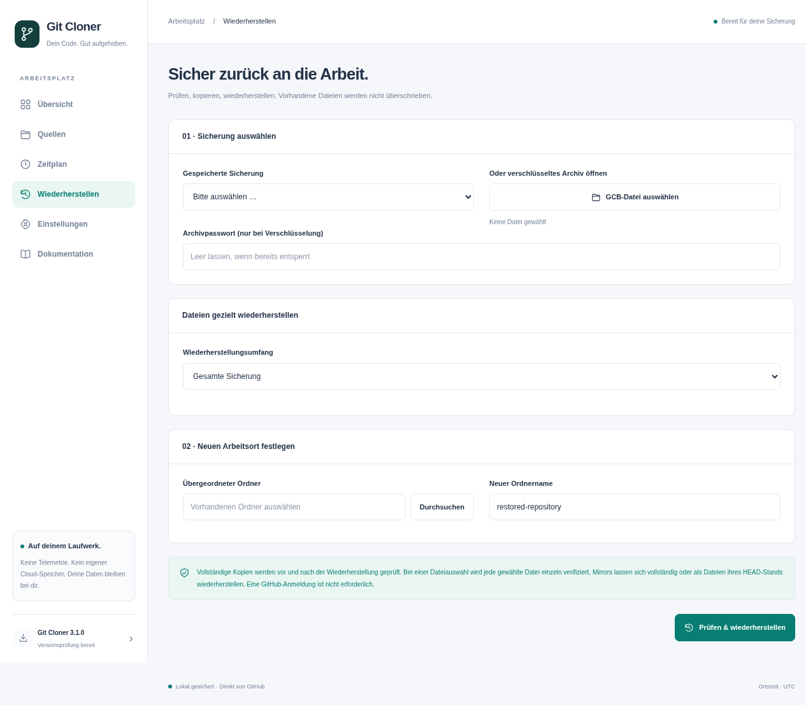

Der Assistent prüft die Quelle, kopiert oder entschlüsselt sie und verifiziert das Ergebnis vor dem endgültigen Umbenennen. Ein Archiv benötigt sein damaliges Passwort. Eine GitHub-Anmeldung ist zur lokalen Wiederherstellung nicht erforderlich. Ein Mirror bleibt bei der Wiederherstellung ein Bare-Repository; daraus lässt sich anschließend eine Arbeitskopie klonen:

```sh
git clone /PFAD/ZUM/WIEDERHERGESTELLTEN-MIRROR /NEUER/ARBEITSORDNER
```

Entwickle ausschließlich in einem separaten Arbeitsordner. Änderungen innerhalb einer verwalteten Sicherung können beim nächsten Austausch verloren gehen. Ein flacher Snapshot enthält nur den gesicherten Standardbranch; zusätzliche Historie kann nur nachgeladen werden, solange ein erreichbares Original sie noch bereitstellt.

## 9. Neue Versionen melden und überspringen

Die Seitenleiste zeigt die ausgeführte Version. Beim Start und danach alle sechs Stunden vergleicht die automatische Versionsprüfung diese mit dem letzten offiziellen stabilen Release von `Ujap1994/Git-Cloner`. Unter **Einstellungen → Allgemein** kannst du manuell prüfen oder die automatische Prüfung deaktivieren.

Eine neuere Version erscheint als Hinweis mit einem Link zur offiziellen Release-Seite. Wenn Benachrichtigungen aktiv sind, gibt es einmalig eine Systemmeldung. **Diese Version überspringen** speichert die Auswahl dauerhaft. Dieselbe oder eine niedrigere Version erzeugt auch nach einem Neustart keine erneute Update-Info. Erst eine höhere Version löst wieder einen Hinweis aus. **Übersprungene Version zurücksetzen** hebt die Auswahl auf.

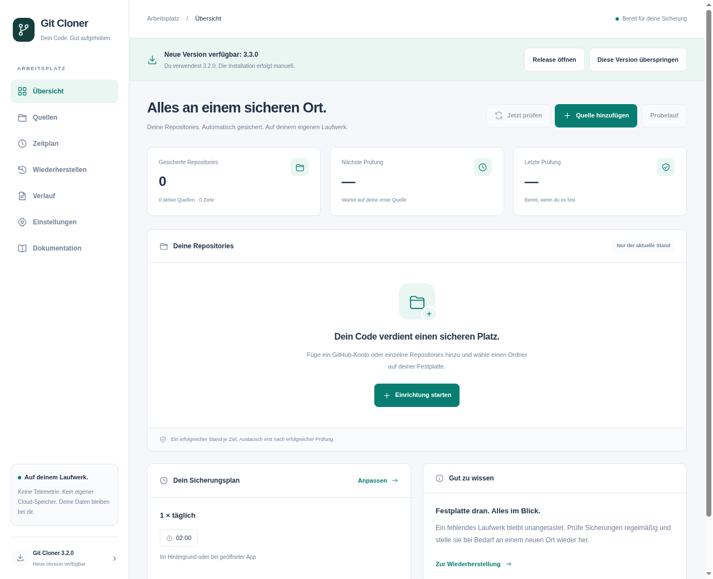

Das Bild verwendet eine simulierte Release-Antwort, keine Behauptung eines veröffentlichten Releases. Die App lädt oder installiert keine Updates automatisch. Zur Aktualisierung das passende offizielle Paket herunterladen, laufende Sicherungen beenden und die neue Version selbst installieren. Gibt es noch kein offizielles Release, zeigt die App dies als eigenen Zustand an.

## 10. Darstellung, Einstellungen und Diagnose

Unter **Einstellungen → Darstellung** gibt es Deutsch/Englisch, Hell/Dunkel/System und drei Schriftgrößen. Auswahlfelder sind gleich hoch; größere Schrift verändert die gesamte Oberfläche. Die Auswahl bleibt nach Neustarts erhalten.

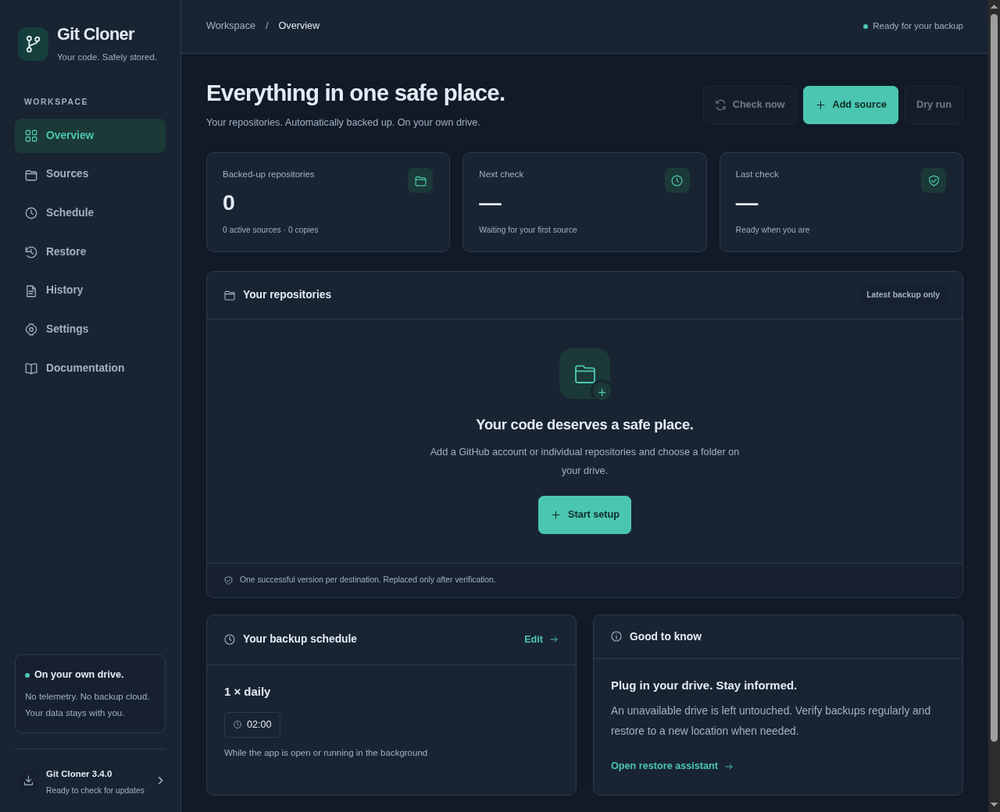

**Einstellungen → Import / Export** exportiert oder importiert Quellen, Optionen und gegebenenfalls erlaubte WLAN-Namen. Tokens und Passwörter werden ausgeschlossen. **Namen und Pfade sind in Einstellungsdateien weiterhin enthalten**; solche Dateien nicht ungeprüft teilen. Ein Import zeigt eine Vorschau und bindet Zielordner neu; OS-Autostart und unabhängige Zeitplanung werden nicht fremd übernommen.

Der Diagnoseexport entfernt Konto-/Repository-Namen, Pfade, Commit-IDs und rohe Fehlermeldungen. Der Verlauf behält bis zu 100 Durchläufe und maximal 500 Einzelergebnisse je Lauf, Fehler zuerst. Gesamtsummen bleiben erhalten. `settings.json`, `state.json`, `history.json` und die verschlüsselte `secrets.enc` niemals als vermeintlich anonymen Support-Export versenden.

| Problem | Nächster Schritt |
| --- | --- |
| Git fehlt | Git installieren, PATH prüfen, App neu starten. Unter macOS kann die Finder-Umgebung von der Terminal-Umgebung abweichen. |
| Laufwerkskennung fehlt | Richtigen Datenträger verbinden. Bei einem bewusst neuen Ziel die Quelle neu einrichten. Keine fremde Kennung kopieren. |
| Fremder Ordner blockiert Ziel | Neuen Zielordner wählen oder vorhandene Daten selbst sicher verschieben. |
| Platzmangel | Platz für den alten und neuen Stand sowie Reserve freigeben; Metadaten/LFS können größer als die Schätzung sein. |
| GitHub 401 / 403 | Gültigkeit, Repository-Freigabe, Org-SSO und API-Limit prüfen. |
| Wartet auf API-Limit | Freigabezeitpunkt abwarten; die Warteschlange setzt automatisch fort und behält erledigte Repositories. Ein Lesetoken unter Einstellungen → Konten erhöht das Limit, danach sofort **Fortsetzen** möglich. |
| DMG wird nicht installiert | Meldung in der Übersicht prüfen: Eine fehlende oder ungültige Signatur, ein Programm für eine andere CPU oder mehrere gleichwertige Pakete verhindern den Austausch. Im letzten Fall den **Release-Dateinamen** eingrenzen, etwa `*arm64.dmg`. |
| LFS fehlt | Git LFS installieren oder die Option abschalten; vorhandener erfolgreicher Stand bleibt erhalten. |
| Passwort fehlt/falsch | Das Passwort dieses Archivs eingeben. Nach einem Wechsel kann für ältere Archive noch das alte gelten. |
| Kein automatischer Lauf | Quelle und Zeitplan aktiviert/gespeichert? Rechner wach? App im Hintergrund oder OS-Worker aktiv? |
| Token nicht speicherbar | Sicheren OS-Schlüsselspeicher/Keyring einrichten oder öffentliche Quellen verwenden. |

[Architektur und Datenablage](ENTWICKLUNG.md) · [Paketverzeichnisse](PAKETVERZEICHNISSE.md) · [Roadmap-Status](ROADMAP.md)


## 11. Einrichtungsassistent und Probelauf

Auf der leeren Übersicht **Einrichtung starten** wählen. Der Assistent enthält keine Standardquelle. Trage eigene Quellen ein, wähle einen bestehenden Sicherungsordner und lege anschließend Häufigkeit und Uhrzeiten fest. Vor dem Speichern zeigt er eine Vorschau der geplanten Ablage. Erst **Einrichtung speichern** bindet das Laufwerk und speichert die Quellen.

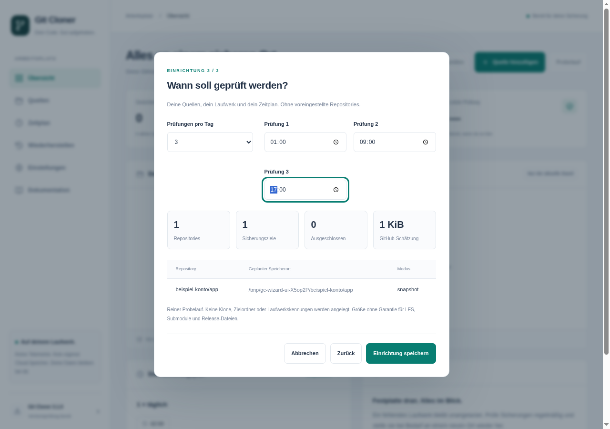

**Probelauf** in Übersicht oder Quellen fragt ausschließlich Repository-Daten ab und liest vorhandene Zielordner. Es werden weder Klone noch Laufwerkskennungen angelegt. Die Vorschau nennt gefundene Repositories, durch Filter oder Vorrangregeln ausgeschlossene Einträge, Zielpfade und die GitHub-Größenschätzung. Bei mehreren Zielen auf demselben erkannten Datenträger wird der gemeinsame freie Platz berücksichtigt. LFS, Submodule und Release-Dateien können größer als diese Schätzung sein. Auch ein Probelauf verbraucht GitHub-API-Anfragen.

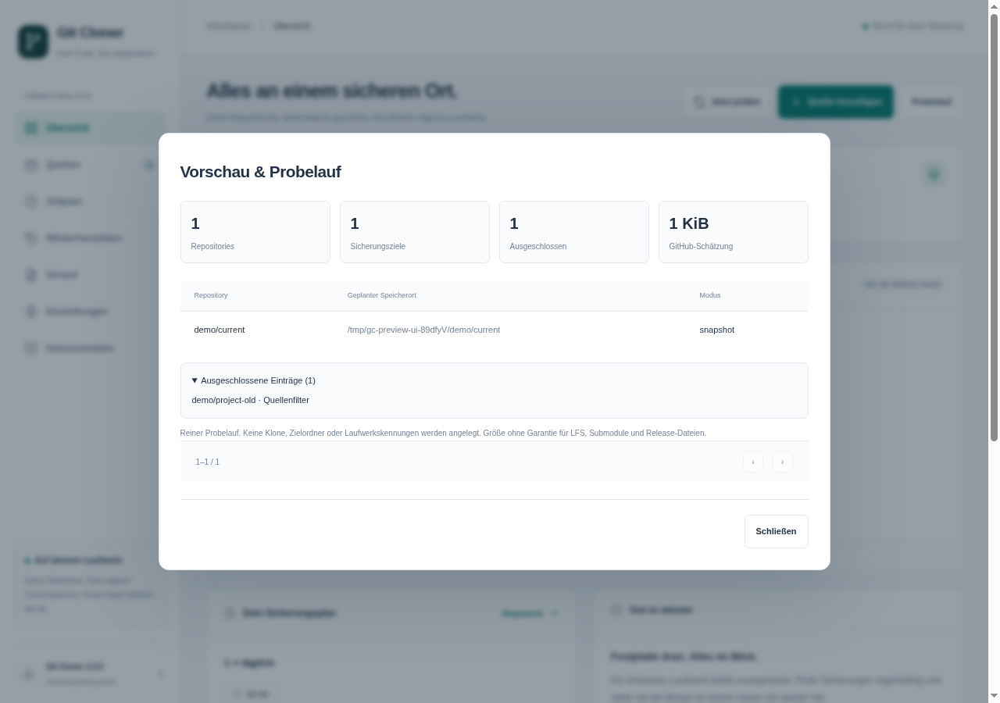

Die neuen Bilder verwenden isolierte Testprofile. Sichtbare `/tmp/gc-…`-Pfade sind zufällige temporäre Testverzeichnisse; Konto- und Repository-Namen sind neutrale Beispiele.

## 12. Pausieren und nach Neustart fortsetzen

Während eines Durchlaufs **Nach laufenden Repos pausieren** wählen. Bereits gestartete Repositories werden abgeschlossen; neue Aufgaben starten nicht mehr. Bei paralleler Ausführung können deshalb noch zwei oder mehr aktive kleine Repositories fertig werden. Danach erscheint **Fortsetzen**. Die ausstehenden Aufgaben und die Laufkonfiguration werden gespeichert und bleiben nach einem App-Neustart verfügbar.

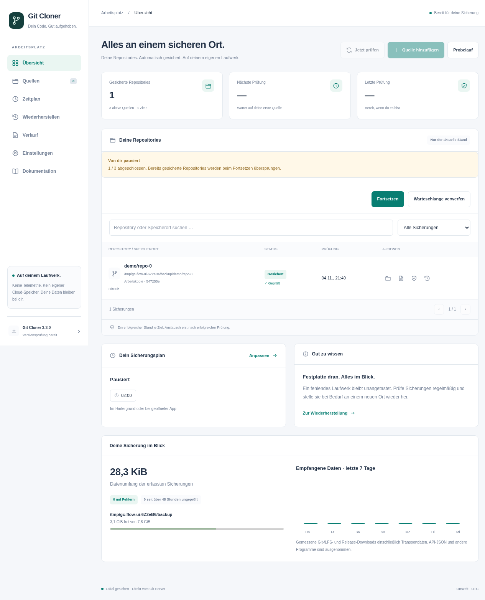

**Fortsetzen** überspringt die in diesem Lauf bereits abgeschlossenen Ziele. **Warteschlange verwerfen** entfernt ausschließlich den ausstehenden Lauf; vorhandene Backups bleiben erhalten. Während eine Warteschlange wartet, bleiben Quellen und Sicherungsumfang fest. Leistungsregeln, Darstellung und zukünftige Prüfzeiten lassen sich ändern. Für einen anderen Sicherungsumfang zunächst den Lauf abschließen oder verwerfen.

Eine Regelpause durch Strom/WLAN wird im laufenden Hintergrundbetrieb etwa alle 30 Sekunden neu geprüft und bei erlaubten Bedingungen automatisch fortgesetzt. Nach einer bewusst gewählten Pause, einem Neustart während eines aktiven Laufs oder einem allgemeinen Laufabbruch bleibt das Fortsetzen ausdrücklich bei dir. Ein unabhängiger Worker prüft Regelpausen bei seinen nächsten Starts. Er startet keine dauerhaft laufende Überwachung einer beendeten GUI.

Zustand und Warteschlange werden gebündelt sowie beim Pausieren geschrieben. Nach einem harten Prozessabbruch können noch nicht protokollierte Prüfungen erneut stattfinden; erfolgreich ausgetauschte Backups bleiben maßgeblich. Es entsteht keine historische Ordnerrotation.

## 13. Leistung, Download-Limit und Ressourcenregeln

Unter **Einstellungen → Leistung & Regeln**:

| Einstellung | Bedeutung |
| --- | --- |
| Parallele kleine Repositories | 1–4, Standard 2. Höchstens zwei kleine Aufgaben je erkanntem Datenträger. |
| Als klein behandeln bis | GitHub-Größenschätzung in MiB, Standard 50. Unbekannte oder größere Repositories laufen exklusiv. |
| Aufwendige Sicherungen | Mirrors, LFS, Submodule, Metadaten und Verschlüsselung laufen unabhängig von der Größenschätzung einzeln. |
| Wiederholungen | 0–5 zusätzliche Versuche je vorübergehend fehlgeschlagener Netzwerkoperation; Standard 2. Zunehmende Wartezeit und begrenzte Berücksichtigung von Retry-After. Verschachtelte Wiederholungen vervielfachen die Versuchszahl nicht. |
| Download-Limit | KiB/s, 0 = unbegrenzt. Gemeinsames Limit über Git-, LFS- und Release-Downloads, einschließlich Transportdaten. API-JSON, Uploads und andere Anwendungen sind ausgenommen. |
| Nur am Netzteil sichern | Bei Akkubetrieb oder unbekanntem erforderlichem Stromstatus wartet die Warteschlange. Laufende Aufgaben werden fertiggestellt. |
| Erlaubte WLAN-Namen | Exakter Name pro Zeile. Leer erlaubt alle Netzwerke. Bei nicht erlaubtem oder unbekanntem WLAN-Namen wartet die App. |

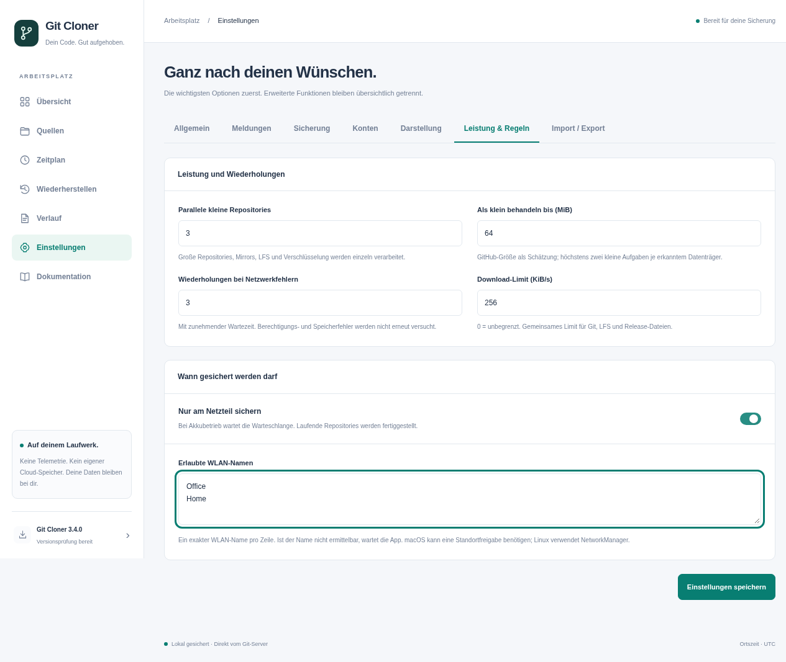

Die Regeln greifen schon vor der ersten Repository-Abfrage eines Sicherungslaufs. Ein manuell angeforderter Probelauf ist eine separate Leseoperation. Unter macOS kann die SSID aus Datenschutzgründen verborgen sein; dann Standort-/Systemberechtigungen prüfen oder die optionale WLAN-Liste leer lassen. Unter Linux wird `nmcli` aus NetworkManager verwendet. Im Flatpak kann diese Host-Abfrage fehlen. Es gibt keine automatische Erkennung aller Mobilfunktarife; eine konkrete WLAN-Liste kann beispielsweise das eigene Hotspot-Netz ausschließen.

Download-Messung und Begrenzung verwenden einen lokalen HTTPS-Tunnel ohne Entschlüsselung des TLS-Verkehrs. Ein konfigurierter HTTP-/HTTPS-Unternehmensproxy wird berücksichtigt. Nicht unterstützte Proxy-Protokolle erzeugen einen Fehler, statt die Begrenzung still zu umgehen. Die App benötigt dafür keine Zertifikate und schaltet die TLS-Prüfung nicht aus.

## 14. Sicherungsumfang je Quelle

Im Quelleneditor **Sicherungsumfang dieser Quelle** öffnen und **Eigene Sicherungsoptionen verwenden** aktivieren. Modus, LFS, Submodule, Metadaten, Integrität und Verschlüsselung gelten dann nur für diese Quelle. Die Speicherreserve wird beim Aktivieren aus den allgemeinen Optionen übernommen. Alle Ziele dieser Quelle verwenden denselben gewählten Umfang.

Ohne eigene Optionen gelten die allgemeinen Sicherungseinstellungen. Für unterschiedliche Regeln innerhalb eines ganzen Kontos einzelne Repository-Regeln anlegen; diese haben weiterhin Vorrang vor der Kontoregel. Eine Verschlüsselungsoption benötigt ein gesetztes Archivpasswort. Mirror und ausgecheckte Submodule bleiben nicht kombinierbar.

## 15. Dateien oder Ordner gezielt wiederherstellen

Unter **Wiederherstellen** eine Sicherung oder GCB-Datei wählen. Ein Archivpasswort gegebenenfalls direkt im ersten Bereich eingeben. Unter **Wiederherstellungsumfang** auf **Einzelne Dateien oder Ordner** wechseln und **Dateien auswählen** öffnen. Ordner lassen sich öffnen oder vollständig markieren. Mehrere Auswahlpfade sind möglich; überlappende Auswahlen kopieren eine Datei nur einmal.

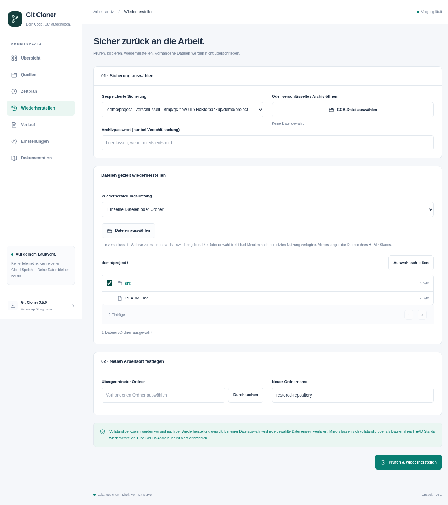

Danach einen vorhandenen übergeordneten Ordner und einen neuen Ausgabeordnernamen wählen. Die relative Ordnerstruktur bleibt erhalten. Git-Verwaltungsdateien sind in der Arbeitskopie-Auswahl verborgen. Ein Mirror zeigt Dateien seines HEAD-Stands; exportierte Git-Dateien werden anhand ihrer Objekt-IDs geprüft und vorhandene LFS-Objekte auf echte Inhalte aufgelöst. Vollständige Mirror-Wiederherstellung bleibt zusätzlich möglich.

Neue Sicherungen schützen das Dateimanifest mit einem separaten Hash im Verwaltungsmarker. Die Auswahl prüft dieses Manifest und die tatsächlich ausgewählten Dateien. Dadurch können intakte Dateien auch dann gerettet werden, wenn eine andere Datei beschädigt ist. Ältere Sicherungen ohne Manifest-Hash benötigen zunächst die vollständige bisherige Prüfung. Die manuelle Gesamtintegritätsprüfung bleibt unabhängig davon verfügbar.

Verschlüsselte Archive müssen zur Auswahl vollständig authentifiziert und in einen privaten lokalen Temp-Ordner entpackt werden. Die Dateiauswahl bleibt fünf Minuten nach der letzten Nutzung verfügbar; Schließen, Verlassen der Wiederherstellungsseite oder reguläres Beenden entfernt die temporären Daten. Während einer laufenden Wiederherstellung werden sie nicht vorzeitig gelöscht. Nach einem harten Prozessabbruch können OS-Temp-Dateien zurückbleiben; es gibt kein forensisch sicheres Löschen.

## 16. Dashboard, hoher Kontrast und Tastatur

Die Übersicht zeigt während eines Laufs Laufzeit, abgeschlossene Aufgaben, eine ungefähre Restzeit und empfangene Daten. Restzeiten sind Schätzungen aus dem bisherigen Ablauf; vor der ersten abgeschlossenen Aufgabe gibt es noch keine belastbare Schätzung. Das Dashboard zeigt erfassten Backup-Umfang, freien Speicher, Netzwerkempfang der letzten sieben lokalen Kalendertage und Fehler beziehungsweise seit über 48 Stunden ungeprüfte Sicherungen. Alte Statusdaten können noch keine Bytewerte enthalten. Andere Programme und API-JSON werden nicht als Backup-Download mitgezählt.

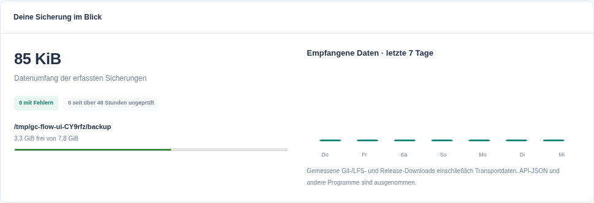

Unter **Darstellung** lässt sich **Hoher Kontrast** aktivieren. Tastaturbedienung umfasst sichtbare Fokusrahmen, einen Überspringlink zum Inhalt, Statusansagen und Pfeiltasten/Pos1/Ende in Einstellungsreitern. Die Kontrastprüfung der Tests ersetzt keine vollständige externe Barrierefreiheitszertifizierung.

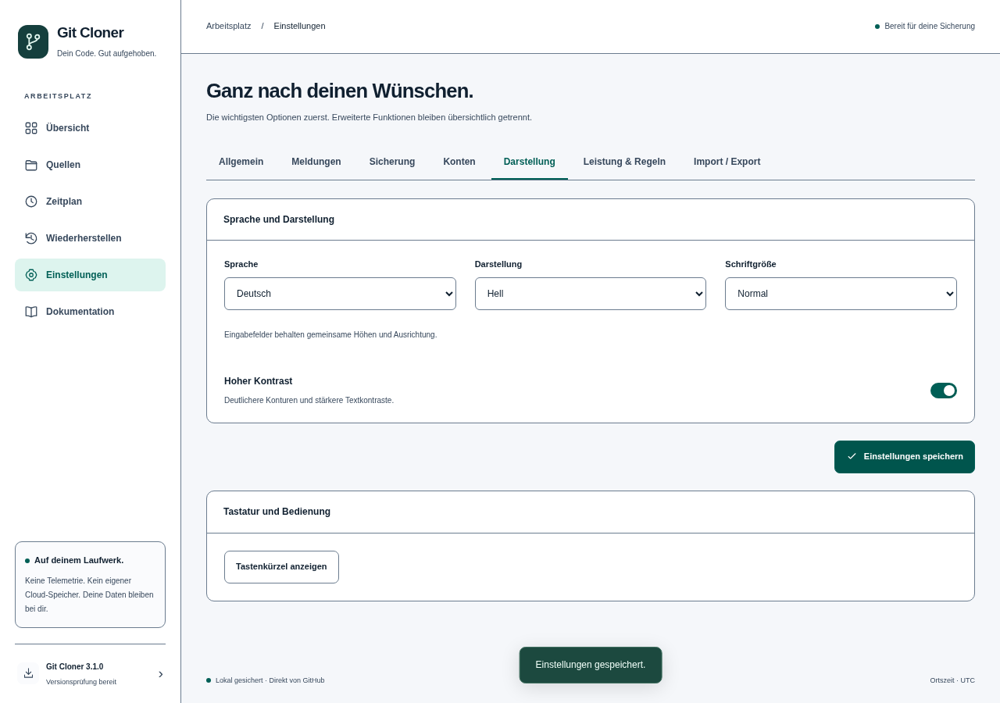

| Tastenkürzel | Funktion |
| --- | --- |
| Cmd/Ctrl + K | Übersicht und vorhandenes Suchfeld öffnen. |
| Cmd/Ctrl + N | Quelle hinzufügen, wenn kein Lauf aktiv oder pausiert ist. |
| Cmd/Ctrl + B | Prüfung starten, wenn Quellen vorhanden sind. |
| Cmd/Ctrl + Umschalt + P | Pause anfordern beziehungsweise fortsetzen. |
| Cmd/Ctrl + Komma | Einstellungen öffnen. |
| F1 | Tastenkürzel anzeigen. |
| Esc | Dialog schließen. |


## 17. Eigene Prüfzeiten je Quelle

Unter **Quellen → Quelle bearbeiten → Prüfzeiten dieser Quelle** die Option **Eigene Prüfzeiten verwenden** aktivieren. Anschließend zwischen einer und 24 täglichen Prüfungen wählen und jede Uhrzeit eintragen. Beispiel: `01:00`, `09:00` und `17:00` für `beispiel-konto/projekt`. Die Auswahl **Nur manuell** nimmt diese Quelle aus automatischen Zeitprüfungen heraus; manuelle Durchläufe können sie weiterhin sichern.

Ohne eigene Zeiten gilt der allgemeine Zeitplan. Die globale Pause unter **Zeitplan** pausiert auch die eigenen Quellenzeiten. **Jetzt prüfen** führt einen normalen Durchlauf für alle aktiven Quellen aus. Jede Quelle erhält einen eigenen gespeicherten Prüfstand; ein Lauf für eine Quelle verhindert keine fällige Prüfung einer anderen. Nach dem Aufwachen wird je Quelle nur die letzte verpasste Uhrzeit des aktuellen Tages nachgeholt.

Bei aktivierter unabhängiger System-Zeitplanung übernimmt die installierte native App die gemeinsamen Termine automatisch nach dem Speichern. Der Rechner muss weiterhin eingeschaltet und wach sein.

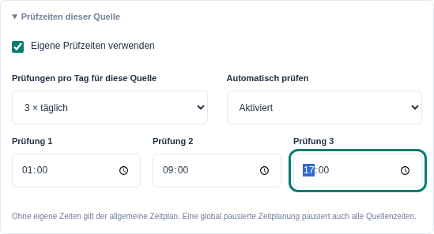

## 18. Releases mit Betriebssystemauswahl sichern

Unter **Einstellungen → Sicherung** die Option **Releases mit Download-Dateien** einschalten. Im Bereich **Release-Dateien** auswählen:

- **Alle Betriebssysteme:** alle vom Projekt angebotenen Dateien des neuesten offiziellen Releases sichern.
- **Nur mein Betriebssystem:** Dateien für das automatisch erkannte **Windows, macOS oder Linux** sichern. Das erkannte System steht direkt neben der Auswahl. Alle Architekturen und Linux-Paketformate des jeweiligen Betriebssystems bleiben enthalten.

Die App ordnet Pakete anhand ihrer Namen und Dateiendungen zu. Dateien ohne eindeutige Zuordnung werden im OS-Modus ausgelassen; gemeinsame Prüfsummen und allgemeine Hinweise bleiben enthalten. Falls benötigte Dateien unklare Namen haben, **Alle Betriebssysteme** verwenden. Die konkrete Auswahl einschließlich ausgelassener Dateien wird mit der Sicherung dokumentiert. GitHubs automatisch erzeugte Quellcode-ZIP- und TAR-Archive werden nicht zusätzlich geladen; der Git-Inhalt wird über die Repository-Sicherung erfasst. Für alle Git-Tags und die Historie den Mirror-Modus verwenden.

Die Einstellung kann unter **Sicherungsumfang dieser Quelle** für einzelne Quellen überschrieben werden. Ein Download wird in den neuen Sicherungsstand integriert. Die App prüft angegebene Dateigrößen und vorhandene SHA256-Digests beim Herunterladen; bei Fehlern bleibt der bisherige erfolgreiche Stand erhalten. Die Platzprüfung berücksichtigt bekannte Release-Dateigrößen zusätzlich zum Repository.

Gesichert werden Dateien des neuesten offiziellen, stabilen Releases je Repository. Erscheint ein neues Release, ersetzt der neue Sicherungsstand die Dateien des älteren Releases; alte Download-Dateien werden nicht zusätzlich aufgehoben. Frühere Release-Metadaten können im JSON-Export enthalten sein. Mit automatischer Programminstallation bleibt standardmäßig nur die installierte Datei erhalten (siehe Abschnitt 35). Die Auswahl bezieht sich auf deine Sicherungsquellen. Die Update-Prüfung für Git Cloner selbst informiert weiterhin nur und installiert keine Programmversion automatisch.

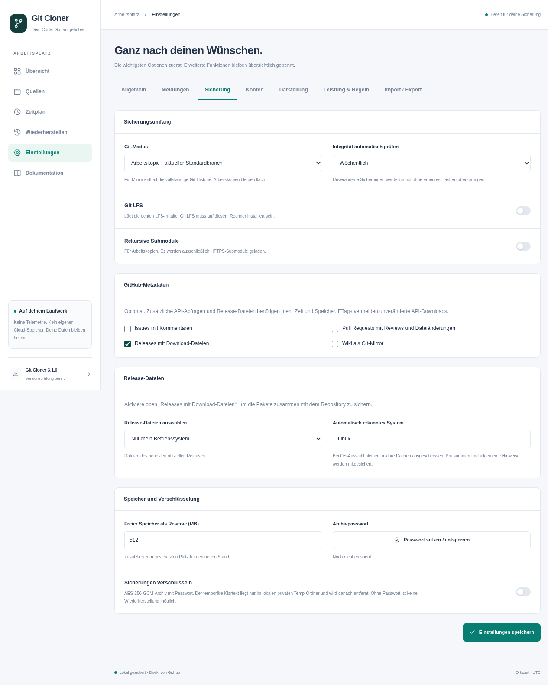

In der **Übersicht** zeigt eine Sicherung mit Release-Dateien den gespeicherten Tag und die Dateizahl. Über **Release-Dateien wiederherstellen** den Wiederherstellungsassistenten öffnen. **Dateien auswählen**, gewünschte Pakete markieren und einen neuen Ausgabeordner angeben. Beispiel: übergeordneter Ordner `/Volumes/Arbeitsplatte`, neuer Name `projekt-release`. Vorhandene Ausgabeordner werden abgelehnt. Der Assistent kopiert nur die gewählten Release-Dateien und prüft ihre Integrität. Dies funktioniert auch mit verschlüsselten Sicherungen und Mirrors. Heruntergeladene Programme werden nicht automatisch gestartet.

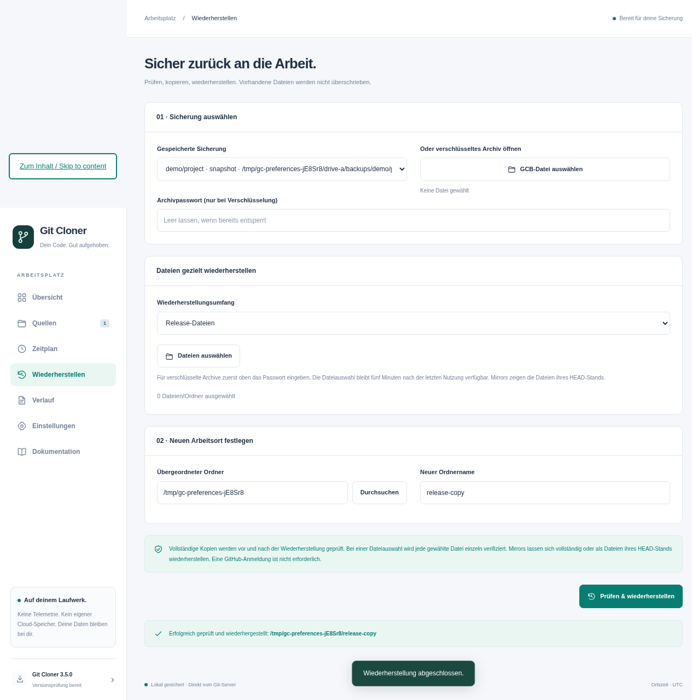

## 19. Änderungen vor einer Sicherung ansehen

In der **Übersicht** bei einer vorhandenen Sicherung **Änderungen ansehen** wählen. Die App vergleicht den gespeicherten Git-Stand mit dem aktuellen Standardbranch auf GitHub. Die Liste unterscheidet neue, geänderte und entfernte Dateien. Die Suche filtert Dateipfade; größere Listen werden seitenweise angezeigt.

Eine Datei anklicken, um ihren Text-Diff zu laden. Textdateien werden bis 256 KiB je Version angezeigt. Große Dateien und Submodule bleiben in der Dateiliste; für Binär- und LFS-Dateien gibt es keine Textansicht. Eine sehr große oder von GitHub gekürzte Dateiliste kann die Vorschau verhindern. Der normale Sicherungslauf bleibt dann verfügbar.

Die Vorschau verändert die gespeicherte Sicherung nicht und führt keinen Projektcode aus. Bei verschlüsselten Sicherungen gegebenenfalls zuerst das Archivpasswort eingeben. Während der Vorschau warten automatische Backups. Schließen gibt die Sicherung wieder frei; eine ungenutzte Sitzung läuft nach etwa fünf Minuten ab. **Alle aktiven Quellen prüfen** schließt die Vorschau und startet den normalen Durchlauf für alle aktiven Quellen.

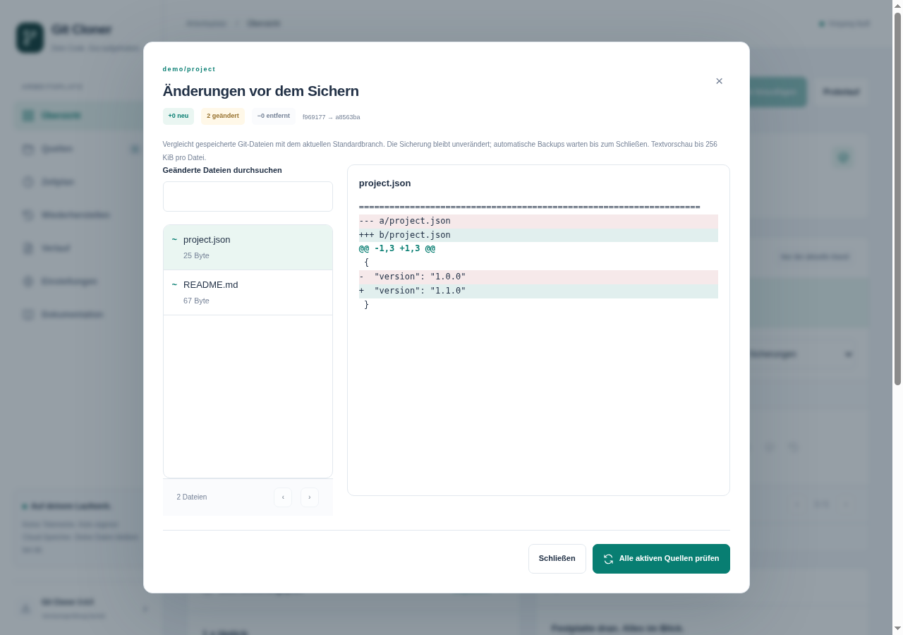

## 20. Laufwerke nach geändertem Pfad wiederfinden

Unter **Zeitplan → Laufwerke wiederfinden** lässt sich die automatische Zuordnung einschalten. Die App sucht bekannte Sicherungsordner auf verbundenen Laufwerken anhand ihrer gespeicherten Ordnerkennung und des relativen Speicherorts. Sie prüft ungefähr einmal pro Minute und vor einem neuen Sicherungslauf. Eine Suche lässt sich außerdem unter **Quellen → Laufwerke wiederfinden** direkt starten.

Beispiel: Eine bekannte Platte wechselt von `/Volumes/Archiv` nach `/Volumes/Archiv 1` oder unter Windows von `E:` nach `F:`. Bei einem eindeutigen Treffer aktualisiert die App die Zuordnung. Die vorhandene Sicherung wird weiterverwendet; sie wird nicht für die Suche verschoben oder neu geklont. Bereits abgeschlossene Aufgaben einer pausierten Warteschlange bleiben abgeschlossen.

Bei mehreren gleichen Kennungen wird keine automatische Auswahl getroffen. Das kann nach dem vollständigen Kopieren einer Sicherungsplatte vorkommen. Den gewünschten Ordner dann in der Quelle bewusst neu auswählen. Die Ordnerkennung ist keine Hardware-Seriennummer. Fehlt ein Laufwerk, erstellt die Suche keinen Ersatzordner am alten Pfad.

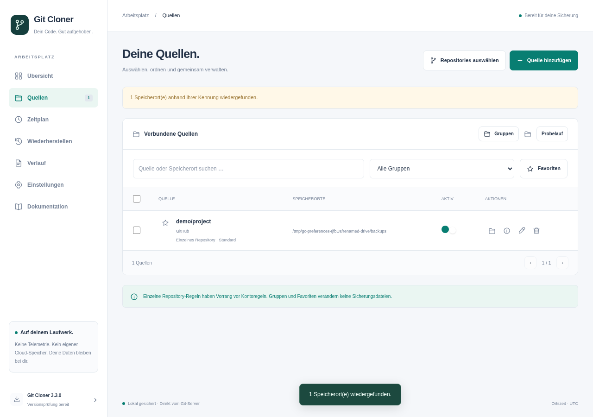

## 21. Benachrichtigungen und Ruhezeiten

Unter **Einstellungen → Meldungen** lassen sich Systemmeldungen insgesamt ausschalten oder genauer festlegen:

- **Alle abgeschlossenen Prüfungen** meldet jeden abgeschlossenen Durchlauf.
- **Nur Fehler** meldet nur Durchläufe mit Fehlern.
- **Änderungen und Fehler** meldet neue oder aktualisierte Sicherungen sowie Fehler.
- **Keine Sicherungsmeldungen** lässt Sicherungsläufe ohne Systemmeldung laufen.

Diese Regeln gelten für manuelle und automatische Läufe. Status und Verlauf bleiben in der App sichtbar. Unter **Neue Programmversionen** kann die Systemmeldung separat deaktiviert werden; ein verfügbarer Versionshinweis bleibt dann in der App sichtbar. „Diese Version überspringen“ behält seine bisherige Wirkung über Neustarts.

Für eine Ruhezeit **Ruhezeit aktivieren** einschalten und beispielsweise `22:00` bis `07:00` eintragen. Es gilt die lokale Uhrzeit; Zeiträume über Mitternacht werden unterstützt. Währenddessen erscheinen keine Systemmeldungen. Sicherungsmeldungen werden nicht nachträglich gesammelt. Ein noch nicht gemeldeter neuer Versionshinweis kann nach Ende der Ruhezeit erscheinen, während die App aktiv ist. Betriebssystemberechtigungen und dessen eigene Fokus-/Nicht-stören-Einstellungen gelten zusätzlich.

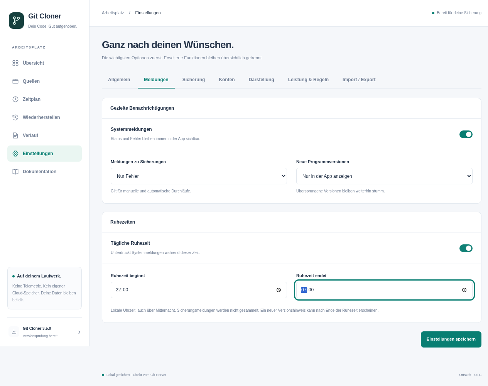

## 22. GitLab und Forgejo als Quellen

Unter **Quellen → Quelle hinzufügen** den **Anbieter** wählen. GitHub verwendet `https://github.com`. Bei GitLab beispielsweise `https://gitlab.example.org`, bei Forgejo `https://git.example.org` eintragen. Unterstützt werden HTTPS-Server, auch mit einem festen Installations-Unterpfad. Zugangsdaten, Abfrageparameter und Fragmente gehören nicht in die Serveradresse.

Unter **Art der Quelle** auswählen, ob ein ganzes Konto beziehungsweise eine Organisation/Gruppe oder ein einzelnes Repository gemeint ist. Bei GitLab-Untergruppen ausdrücklich **Konto / Organisation / Gruppe** wählen: `beispiel-gruppe/untergruppe` ist eine Gruppe, `beispiel-gruppe/untergruppe/projekt` ein Repository. Die Gruppensicherung schließt Untergruppen ein und lässt extern geteilte Projekte aus. Bei Forgejo sind Konten/Organisationen und `konto/projekt` möglich. Eine Quelle pro Zeile; der gewählte Anbieter und Server gelten für diese Zeilen.

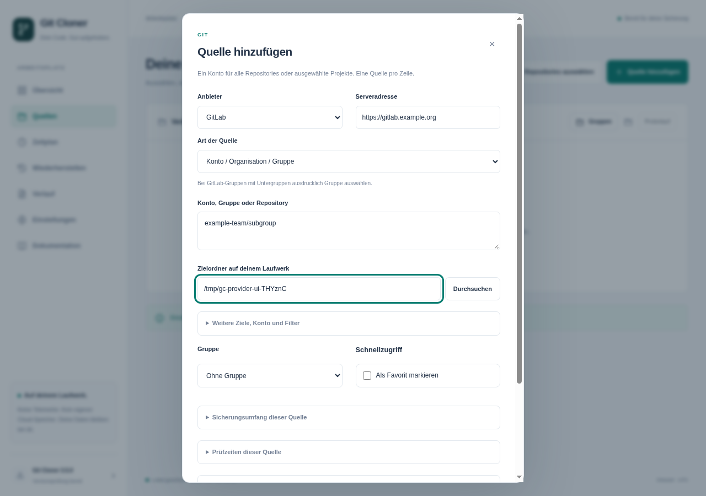

Für private Quellen unter **Einstellungen → Konten** ein Konto mit demselben Anbieter und exakt demselben Server anlegen. Bei Forgejo den eigenen Benutzernamen zusätzlich angeben. Ein passendes Lesetoken speichern und in der Quelle unter **Weitere Ziele, Konto und Filter → Zugangsdaten verwenden** auswählen. GitLab benötigt passende Rechte für API und Repository-Lesen, beispielsweise `read_api` und `read_repository`. Bei Forgejo hängen die nötigen Leserechte von den gewählten Repository-, Issue-, Organisations- und Kontofunktionen ab. Tokens werden nur mit einem verfügbaren sicheren OS-Schlüsselspeicher gespeichert. **Öffentlich · ohne Token** verwendet für andere Anbieter kein GitHub-Standardtoken.

Ein Konto bleibt an seinen Server gebunden. Vor einer Änderung dieser Zuordnung gespeicherte Zugangsdaten entfernen; die App gibt Tokens nicht an andere Server oder externe Asset-Weiterleitungen weiter. Die GitHub-Geräteanmeldung gilt weiterhin nur für GitHub. Für GitLab/Forgejo wird ein passendes Token verwendet.

GitHub behält die Ablage `Ziel/Konto/Repository`. Andere Anbieter erhalten davor einen stabilen Ordner aus Anbieter, Server und kurzer Serverkennung. So überschreibt etwa `beispiel-konto/projekt` auf zwei verschiedenen Servern keine andere Sicherung. Der Probelauf zeigt den vollständigen Zielpfad. Snapshots, Mirrors, LFS, HTTPS-Submodule, Verschlüsselung und Wiederherstellung funktionieren auch für diese Quellen.

GitLab-Metadaten umfassen Issues und Notizen, Merge Requests mit Notizen und Datei-Diffs, Releases/Dateien und Wiki. Forgejo exportiert Issues/Kommentare, Pull Requests/Reviews/Dateien, Releases/Dateien und Wiki. API-Berechtigungen und vom Server begrenzte Daten, etwa gekürzte Merge-Request-Diffs, bleiben zu beachten. GitLab besitzt nicht dieselbe Vorabversionsmarkierung wie GitHub: Kommende Releases und als SemVer-Vorabversion erkennbare Tags werden bei der Dateiauswahl ausgelassen. Automatische Quellcodearchive werden auch hier nicht zusätzlich geladen.

Die App verwendet GitLab API v4 und Forgejo API v1. Forgejo 17.0.1 wird zusätzlich mit einem echten privaten HTTPS-Testserver geprüft. GitLab wird über kontrollierte API-Szenarien und öffentliche echte API-Aufrufe geprüft; eine private GitLab-Installation mit eigener SSO-/Proxy-Konfiguration benötigt ihre üblichen Serverfreigaben. Diese Unterstützung ist kein vollständiger Export aller CI-, Paketregistry- oder Administrationsdaten eines Git-Servers.

## 23. Verlauf suchen und gezielt exportieren

**Verlauf** in der Seitenleiste öffnen. Nach Repository suchen, **Ergebnis** auf alle Prüfungen, Fehler oder Änderungen stellen und optional **Von einschließlich** sowie **Bis einschließlich** eintragen. Die Datumsgrenzen verwenden die lokale Uhrzeit. Suche und Details bleiben seitenweise begrenzt, damit große Verläufe die Oberfläche nicht blockieren.

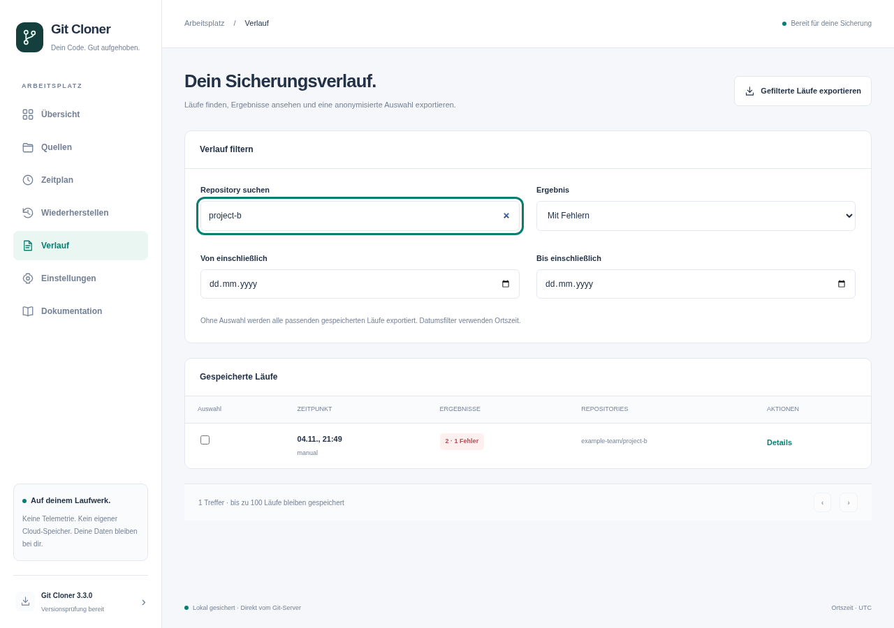

Über **Details** die Ergebnisse eines Laufs öffnen; eine Repository-Suche wird dort übernommen. Bei Fehlern lässt sich direkt die passende **Fehlerhilfe** öffnen. Kästchen auswählen und **Gefilterte Läufe exportieren** verwenden: Mit Auswahl werden diese Läufe exportiert, ohne Auswahl alle passenden gespeicherten Läufe. Im Detaildialog exportiert **Diesen Lauf anonym exportieren** den vollständigen gespeicherten Lauf.

Der Export ersetzt Repository-Namen durch neutrale Kennungen und entfernt persönliche Pfade, rohe Fehlermeldungen und Zugangsdaten. Er enthält die gespeicherten Ergebnisse, keine Sicherungsdateien. Aufbewahrt werden die letzten 100 abgeschlossenen Läufe und höchstens 500 Detailergebnisse pro Lauf; eine Kürzung wird ausgewiesen. Nicht aufbewahrte Details können später nicht über die Suche rekonstruiert werden.

## 24. Bei wenig Speicher automatisch warten

Reicht der freie Platz einschließlich Reserve nicht, wechselt die Warteschlange auf **Wartet auf freien Speicher · automatische Fortsetzung**. Der bisherige erfolgreiche Sicherungsstand bleibt erhalten. Fertige Ziele bleiben als fertig gespeichert; die betroffene Aufgabe wird nicht als erfolgreich abgeschlossen markiert.

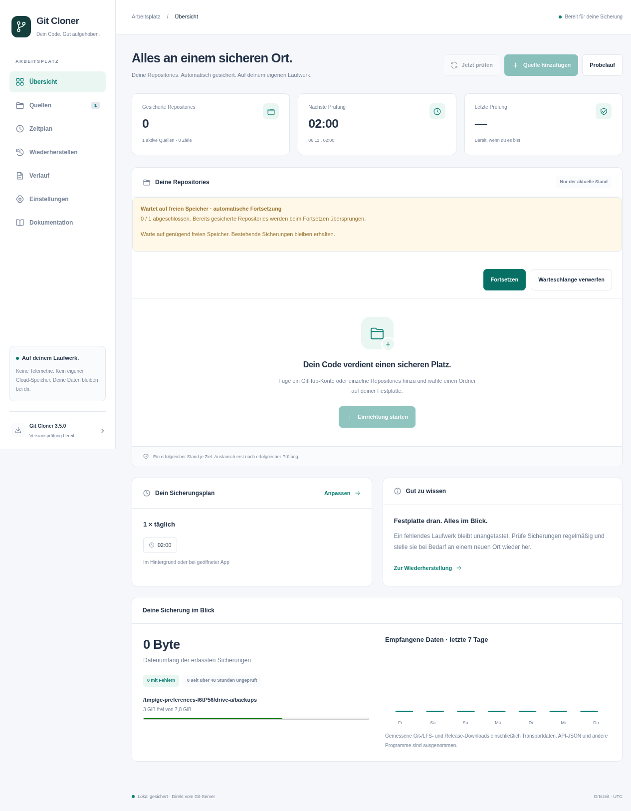

Platz außerhalb vorhandener Sicherungen freigeben und das richtige Laufwerk verbunden lassen. Bei laufender App wird ungefähr alle 30 Sekunden geprüft, ob die gespeicherte Platzanforderung erfüllt ist. Während des Wartens werden dafür keine Git- oder Repository-API-Abfragen wiederholt. Danach setzt die Warteschlange automatisch fort. **Fortsetzen** kann eine Prüfung unmittelbar anstoßen. Fehlt weiterhin Platz, bleibt die Warteschlange erhalten.

Bei geschlossener App erfolgt die nächste Prüfung durch einen eingerichteten nativen Worker-Termin oder beim erneuten Öffnen und Fortsetzen. Ein ausgeschalteter oder schlafender Rechner wird nicht geweckt. Eine bewusst von dir pausierte Warteschlange wird nicht automatisch weitergeführt. Bei geändertem Laufwerkspfad kann die bestehende Laufwerkswiedererkennung auch die wartende Aufgabe zuordnen.

Die App löscht keine anderen Backups, um Platz zu schaffen. Zum Ändern des Sicherungsumfangs oder der Reserve bei einer festgehaltenen Warteschlange diese bewusst verwerfen und danach die Optionen ändern; bereits vorhandene Sicherungsdateien bleiben erhalten. Ein neuer Lauf überspringt weiterhin unveränderte erfolgreiche Stände.

## 25. Passende Hilfe zu Fehlern

In der Übersicht oder in Verlaufsdetails **Fehlerhilfe** wählen. Auch eine Fehlermeldung als Toast bietet diesen Einstieg. Die Hilfe schlägt zur Fehlerart passende Schritte vor: Token und Leserechte, Netzwerk/VPN/Proxy, API-Wartezeiten, Laufwerkszuordnung, Schreibschutz, freier Platz, Git/LFS oder Archivpasswörter.

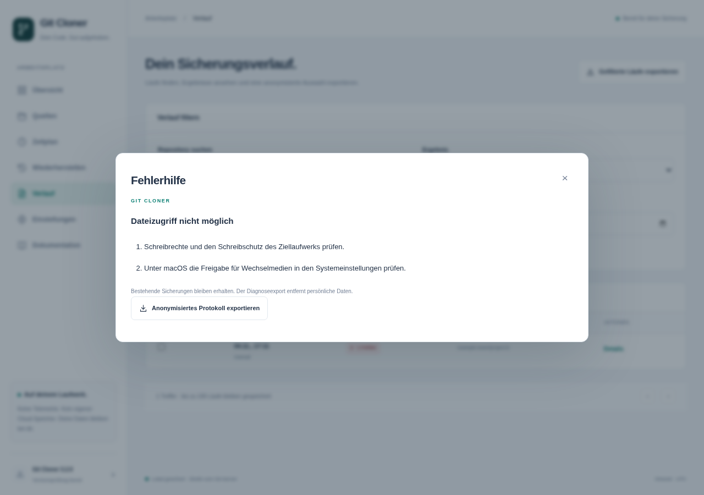

Die Hilfe ändert keine Systemeinstellungen und entfernt keine Daten. Für einen Fehlerbericht kann ein anonymisiertes Diagnoseprotokoll exportiert werden. Originale bei Integritäts- oder Passwortfehlern behalten; zunächst an einem neuen Ausgabeort wiederherstellen.

## 26. Archivpasswort kontrolliert wechseln

Unter **Einstellungen → Sicherung → Passwortwechsel-Assistent** die verschlüsselten Sicherungen öffnen. Die Liste zeigt pro Seite bis zu 100 Archive, ihre Erreichbarkeit und die bekannte Passwortzuordnung. Erreichbare Archive auswählen; bis zu 1000 Archive lassen sich in einem Durchlauf umstellen. Nicht ausgewählte oder fehlende Laufwerke behalten zunächst ihr bisheriges Passwort.

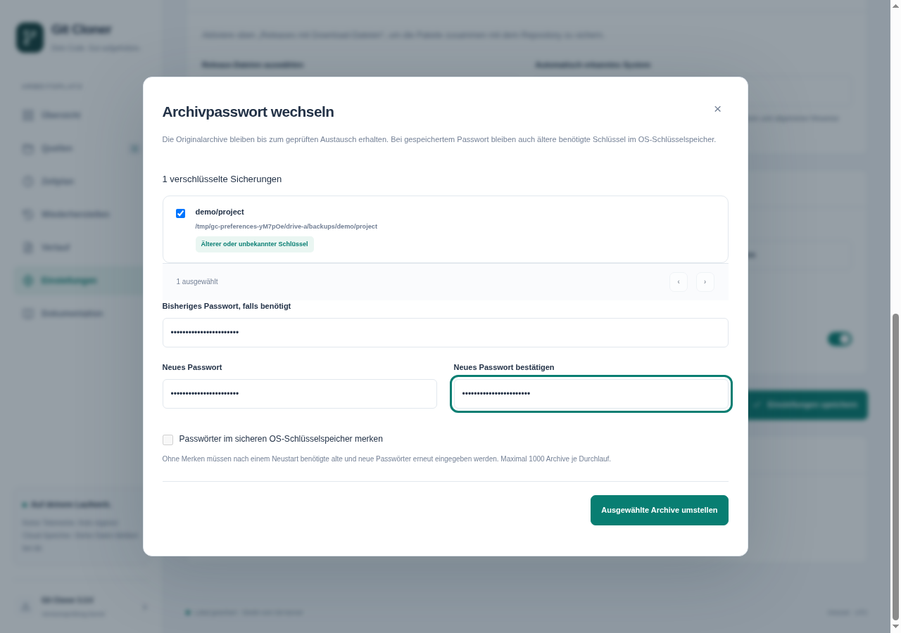

Das **bisherige Passwort** bei Bedarf eingeben, ein **neues Passwort** mit mindestens zwölf Zeichen wählen und darunter **bestätigen**. Sind passende ältere Passwörter bereits sicher gespeichert, kann die bisherige Eingabe leer bleiben. Die App authentifiziert ein ausgewähltes Archiv, bevor sie das neue aktive Passwort übernimmt.

**Passwörter im sicheren OS-Schlüsselspeicher merken** ist optional und übernimmt die bisherige Merken-Einstellung. Bei aktivierter unabhängiger verschlüsselter Zeitplanung ist das Merken erforderlich. Gespeicherte ältere benötigte Passwörter bleiben für noch nicht umgestellte Archive verfügbar. Ohne Merken müssen nach einem Neustart benötigte alte und neue Passwörter wieder eingegeben werden; die Verwaltungsdatei enthält dabei nur Kennungen, keine Passwörter.

**Ausgewählte Archive umstellen** entschlüsselt und prüft jedes Archiv in einem privaten temporären Ordner, erstellt den neuen verschlüsselten Stand und tauscht ihn anschließend aus. Der Inhalt und seine Git-Historie werden dabei erhalten. Die Wiederanlaufsdaten enthalten keine Passwörter. Wird ein Austausch unterbrochen, wird er nach dem nächsten Start beziehungsweise vor einer weiteren Archivoperation aus dem gespeicherten Zustand abgeschlossen oder auf das intakte alte Archiv zurückgeführt. Fehlt das Laufwerk, bleibt dieser Zustand erhalten.

Über **Nach aktuellem Archiv stoppen** zwischen zwei Archiven anhalten. Ein bereits laufendes Archiv wird fertiggestellt. Der Ergebnisbereich zeigt erfolgreiche, fehlgeschlagene und noch mit älterer Zuordnung verbliebene Archive. Nach erneutem Verbinden einer Platte den Assistenten wieder öffnen; bekannte alte Schlüssel oder das zugehörige bisherige Passwort ermöglichen die Umstellung. Ältere externe GCB-Kopien, die nicht zur verwalteten Auswahl gehören, werden nicht automatisch verändert.

Der Vorgang braucht zusätzlich Platz für den bisherigen und neuen verschlüsselten Stand sowie für authentifizierte und entpackte temporäre Daten. Temporäre Klartextdaten werden regulär entfernt; nach einem harten Prozessabbruch können OS-Temp-Dateien zurückbleiben. Ein vergessenes Passwort kann nicht wiederhergestellt werden; es gibt kein forensisch sicheres Löschen. Das einfache **Archivpasswort setzen/entsperren** prüft bei erreichbaren bestehenden Archiven das passende Passwort; für einen tatsächlichen Wechsel den Assistenten verwenden.

## 27. LFS und Submodule vorschlagen lassen

Unter **Quellen** bei einer gespeicherten Quelle **Umfang empfehlen** öffnen. Bei einer Konten-/Gruppenquelle ein Repository innerhalb dieser Quelle angeben. **Umfang prüfen** liest den Git-Dateibaum und kleine `.gitattributes`-Dateien. Es wird kein Projekt geklont und kein Projektcode ausgeführt.

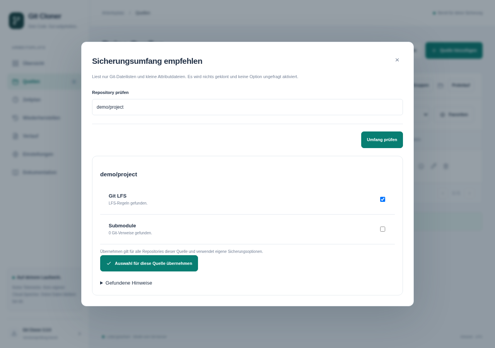

Die App erkennt LFS-Attributregeln und Submodul-Verweise, zeigt die gefundenen Pfade und prüft bei LFS auch die lokale Verfügbarkeit von Git LFS. Unvollständige oder begrenzte API-Ergebnisse werden ausgewiesen; fehlende Hinweise sind dann kein Beweis dafür, dass das Projekt keine solchen Inhalte besitzt.

Die Kästchen prüfen und erst **Auswahl für diese Quelle übernehmen** wählen. Dadurch werden eigene Sicherungsoptionen für diese Quelle verwendet; die globalen Einstellungen bleiben erhalten. Bei einer ganzen Konto-/Gruppenquelle gilt die Auswahl für alle ihre Repositories. Submodule benötigen den Modus Arbeitskopie und erreichbare HTTPS-Ziele; bei einem Mirror bleibt diese Empfehlung deaktiviert, bis der Modus bewusst geändert wurde. Git LFS gegebenenfalls separat installieren. Schließen ohne Übernehmen ändert keine Optionen.

## 28. Repositories mit Checkboxen auswählen

Unter **Quellen → Repositories auswählen** zunächst Anbieter und HTTPS-Server festlegen, passende Zugangsdaten auswählen und den eigenen Konto-, Organisations- oder Gruppennamen eingeben. Die Felder starten ohne voreingestellte Konten oder Repository-Namen. Bei GitLab sind auch Untergruppen wie `beispiel-gruppe/untergruppe` möglich. **Laden** fragt nur die Repository-Liste ab; es wird noch nichts geklont oder auf dem gewählten Sicherungslaufwerk angelegt.

Die Liste lädt bis zu 50 Einträge je Seite. Die Suche wird an den Anbieter geschickt. Checkboxen bleiben beim Blättern und bei einer neuen Suche innerhalb derselben Auswahl erhalten. Die Checkbox im Tabellenkopf betrifft ausschließlich die aktuelle Seite. Bereits als einzelne Quellen eingetragene Repositories sind gekennzeichnet. GitHub begrenzt seine Such-API auf höchstens 1.000 Treffer; eine gekürzte Suche wird angezeigt und sollte präzisiert werden. Private Repositories benötigen entsprechende Leserechte.

Danach einen vorhandenen gemeinsamen Zielordner wählen, optional eine zuvor selbst angelegte Gruppe und Favoritenstatus festlegen und **Quellen hinzufügen** drücken. Jedes ausgewählte Repository wird zu einer eigenen, später einzeln anpassbaren Quelle. Insgesamt bleiben maximal 100 Quellen möglich. Eine Auswahl läuft nach 15 Minuten ohne Nutzung ab. Geänderte Anbieter-, Konto- oder Eigentümerangaben müssen vor dem Hinzufügen erneut geladen werden. Abbrechen speichert keine Quellen.

**GitHub-Adressen einfügen:** Eine Adresse wie `https://github.com/beispiel-konto/beispiel-projekt` wird im Quellenfeld sofort zu `beispiel-konto/beispiel-projekt` bereinigt. Auch `.git`, abschließende Schrägstriche und übliche Unterseiten wie Releases oder Branches werden erkannt. Einträge lassen sich weiterhin zeilenweise eingeben.

Eine Konto- oder Organisationshauptseite wie `https://github.com/orgs/beispiel-team/repositories` öffnet automatisch die Repository-Liste und aktiviert **Neue Repositories automatisch mit aufnehmen**. **Sammelquelle hinzufügen** speichert eine Quelle für alle passenden aktuellen und zukünftigen Repositories. Bei jeder Prüfung wird die Liste erneut ermittelt; neue Projekte werden dadurch mitgesichert. Einzelne Repository-Regeln haben Vorrang, auch wenn sie pausiert sind. Bestehende Filter, Sicherungsoptionen und Prüfzeiten aus dem Quellenformular werden übernommen.

Eine erneute Eingabe derselben Hauptseite erzeugt keine doppelte Sammelquelle und überschreibt keine bestehenden Einstellungen. Neue Repositories sind bereits durch die Sammelquelle abgedeckt. Über **Repositories anzeigen** in deren Quelleneintrag lässt sich die aktuelle Liste erneut öffnen. Eine pausierte vorhandene Sammelquelle bleibt pausiert; sie lässt sich ausdrücklich im Quellenbereich aktivieren.

Für eine feste Auswahl **Neue Repositories automatisch mit aufnehmen** deaktivieren. **Alle fehlenden auswählen** berücksichtigt auch weitere Seiten und überspringt bereits eingetragene einzelne Quellen. Übersteigt die Auswahl die Grenze von 100 Quellen, wird nichts teilweise übernommen; die Sammelquelle deckt große Konten mit einer einzigen Quelle ab. Checkboxen und Suche ermöglichen weiterhin eine gezielte Teilmenge.

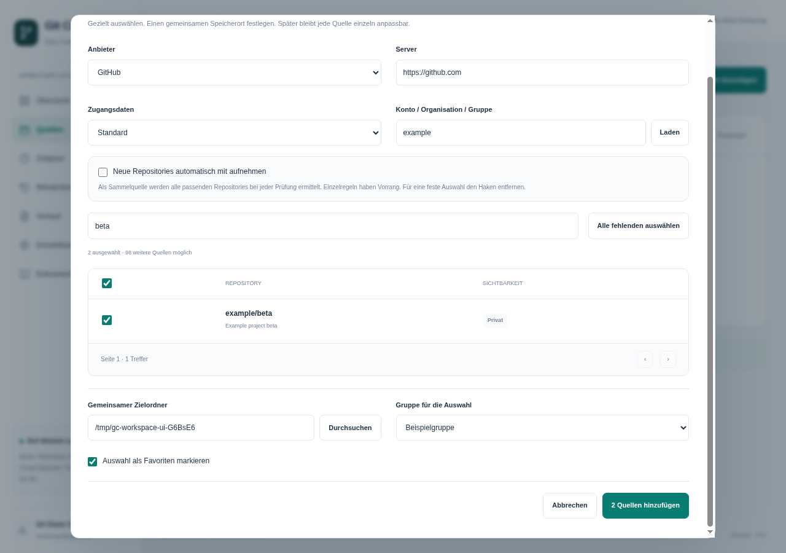

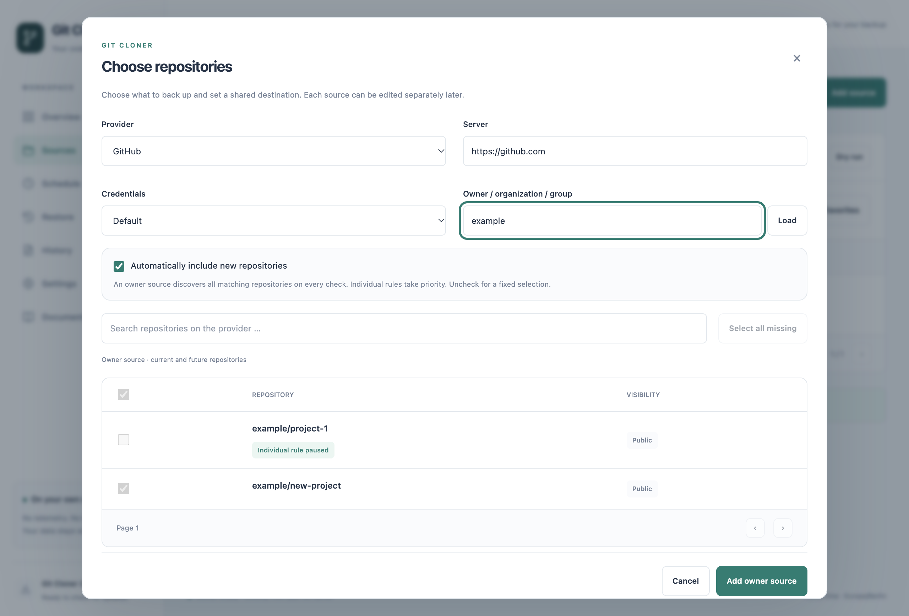

## 29. Gruppen, Favoriten und Quellenauswahl

**Quellen → Gruppen** öffnet die Verwaltung für bis zu 30 selbst benannte Gruppen. Dort Gruppen anlegen, umbenennen oder entfernen. Das Entfernen einer Gruppe erhält ihre Quellen und Sicherungsdateien; diese Quellen sind danach ohne Gruppe. Beim ersten Start bestehen keine Gruppen.

Der Stern neben einer Quelle schaltet ihren Favoritenstatus um. Suche, Gruppenfilter und **Favoriten** kombinieren sich. Je Seite werden höchstens 25 Quellen dargestellt. Checkboxen markieren Quellen auch über mehrere Seiten und Filter hinweg. Die Aktionsleiste zeigt die Gesamtzahl; **Auswahl aufheben** entfernt nur die Markierung. Über **Gruppe zuordnen** und **Favoriten setzen/entfernen** lässt sich die Auswahl direkt organisieren. Organisation und Favoriten funktionieren auch bei abgezogenem Laufwerk oder während einer laufenden Sicherung. Sicherungsumfang und aktive Warteschlangen ändern sich dadurch nicht.

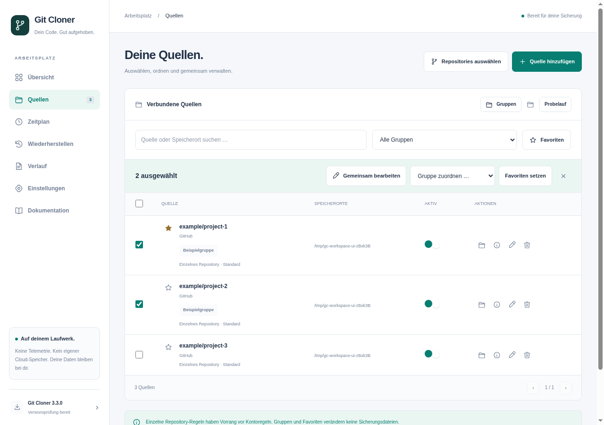

## 30. Mehrere Quellen gemeinsam bearbeiten

Quellen per Checkbox markieren und **Gemeinsam bearbeiten** öffnen. Alle Felder beginnen mit **Unverändert lassen**. Dadurch bleiben Unterschiede zwischen den ausgewählten Quellen erhalten. Nur ausdrücklich gewählte Werte werden ersetzt.

Neben Gruppe, Favoriten und Aktivierung sind gemeinsame Änderungen an Zielordner, kompatiblen Zugangsdaten, Fork-/Archivfiltern, Namensmustern, Sicherungsumfang und eigenen täglichen Prüfzeiten möglich. Für Sicherungsumfang und Zeitplan lassen sich auch wieder die globalen Optionen übernehmen. Bei gezielten Sicherungsänderungen bleiben alle nicht geänderten Optionen je Quelle erhalten. Ein bewusst leer gelassenes, aktiviertes Musterfeld entfernt die bisherigen Muster. Mirror und Submodule bleiben gegenseitig unvereinbar.

**Änderungen prüfen** zeigt pro betroffener Quelle **Bisher** und **Danach**, mit bis zu zehn Quellen pro Vorschauseite. Die Vorschau schreibt weder Sicherungen noch Laufwerkskennungen. Erst **Änderungen übernehmen** speichert die geprüfte Konfiguration gemeinsam. Wird zwischenzeitlich die Konfiguration geändert, muss die Vorschau neu erstellt werden; eine alte Vorschau überschreibt keine neueren Einstellungen. Eine Vorschau gilt höchstens fünf Minuten.

Ein geänderter Zielordner gilt für zukünftige Sicherungen. Bestehende Sicherungsordner bleiben an ihrem bisherigen Ort erhalten. Quellen und Sicherungsumfang können während laufender oder pausierter Durchläufe nicht geändert werden. Neue Verschlüsselungsoptionen benötigen ein entsperrtes Archivpasswort; unabhängige OS-Aufgaben benötigen zusätzlich das sichere Merken dieses Passworts.

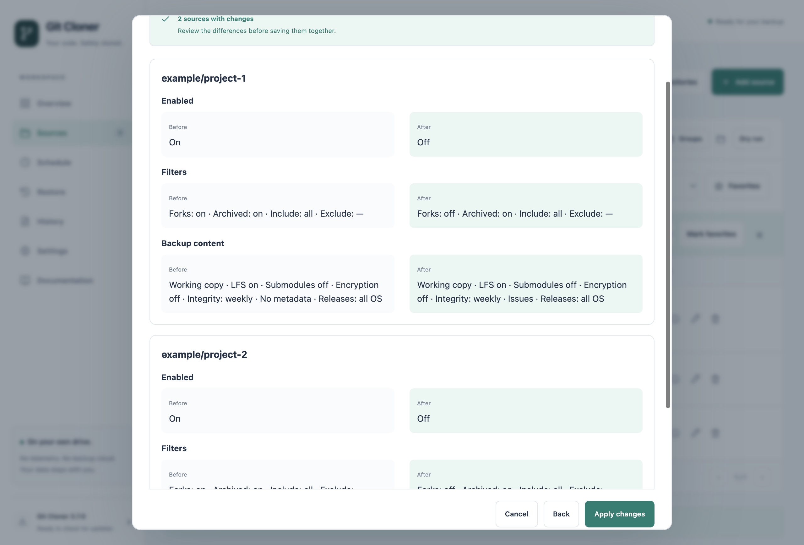

## 31. Große Release-Downloads fortsetzen

Beim optionalen Mitsichern von Release-Dateien behält die App geprüfte Dateiteile nach einem Netzwerkabbruch. Beim nächsten Versuch oder nach einem Programmneustart setzt sie passende Downloads mit HTTP-Range fort. Eine starke ETag-Kennung oder ausreichend alte, sichere HTTP-Änderungsdaten werden per `If-Range` geprüft; verfügbare SHA256-Angaben werden zusätzlich verifiziert. Ohne geeignete Kennung oder Prüfsumme wird sicher neu begonnen. Ignoriert der Server Range oder ändern sich seine Kennungen, wird die bisherige Datei nicht durch unpassend zusammengesetzte Teile ersetzt.

Die Fortschrittsanzeige nennt Datei, geladene Menge und gegebenenfalls **Fortgesetzt ab …**. Bereits vollständig zwischengespeicherte Dateien werden vor der Übernahme erneut geprüft. Nach einem Fehler bleibt der vorherige erfolgreiche Repository-Stand erhalten.

Der temporäre Ordner `.git-cloner-downloads` liegt im konfigurierten Zielordner und ist vom erfolgreichen Backup getrennt. Bei aktivierter Backup-Verschlüsselung sind auch dauerhaft gespeicherte Download-Teile einzeln mit AES-256-GCM verschlüsselt; das Archivpasswort wird dafür benötigt und nicht im Cache gespeichert. Nicht verschlüsselte Sicherungen verwenden Dateiteile mit eingeschränkten Dateirechten. Für Cache, neue Sicherung und Austausch wird vorübergehend zusätzlicher Platz benötigt.

Nach einer erfolgreichen Sicherung werden zugehörige eigene Cache-Dateien entfernt. Nicht weiterverwendete Teile, die älter als sieben Tage sind, werden bei erneuter Nutzung dieses Repository-Caches geprüft und bereinigt. Fremde Dateien, Links oder ungültige Kennungen werden nicht gelöscht. Wie bei bisherigen verschlüsselten Sicherungen können temporäre Klartextdaten im Arbeitsverzeichnis bei einem harten Prozessabbruch verbleiben; es gibt kein forensisch sicheres Löschen.

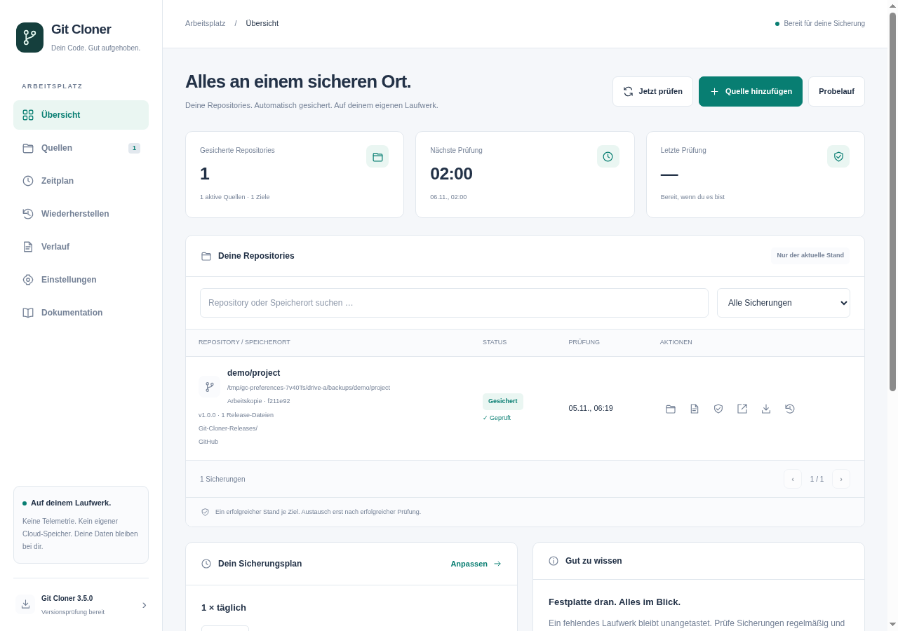

Weitere Detailansichten sind als [eigenes UI-Konzept](DETAILANSICHTEN.md) beschrieben. Die dort genannten zusätzlichen Funktionen sind noch keine implementierten Funktionen der Version 3.3.


## 32. Vorhandene Release-Dateien lokal übernehmen

Die Wiederverwendung ist automatisch aktiv. Wenn sich Git-Dateien, Release-Beschreibungen oder andere Metadaten ändern, werden bereits gespeicherte, unveränderte Release-Dateien lokal in den neuen Stand übernommen. Vor der Übernahme prüft die App das vorhandene Dateimanifest, die Dateikennung und den kopierten Inhalt. Verfügbare SHA256-Werte des Anbieters haben Vorrang; ansonsten werden Dateiname, ID, Größe und vorhandene Änderungsangaben beziehungsweise URL gebunden. Beschädigte oder geänderte Dateien werden erneut geladen.

Downloadzähler gehören nicht zum Änderungsvergleich. Allein die Anzahl fremder Downloads löst daher keine neue Sicherung aus. Bei vollständig unverändertem Stand bleibt die normale unveränderte Sicherung bestehen. Die Fortschrittsanzeige nennt eine lokale Übernahme ausdrücklich.

Bei verschlüsselten Sicherungen authentifiziert die App das bisherige Archiv und entsperrt es vorübergehend für die Wiederverwendung. Das passende Archivpasswort wird benötigt. Kann der alte Stand nicht sicher gelesen werden, wird die Datei neu heruntergeladen. Temporäre Klartextdaten werden danach entfernt; ein harter Prozessabbruch und forensisch sichere Löschung bleiben technische Grenzen.

## 33. Architektur und Dateitypen auswählen

Unter **Einstellungen → Sicherung → Release-Dateien** zunächst **Releases mit Download-Dateien** aktivieren. Dann Betriebssystem und **Prozessorarchitektur** auswählen. **Nur meine Architektur** verwendet die Architektur der laufenden Anwendung; eine konkrete Auswahl wie ARM64 oder x64 bleibt ebenfalls möglich. Universal-Pakete zählen als passend. Dateien mit unklarer Architektur werden bei einem konkreten Architekturfilter ausgelassen.

Unter **Dateitypen auswählen** die gewünschten Formate markieren. Ohne Markierungen sind alle Formate erlaubt. Mehrere Markierungen kombinieren sich: beispielsweise DMG und ZIP. Betriebssystem, Architektur und Dateityp wirken zusammen. Für ein ARM64-Mac-Beispiel **Nur mein Betriebssystem**, **ARM64** und **DMG** wählen. Auf anderen Systemen die eigene Auswahl treffen. Gemeinsame Prüfsummen und passende Signaturdateien werden weiterhin mitgesichert.

Die Auswahl gilt global oder über **Quelle bearbeiten → Sicherungsumfang dieser Quelle → Eigene Sicherungsoptionen verwenden** gezielt für ein Repository. Ein Filterwechsel baut den aktuellen Stand neu auf und übernimmt passende vorhandene Dateien lokal. Nicht mehr ausgewählte Dateien verschwinden erst mit einer erfolgreich geprüften Ersatzsicherung. Die Auswahl beschreibt Dateinamen des Anbieters; sie führt keine fremden Programme aus.

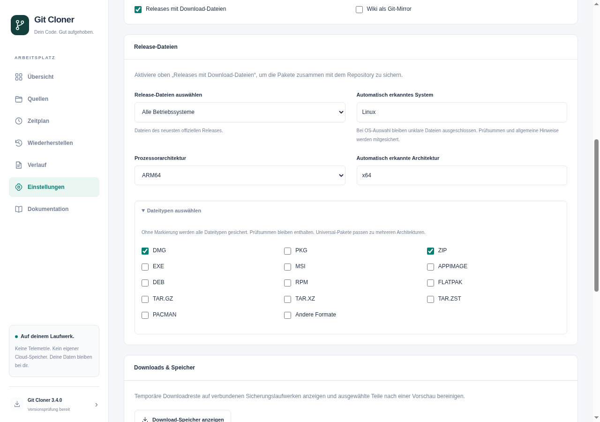

## 34. Download-Speicher kontrolliert bereinigen

**Einstellungen → Sicherung → Downloads & Speicher → Download-Speicher anzeigen** liest die verbundenen konfigurierten Sicherungsziele. Die Ansicht zeigt belegte Bytes der erkannten temporären Dateien, Teilanzahl, Zeitpunkt, Vollständigkeit und Verschlüsselung. Soweit zuordenbar, erscheint die Quelle. Verschlüsselte Downloadreste speichern keine unverschlüsselten Release-Dateinamen; die Anzeige kann daher allgemeiner ausfallen.

Einträge per Checkbox markieren und **Bereinigung prüfen** öffnen. Die Vorschau nennt Anzahl und Größe. **Zurück** verändert keine Dateien. Erst **Ausgewählte Teile bereinigen** entfernt die geprüften eigenen temporären Teile. Diese müssen beim nächsten Download erneut geladen werden. Fertige Sicherungen und installierte Programme werden dabei erhalten.

Während eigener Schreibvorgänge wird nicht bereinigt. Zusätzliche Sperren schützen aktive Downloads anderer App-Prozesse. Nach Änderungen an den Dateien oder Sicherungszielen ist eine neue Vorschau erforderlich. Fremde Dateien, Links, ungültige Kennungen und ausgetauschte Laufwerke werden nicht gelöscht. Die Anzeige ist auf 1.000 Einträge und je Eintrag auf 10.000 Teile begrenzt; Warnungen erläutern nicht prüfbare Bereiche.

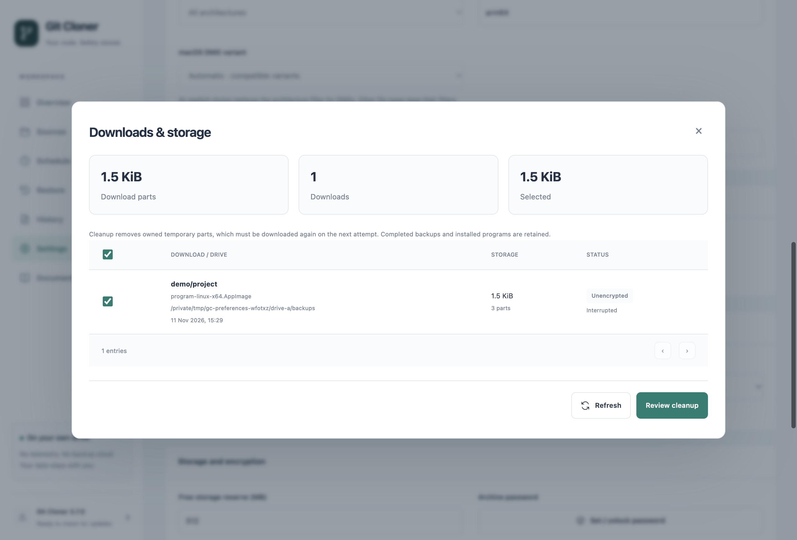

## 35. Programme aus einem Repository automatisch installieren

Diese Option aktualisiert **das Programm aus deiner gewählten Quelle**, nicht Git Cloner selbst. Sie ist zunächst aus und gilt nur für einzeln eingetragene Repositories. Eine Sammelquelle installiert keine neu entdeckten Programme automatisch.

1. **Quellen → Quelle hinzufügen/bearbeiten** öffnen und ein eigenes einzelnes Repository wie `beispiel-konto/beispiel-programm` eintragen.
2. **Programm automatisch installieren** aufklappen und **Neueste Release-Version installieren und ersetzen** aktivieren. Dadurch werden eigene Sicherungsoptionen mit Release-Dateien aktiviert. Waren Release-Dateien zuvor aus, wird zunächst das eigene Betriebssystem gewählt. Bereits aktive Release-Filter bleiben erhalten.
3. Einen bestehenden **Programm-Zielordner** getrennt von allen Sicherungsordnern wählen. Die App legt darin eine zugeordnete Ablage unter `Konto/Repository` an. Für andere Anbieter kommt eine eigene Anbieter-/Server-Zuordnung hinzu.
4. Optional den **Release-Dateinamen** eingrenzen: zum Beispiel `*.dmg`, `*portable*.exe` oder `*.AppImage`. `*` und `?` sind möglich. Ohne Muster wird ein passend klassifiziertes unterstütztes Paket bevorzugt; bei gleichwertigen mehreren Kandidaten wird eine genauere Auswahl verlangt.
   Standardmäßig bewahrt die Sicherung danach **nur die zu installierende Datei des neuesten Releases** auf, zum Beispiel genau ein DMG. Die übrigen Dateien dieses Releases und ältere Releases werden beim nächsten Lauf aus dem Sicherungsstand entfernt; bereits vorhandene passende Dateien werden dafür lokal übernommen statt neu geladen. Wer zusätzlich alle passenden Release-Dateien behalten möchte, aktiviert **Alle passenden Release-Dateien behalten**. Lässt sich keine eindeutige Programmdatei bestimmen, bleiben die gefilterten Dateien erhalten.
5. Quelle speichern und **Jetzt prüfen** starten oder den nächsten geplanten Lauf abwarten.

Nach der erfolgreichen Sicherung prüft die App die tatsächlichen Release-Dateien erneut und bereitet das Programm getrennt vor. Erst danach wird die vorhandene zugeordnete Programmkopie ersetzt. Ist Version und Inhalt bereits aktuell, bleibt die vorhandene Installation bestehen. Fehler erhalten den bisherigen Programmstand und erscheinen zusätzlich zum Sicherungsstatus sowie im Fehlerzähler, Verlauf und den eingestellten Fehlermeldungen. Die Übersicht zeigt den installierten Tag und bietet **Programmordner öffnen**. Programme werden durch die Installation nicht automatisch gestartet.

| System | Unterstützter automatischer Installationsweg |
| --- | --- |
| macOS | Ein eindeutig erkennbares `.app`-Bundle aus DMG oder ZIP. Signatur, Bundle und tatsächliche Prozessorarchitektur werden geprüft. Ad-hoc-signierte Bundles sind möglich; eigene Signierzertifikate werden nicht eingerichtet. Laufende Mac-Programme werden später erneut versucht. DMGs mit Lizenzdialog werden ohne Rückfrage über eine schreibgeschützte Kopie geöffnet; mit dem Einschalten der Installation stimmst du den Bedingungen dieses Herausgebers zu. Ein bereits im Finder geöffnetes DMG wird gelesen und bleibt geöffnet. Auf Apple-Silicon-Macs werden reine Intel-Programme nur gewählt, wenn kein natives Paket vorhanden ist; sie laufen über Rosetta 2. |
| Windows | Als Portable gekennzeichnete EXE oder ZIP mit einem eindeutig erkennbaren Hauptprogramm und Begleitdateien. PE-Kopf und tatsächliche Architektur werden geprüft. |
| Linux | AppImage mit passendem ELF-/AppImage-Kopf und Prozessorarchitektur. Die Datei wird ausführbar in der zugeordneten Ablage gespeichert. |

MSI-/NSIS-Systeminstallationen, PKG, DEB, RPM und beliebige Installationsskripte werden nicht automatisch ausgeführt. Es gibt keine automatische Rechteerhöhung. Wenn Rechte fehlen oder Windows eine verwendete Datei sperrt, bleibt der bisherige Stand erhalten. Bei importierten Einstellungen ist die Installation zunächst wieder deaktiviert und muss lokal je Quelle eingeschaltet werden.

Nutze die Option nur für Herausgeber, denen du vertraust. Bewahre persönliche Daten und Einstellungen außerhalb der verwalteten Programmkopie auf. Zusätzliche Dateien direkt im verwalteten Ziel oder fremde temporäre Ordner blockieren den Austausch. Zielwechsel behalten vorhandene Installationen am alten Ort; sie werden nicht ungefragt verschoben oder gelöscht. Ein harter Abbruch kann eigene temporäre Arbeitsdaten hinterlassen; ein unterbrochener Austausch wird beim nächsten Installationsversuch anhand seiner Kennungen wieder aufgenommen.

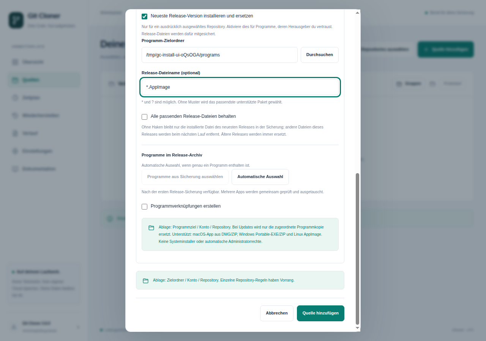
## 36. Programmverknüpfungen

Die Beispiele bleiben anonym: `beispiel-konto/programmsammlung`, ein selbst gewählter Sicherungsordner und ein davon getrennter Programmordner. Es wird kein Beispiel-Repository automatisch eingetragen.

1. **Quellen → Quelle bearbeiten → Programm automatisch installieren** öffnen.
2. Die Installation einschalten und einen bestehenden Programm-Zielordner wählen, falls noch nicht eingerichtet.
3. **Programmverknüpfungen erstellen** einschalten. Als Vorschlag erscheint der vom Betriebssystem gemeldete Desktop-/Schreibtischordner; über **Durchsuchen** lässt sich ein anderer bestehender Ordner wählen. Er muss außerhalb der Sicherungs- und konkreten Programmablage liegen.
4. **Änderungen speichern** und **Jetzt prüfen** ausführen oder den geplanten Lauf abwarten.

Nach erfolgreicher Installation erhält jedes gewählte Programm eine Verknüpfung: macOS eine symbolische Finder-Verknüpfung zur `.app`, Windows eine echte `.lnk`, Linux einen `.desktop`-Starter. Die App startet dabei kein heruntergeladenes Programm. Unter einigen Linux-Desktops muss das Starten einer Desktop-Datei einmal ausdrücklich erlaubt werden. Windows-Verknüpfungen werden über die native Electron-Schnittstelle erzeugt, ohne den Programmcode auszuführen.

Verknüpfungen zeigen auf den aktuellen verwalteten Programmstand. Bei einer geänderten Auswahl werden nur eigene unveränderte Verknüpfungen entfernt; nach einem Ordnerwechsel werden erst die neuen angelegt. Eine vom Benutzer bearbeitete oder fremde Datei wird nicht überschrieben oder gelöscht. In diesem Fall erscheint eine Meldung zusätzlich zur erfolgreichen Programminstallation. Die Zuordnung liegt in einem versteckten Begleitordner im gewählten Verknüpfungsordner. Wird diese Zuordnung entfernt, behandelt die App übrig gebliebene Dateien vorsichtig als fremd.

Zum Entfernen eigener Verknüpfungen die Option ausschalten, speichern und noch einmal prüfen lassen. Das bloße Deaktivieren der gesamten Programminstallation oder einer Quelle entfernt vorhandene Programme und Verknüpfungen nicht. Alte Programmkopien an früheren Zielorten bleiben ebenfalls erhalten.

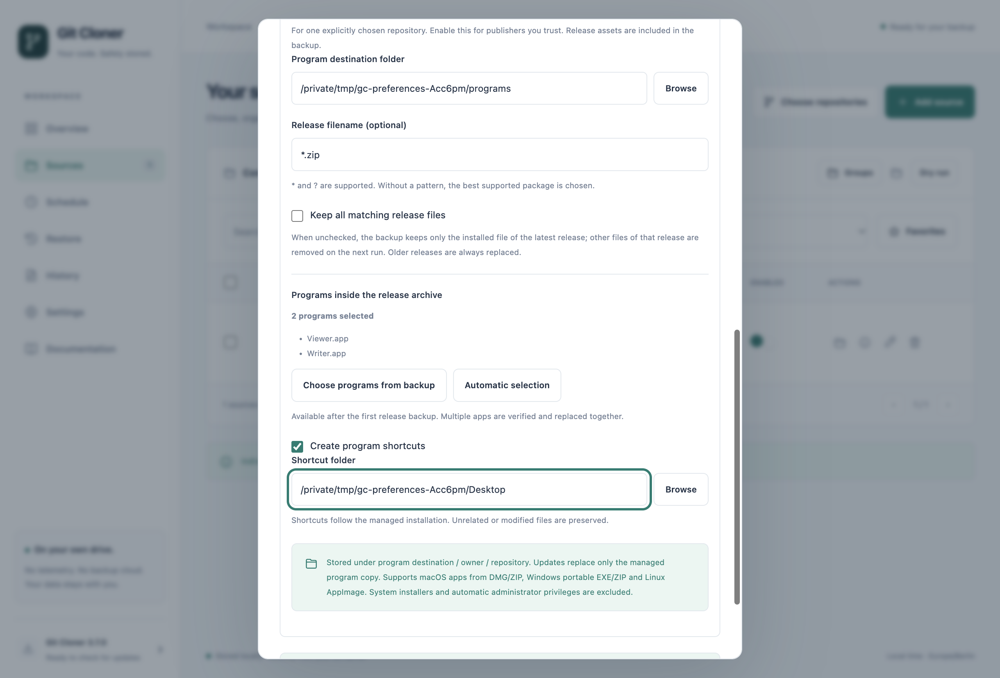

## 37. Mehrere Programme aus einer Release-Datei

1. Ein einzelnes Repository mit **Release-Dateien** sichern. Falls das Archiv mehrere Programme enthält, kann die zunächst nicht eindeutige Installation eine Meldung erzeugen; die Release-Sicherung bleibt erfolgreich erhalten.
2. Die gespeicherte Quelle bearbeiten und **Programm automatisch installieren → Programme aus Sicherung auswählen** öffnen. Bei mehreren gleichwertigen Release-Paketen zunächst den **Release-Dateinamen** eingrenzen, etwa mit `*suite*.zip`.
3. Die App öffnet ausschließlich die vorhandene geprüfte Release-Datei. Unter macOS werden `.app`-Bundles aus DMG/ZIP angezeigt, unter Windows mögliche Hauptprogramme aus einem Portable-ZIP. Signatur/Programmformat und CPU werden vor der Auswahl geprüft; nicht passende Einträge bleiben deaktiviert. Linux-AppImages und einzelne Portable-EXEs bleiben einzelne Programme.
4. Zwischen einem und 64 Programme auswählen, **Auswahl übernehmen** und anschließend die Quelle mit **Änderungen speichern** sichern. **Abbrechen** übernimmt keine Auswahl. **Automatische Auswahl** setzt die Auswahl auf das bisherige Verhalten mit einem eindeutig erkannten Programm zurück.
5. **Jetzt prüfen** starten. Die ausgewählten Programme werden gemeinsam vorbereitet und die zugeordnete Installation erst nach vollständiger Prüfung ausgetauscht. Auch eine geänderte Auswahl bei identischem Release löst den erforderlichen Austausch aus.

Die Auswahl verwendet die Pfade innerhalb des Archivs und gilt für spätere Releases. Ändert ein Herausgeber diese Pfade oder fehlt eine gewählte App, bleibt die vorherige Installation erhalten. Dann die Auswahl aus der neuen Sicherung erneut öffnen. Läuft eine der verwalteten Mac-Apps noch, wird der Austausch bei einer späteren Prüfung erneut versucht.

Windows-Portable-Programme benötigen oft gemeinsame DLLs und Hilfsdateien: Der zugehörige Portable-Ordner wird mitsamt Begleitdateien kopiert. Weitere EXEs können deshalb als Begleitdateien vorhanden bleiben; ausgewählt werden die zu verwaltenden Hauptprogramme und ihre Verknüpfungen. Es werden weiterhin keine MSI-/NSIS-/PKG-Systeminstaller oder beliebigen Installationsskripte ausgeführt.

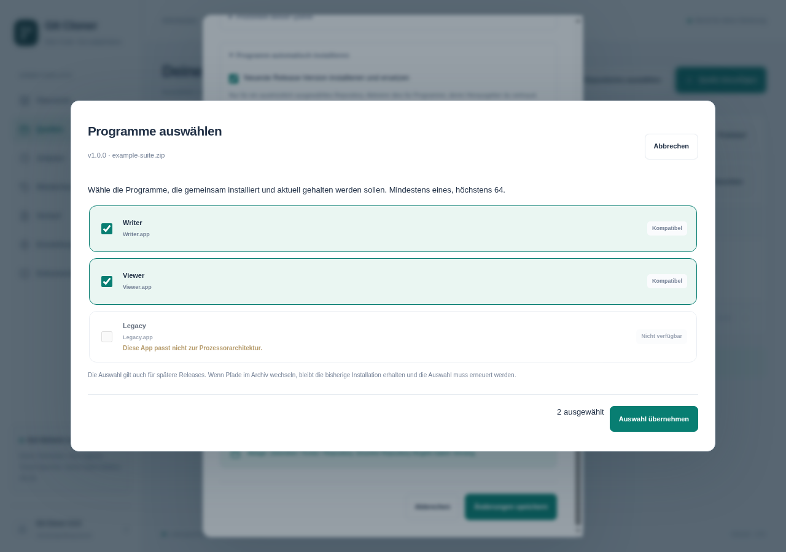

## 38. Download-Verlauf und gemessene Ersparnis

**Einstellungen → Sicherung → Downloads & Speicher → Download-Verlauf anzeigen** öffnet die neue Übersicht. Sie liest den Verlauf erst beim Öffnen oder Aktualisieren und benötigt dafür keinen GitHub-Abruf.

| Wert | Messgrundlage |
| --- | --- |
| Empfangene Release-Nutzdaten | Tatsächlich aus den Antwort-Streams gelesene Dateibytes, einschließlich fehlgeschlagener Versuche. HTTP-/TLS-Header und sonstiger Protokollverkehr sind nicht enthalten; komprimierte Antworten werden nach der Dekodierung gezählt. Git-Klon- und Metadatenverkehr gehört nicht zu diesem Wert. |
| Datenabruf vermieden | Inhaltlich geprüfte lokal übernommene Dateien sowie bereits vor diesem Abruf vorhandene, später erfolgreich verwendete Downloadteile. Innerhalb desselben Versuchs neu empfangene Teile werden auch bei Wiederholungen nicht als Ersparnis gezählt. Unveränderte Repository-Prüfungen erzeugen keine erfundenen Dateieinsparungen. |
| Cache-Dateibytes bereinigt | Vor erfolgreichem Entfernen gemessene Größen eigener temporärer Dateien einschließlich Cache-Kennungen. Automatische Bereinigung nach einem Backup und manuelle Bereinigung sind enthalten. Physisch freie Kapazität kann wegen Dateisystemblöcken, Kompression und gemeinsam belegten Blöcken abweichen. |

Nach Repository, Dateiname oder Tag suchen und nach **Ergebnis** oder **Zeitraum** filtern. Die Kennzahlen gelten immer für alle gefilterten Treffer, nicht nur für die sichtbare Seite. Jede Seite enthält höchstens 50 Einträge; der Verlauf behält maximal 2.000 Ereignisse. Es werden keine historischen Werte nachträglich erfunden und keine vermeintlich gemessenen Zeitgewinne geschätzt.

Der Verlauf wird lokal im App-Profil gespeichert und bleibt nach Neustarts erhalten. Schreibvorgänge sind gebündelt; der erste Eintrag sowie Zustands- und Laufabschlüsse sichern ausstehende Einträge. Bei einem harten Prozessabbruch können noch nicht geschriebene Ereignisse fehlen. Auch Bereinigung kann keine verlorenen alten Einträge rekonstruieren. Bei verschlüsselten Sicherungen werden Dateinamen der Release-Dateien nicht in den Verlauf geschrieben; Repository-Namen und Tags bleiben wie im vorhandenen Sicherungsstatus sichtbar. Einträge mit **Fehlgeschlagen** zählen empfangene Nutzdaten, aber keine erfolgreich vermiedenen Dateidownloads.

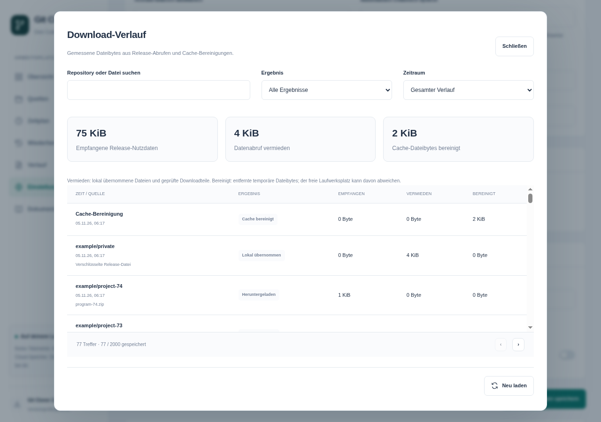

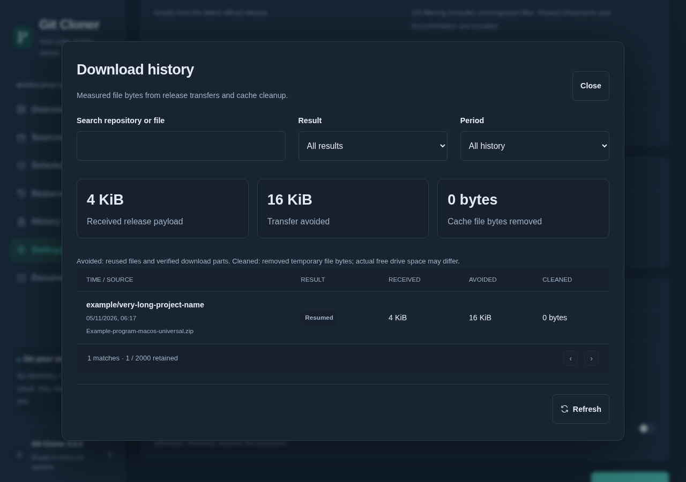
