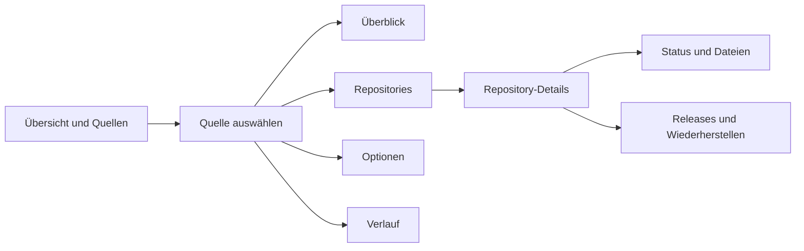

# Geplanter Aufbau der Detailansichten

Dies ist das Konzept für die weitere Oberfläche. Version 3.3 implementiert Repository-Auswahl, Gruppen/Favoriten, fortsetzbare Release-Downloads und Mehrfachbearbeitung. Zusätzliche Detailleisten, Prognosen, Dateivorschauen oder automatische Probe-Wiederherstellungen sind hier **geplant**, noch nicht implementiert. Alle Namen sind neutrale Beispiele.

## Ein gemeinsames Grundmuster

Die Hauptübersicht zeigt weiterhin nur Sicherungszustand, letzte erfolgreiche Prüfung, nächste Prüfung und wichtige Meldungen. Ein Klick auf einen Eintrag öffnet dessen Details. Suche, Filter, Auswahl und Scrollposition bleiben beim Zurückkehren erhalten.

Auf breiten Fenstern öffnet sich rechts eine etwa 440–560 Pixel breite Detailleiste über der Liste. Bei schmaleren Fenstern erhält der Inhalt eine eigene Ansicht mit **Zurück**. So wird eine Tabelle nicht zwischen Seitenleiste und Detailbereich zusammengedrückt. Die bestehende Navigation bleibt erhalten.

Jede Detailansicht verwendet dieselbe Anordnung:

1. **Kopf:** Name, Anbieter, Status sowie Gruppe/Favorit. Ein Schließen- beziehungsweise Zurück-Knopf liegt immer an derselben Stelle.
2. **Zusammenfassung:** zwei gleich hohe Felder für letzte erfolgreiche Sicherung und nächste Prüfung. Wichtige Fehler stehen direkt darunter mit passender Fehlerhilfe.
3. **Reiter:** wenige klar benannte Bereiche. Umfangreiche Inhalte werden erst beim Öffnen ihres Reiters geladen.
4. **Aktionen:** eine eindeutige Hauptaktion und wenige Nebenaktionen. Speichern und Wiederherstellen benötigen eine sichtbare Auswahl beziehungsweise Vorschau.

## Quellen

| Reiter       | Inhalt                                                                                                                                    | Hauptaktion                     |
| ------------ | ----------------------------------------------------------------------------------------------------------------------------------------- | ------------------------------- |
| Überblick    | Anbieter, zugewiesenes Konto, Laufwerke, letzte/kommende Prüfung und aktuelle Hinweise.                                                   | Jetzt prüfen                    |
| Repositories | Suchbare, paginierte Liste der zugehörigen Repositories mit Sicherungsstatus. Bei einer Kontoquelle erst nach Bedarf beim Anbieter laden. | Repository öffnen               |
| Optionen     | Zielordner, Filter, Umfang und Zeitplan; sichtbar zwischen übernommenen globalen und eigenen Werten unterscheiden.                        | Änderungen prüfen / speichern   |
| Verlauf      | Auf diese Quelle begrenzte Läufe und Fehler. Die Aufbewahrungsgrenzen werden sichtbar ausgewiesen.                                        | Details / anonymisierter Export |

Gruppen/Favoriten stehen im Kopf statt als weiterer Reiter. Bei einer Mehrfachauswahl erscheint die gemeinsame Aktionsleiste; individuelle Unterschiede bleiben bis zur ausdrücklichen Änderung erhalten.

## Einzelne Repository-Sicherungen

| Reiter           | Inhalt                                                                                                                                      |
| ---------------- | ------------------------------------------------------------------------------------------------------------------------------------------- |
| Status           | Aktueller Commit, Git-Modus, Datenumfang, Verschlüsselung, letzte Integritätsprüfung und nächste geplante Prüfung.                          |
| Dateien          | Vorhandene Dateien und Ordner seitenweise durchsuchen; spätere Text-/Bildvorschau mit Größenbegrenzung.                                     |
| Releases         | Aktueller gesicherter Release, OS-Auswahl, Dateinamen, Größen und Prüfergebnisse. App-Versionsmeldungen bleiben davon getrennt.             |
| Wiederherstellen | Gesamte Sicherung oder ausdrücklich ausgewählte Dateien an einen neuen Ort wiederherstellen. Ziel und Auswahl vor dem Start zusammenfassen. |

Eine spätere automatische Probe-Wiederherstellung erhält hier ein eigenes Ergebnis mit Datum und Fehlerhilfe. Bis diese Funktion implementiert ist, erscheinen dafür keine leeren Platzhalter oder fiktiven Erfolgsanzeigen.

## Laufwerke und Speicher

Eine Laufwerksansicht soll freien/belegten Platz, zugeordnete Quellen und Erreichbarkeit zusammenführen. Ein späterer Speichertrend wird als Schätzung gekennzeichnet und benötigt tatsächlich erfasste Messwerte.

**Temporäre Downloads** erhält einen eigenen Bereich: belegter Platz, betroffene Dateien, letzte Aktivität und eine kontrollierte Bereinigung ausschließlich eigener Cache-Dateien. Während aktiver Schreibvorgänge bleibt Bereinigen gesperrt. Ein späteres **Sicher auswerfen** wird nur für passende Datenträger und nach Abschluss aller eigenen Vorgänge angeboten.

## Darstellung, Bedienung und Performance

- Zwei Spalten für vergleichbare Felder, einheitliche Steuerungshöhen und ausreichend Platz für lange Namen. Auf schmaleren Fenstern wechseln die Felder gemeinsam in eine Spalte.
- Dieselben Farben, Abstände und Symbole wie in Version 3.3. Status wird mit Text und Symbolen zusätzlich zur Farbe erklärt.
- Tastaturbedienung, sichtbarer Fokus, sinnvolle Fokus-Rückkehr und passende Screenreader-Bezeichnungen. Große Schrift und Dunkelmodus werden weiterhin getestet.
- Listen bleiben paginiert. Keine vollständigen Dateibäume oder Repository-Kataloge beim Öffnen der Hauptübersicht laden.
- Fortschrittsmeldungen aktualisieren ihren Bereich; sie ersetzen keine Eingaben oder Tabellen und verschieben den Tastaturfokus nicht.
- Anbieterabfragen werden begrenzt, zwischengespeichert und beim Verlassen einer Ansicht abgebrochen. Keine zusätzliche Telemetrie oder Servereinrichtung.
