# Git Cloner 3 — anonymized guide

All account names, repository names and drive paths below are neutral placeholders. **The application starts with no configured sources.** Replace examples with your own details. Screenshots use isolated local test profiles without credentials.

## Install

Use the [official GitHub releases](https://github.com/Ujap1994/Git-Cloner/releases) and check `SHA256SUMS.txt`. Packaged applications do not require Node.js. Install Git and, if you enable LFS, Git LFS. Flatpak includes both.

- **macOS:** choose Universal, Apple Silicon ARM64 or Intel x64. Drag the app from the DMG to Applications. Install Git using `xcode-select --install` if needed.
- **Windows:** install Git for Windows with PATH integration, then choose the x64/ARM64 installer or Portable executable.
- **Ubuntu/Mint:** install Git and use `sudo apt install ./PACKAGE.deb`.
- **Fedora:** use `sudo dnf install git ./PACKAGE.rpm`.
- **Arch/CachyOS:** use `sudo pacman -U ./PACKAGE.pkg.tar.zst`.
- **AppImage:** install Git, make the file executable and run it. FUSE may be required; extraction with `--appimage-extract` is an alternative.
- **Flatpak:** install the bundle using `flatpak install --user ./PACKAGE.flatpak`, then run `flatpak run io.github.Ujap1994.GitCloner`. Flathub must be configured for the runtime. A bundle does not imply a published Flathub listing.

Packages do not have a verified publisher signature. macOS builds use a technical ad-hoc signature and are not notarized. macOS Privacy & Security or Windows SmartScreen may require approval after checking the source and checksum. Certificate setup, automatic update downloads and automatic installation are excluded.

Keep Portable/AppImage files at a permanent location before enabling login startup or OS scheduling. Reconfigure those options after moving the executable. Portable still stores settings in the regular user profile.

## Add your sources

Connect your external drive and create a writable folder, for example `/Volumes/BackupDisk/GitHub`, `E:\GitHub-Backups` or `/media/backup-disk/GitHub`. The app records a random identity in `.git-cloner-volume.json`; keep this file. Missing drives are never replaced with a newly created local folder.

Open **Sources → Add source**. Enter one account, organization or repository per line:

```text
example-account
another-account/tool
```

GitHub HTTPS URLs also work. An account source selects that account's own repositories visible to the chosen credentials. Pick an existing destination. Files are stored at `Destination/Owner/Repository`. An explicit repository rule takes priority over an overlapping account rule.

Expand the advanced section to select credentials, exclude forks or archived repositories, use include/exclude patterns (`*` and `?`), and add up to nine additional destinations. Each target is an independent backup. Exclusions take priority over includes.

Select **Check now** for the first run. The previous successful backup is replaced only after the new copy has passed verification. Failed or deleted remote sources do not automatically delete existing backups. Search, status filtering and pages of up to 75 rows keep large lists usable.

## Backup options

Under **Settings → Backup**, choose a shallow snapshot of the current default branch or a full bare mirror containing all branches, tags and Git history. Mirrors use incremental fetch. Enable actual LFS downloads if needed. Recursive submodules are supported for snapshots using HTTPS; they cannot be combined with mirror mode.

From version 3.3, downloaded release files are visible under **`destination / owner / repository / Git-Cloner-Releases`** with their original filenames. The overview shows this location and provides **Open release folder**. A numbered alternative protects an existing repository-owned folder. Encrypted backups keep this folder inside `backup.gcb`; use **Restore release assets** and unlock the archive. Legacy hidden `.git/git-cloner-metadata/release-assets` backups remain restorable and migrate on their next successful check.

Optional metadata exports include issues/comments, pull requests/reviews/comments/file changes, releases/assets and a Wiki mirror. They are local exports, not an automatic GitHub reimport. Missing or inaccessible Wikis produce an explicit message; a later Wiki fetch failure preserves an existing backup that already contains its Wiki.

New backups have Git checks and SHA256 manifests. Existing backups are checked weekly by default; always/manual policies are available. A detected damaged managed backup is rebuilt during the next run only if a valid replacement can be obtained. Free-space checks include a reserve, but GitHub's size estimate may not cover large LFS and release assets.

There is **one successful version per repository and destination**, without historical folder rotation. During replacement, both the old and new version need space. A mirror's internal Git history belongs to that single backup. Do not develop inside managed backup folders.

## Encryption and restore

Set an archive password of at least twelve characters under **Settings → Backup**, optionally remember it in the secure OS vault, enable encryption and save. Backups then contain `backup.gcb` and a management marker. AES-256-GCM and scrypt protect archive contents; surrounding owner/repository paths and status markers remain visible.

**A lost password cannot be recovered.** Keep an independent copy. After changing it, backups not yet successfully replaced still need the old password. A session-only password must be re-entered after restart. An independent encrypted worker requires a saved password and an accessible secure OS vault.

Private plaintext temporary files exist on the internal drive during processing and are removed afterwards; removal is not forensic secure erasure. Regular encrypted checks validate the archive hash. Manual verification also decrypts and checks Git plus every file. Authentication finishes before extraction.

Open **Restore**, select a known backup or a `.gcb` file, choose an existing parent directory and a **new folder name**. Existing folders are never overwritten. The result is verified before becoming the final destination. No GitHub login is needed for local recovery. Restored mirrors remain bare; create a working copy using `git clone /PATH/TO/MIRROR /NEW/WORKING/FOLDER`.

## Schedule and drives

Choose 1–24 daily checks under **Schedule** and set a separate time for each. All times use the local system timezone. Background mode keeps the app running in the tray/menu bar. Login startup is available for installed applications.

Optional independent OS scheduling creates a user LaunchAgent on macOS, a Windows task or a systemd user timer on Linux. A windowless worker can then run with the GUI closed. App and worker share a process lock. Flatpak and development builds use the in-app scheduler instead.

The computer must be **powered on, awake and in the signed-in user context**. The app does not wake it. The in-app scheduler catches up the latest missed check of the current day once. Drive-reconnection checks poll configured paths approximately every 30 seconds while the app is running, including tray mode; they cannot start a fully closed app.

## Accounts and privacy

Public sources require no token. Under **Settings → Accounts**, create named credentials and select them per source. Personal Access Tokens need read access to repository contents; optional metadata needs the relevant issues/pull-request permissions. Organization approval or SSO may be required.

Device Flow is supported but requires the public client ID of a GitHub OAuth app with Device Flow enabled. This project does not supply a shared OAuth app. No client secret is required. PATs and public access remain available without registering an OAuth application.

Tokens and optionally the archive password use Electron `safeStorage`. The unsafe Linux `basic_text` fallback is rejected. Secrets are never returned with UI state, stored in Git remote URLs or included in settings exports. There is no telemetry or proprietary backup server.

Settings export/import excludes tokens and passwords, **but includes source names and paths**. Review before sharing. The diagnostic export removes names, paths, commit IDs and raw error messages. Never share `secrets.enc` or assume raw settings/state/history files are anonymous.

## Update notices and appearance

Startup and six-hourly checks compare the running app against the latest official stable GitHub release. A newer version shows a banner linking to its release page, with one system notification if enabled. **Skip this version** persists across restarts; the same or lower release stays hidden. Only a higher version triggers a new notice. Reset the skipped version under **Settings → General** if needed.

No update is downloaded or installed automatically. Download the appropriate official package and install it yourself after active backups have finished.

Under **Settings → Appearance**, choose English/German, system/light/dark and one of three text sizes. Controls retain matching heights and the choice persists.

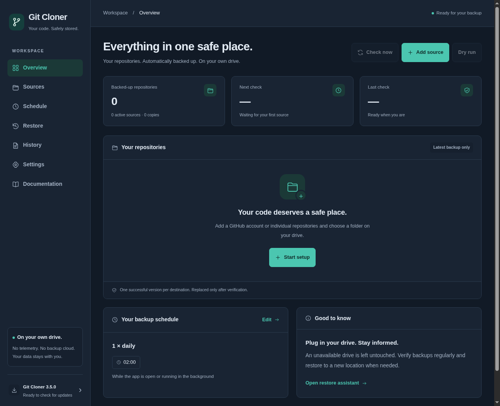

## Version 3: setup, preview and queue

The empty overview offers **Start setup**: enter your own sources, choose an existing folder, then configure daily check times. No source is prefilled. **Dry run** shows matching/excluded repositories, planned paths and estimated space without creating backups or drive identities. API requests still count toward GitHub limits; LFS and release assets may exceed the size estimate.

During a run, **Pause after active repos** stops dispatching new work after already active repositories finish. **Resume** skips completed targets, including after restarting the application. **Discard queue** removes only the remaining run, preserving existing backups. Sources and backup content remain fixed while a queue waits; performance rules, appearance and future schedule times can be changed. A hard crash may repeat recent checks whose checkpoint had not yet been written.

## Performance and network rules

Under **Settings → Performance & rules**, configure 1–4 concurrent small tasks (default 2), the small-repository threshold (default 50 MiB), network retries (default 2), and a shared download limit in KiB/s (0 means unlimited). At most two small tasks run per detected volume. Mirrors, LFS, submodules, metadata and encryption run exclusively.

The download limit includes Git/LFS and release assets plus transport overhead. API JSON, uploads and other applications are excluded. A local opaque HTTPS tunnel preserves TLS verification and supports an inherited HTTP/HTTPS proxy. Unsupported proxy protocols fail explicitly. Transient network failures use bounded backoff; permission and disk failures are not retried automatically. Nested retries do not multiply the attempt budget.

Optional AC-only and exact Wi-Fi-name rules apply before the first repository lookup. Unknown required states keep the queue waiting. Rule pauses resume automatically while the app is running, approximately every 30 seconds; user pauses and interrupted runs require explicit Resume. Independent workers retry policy queues on later launches. macOS may hide SSIDs for privacy reasons; Linux uses NetworkManager's `nmcli`, which may be unavailable in Flatpak. Leave the optional Wi-Fi list empty to allow all networks. There is no universal cellular-plan detection.

## Source-specific backup options

Expand **Backup content for this source** in the source editor and enable its own options. Choose Git mode, LFS/submodules, metadata, integrity and encryption independently of the global defaults. The disk reserve is copied when enabling source options. All destinations belonging to that source use the same content rules. Disable the override to inherit global settings again.

## Selective recovery

Choose a backup/archive under **Restore**, enter its archive password if needed, then choose **Selected files or folders** and **Choose files**. Browse directories and mark individual entries or whole folders. Select a new output folder as usual. Relative paths are preserved and overlapping selections do not duplicate files. Mirrors show files from HEAD and resolve available LFS objects to real content; full bare-mirror recovery remains available.

Version 3 backups include a separate manifest hash. Browsing checks that manifest, and recovery verifies each selected file. Intact files can therefore be rescued even if unrelated files are damaged. Older backups without that manifest hash use the existing full verification first. Windows-incompatible names are rejected explicitly.

Encrypted archives must first be fully authenticated and extracted to private local temporary storage. Browsing expires five minutes after the last interaction. Closing the browser, leaving Restore or quitting normally removes plaintext; an active restore keeps its session alive until completion. Hard process termination may leave OS temporary files. Removal is not forensic secure erasure.

## Dashboard and accessibility

The overview adds elapsed time, approximate remaining time, measured downloads, tracked backup size, free space and a seven-local-day chart. It flags errors and backups not checked for over 48 hours. Older records may lack byte counts. Empty first-run profiles concentrate on setup.

**High contrast** is available under Appearance. Tabs support arrows/Home/End, a skip link leads to main content, and state changes have accessible announcements. This is not a claim of external accessibility certification.

| Shortcut | Action |
| --- | --- |
| Cmd/Ctrl + K | Open the overview and existing search field. |
| Cmd/Ctrl + N | Add a source when no queue is active/waiting. |
| Cmd/Ctrl + B | Start a check with configured sources. |
| Cmd/Ctrl + Shift + P | Request pause or resume. |
| Cmd/Ctrl + comma | Open settings. |
| F1 | Show shortcuts. |
| Escape | Close a dialog. |

## Troubleshooting

| Issue | Action |
| --- | --- |
| Git not found | Install Git, check PATH and restart. Finder-started macOS apps may have a different environment from the terminal. |
| Drive missing/identity mismatch | Connect the original drive or deliberately configure a new destination. |
| Existing foreign folder | Choose a new target or move your own data safely. The app will not overwrite it. |
| GitHub 401/403 | Check token validity, permissions, organization SSO and rate limits. |
| Missing LFS | Install Git LFS or disable the option. The previous successful backup stays intact. |
| Password error | Enter this archive's original password, including the old password after a recent change if applicable. |
| No automatic check | Confirm enabled sources, saved times, awake computer, running app or enabled native worker. |

For deeper setup, additional screenshots and OS details, see the [German guide](ANLEITUNG.md). [Architecture](ENTWICKLUNG.md), [distribution catalogs](PAKETVERZEICHNISSE.md) and [validation results](VALIDIERUNG.md) describe technical details and outstanding external publication/hardware steps.


## New in 3.1: schedules, releases and previews

**Per-source schedules:** open Sources → Edit source → Check times for this source. Enable custom times, choose 1–24 checks and enter each local time. “Manual only” disables scheduled runs for that source. Without an override, the general schedule applies. The global schedule pause also pauses custom source schedules. Each source has its own persisted checkpoint; manual checks still process all enabled sources. Native OS scheduling combines the enabled sources’ times.

**Release assets:** under Settings → Backup, enable releases with downloadable assets, then choose all operating systems or the automatically detected Windows, macOS or Linux. The filter includes all architectures of that OS. Unknown package names are excluded in OS mode; shared checksums and documentation remain included. Choose all systems when a required asset has an unrecognized name. The latest official stable release’s assets are kept in the single current backup; older release metadata can remain in JSON exports. Automatic GitHub source archives are not downloaded separately. Git data follows your snapshot/mirror choice.

Release downloads are checked against declared sizes and available GitHub SHA256 digests. A failed download keeps the previous successful backup. Use the overview’s “Restore release assets” action to select individual packages and copy them into a new folder. Encrypted backups and mirrors are supported. Programs are never installed or executed automatically.

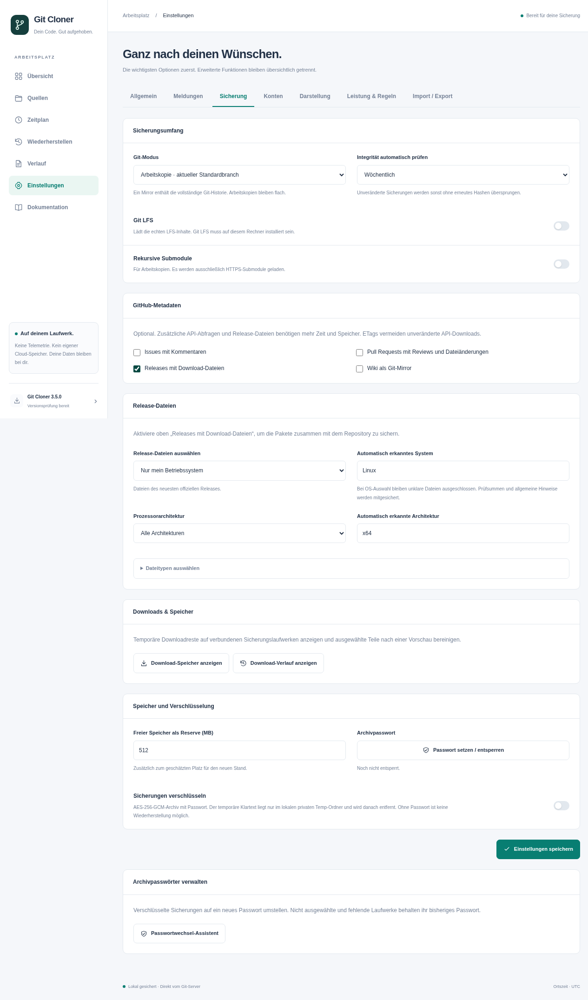

**Change preview:** choose “Review changes” on an existing backup. Search the added, modified and deleted files, then select a file to load a text diff. Text previews are limited to 256 KiB per version. Large files and submodules are listed; binary and LFS files have no text preview. A truncated GitHub tree can prevent a complete preview while regular backups remain available. The saved backup is unchanged and no project code runs. Backups wait while the dialog is open; closing or expiry releases the session. “Check all enabled sources” starts the regular run after closing.

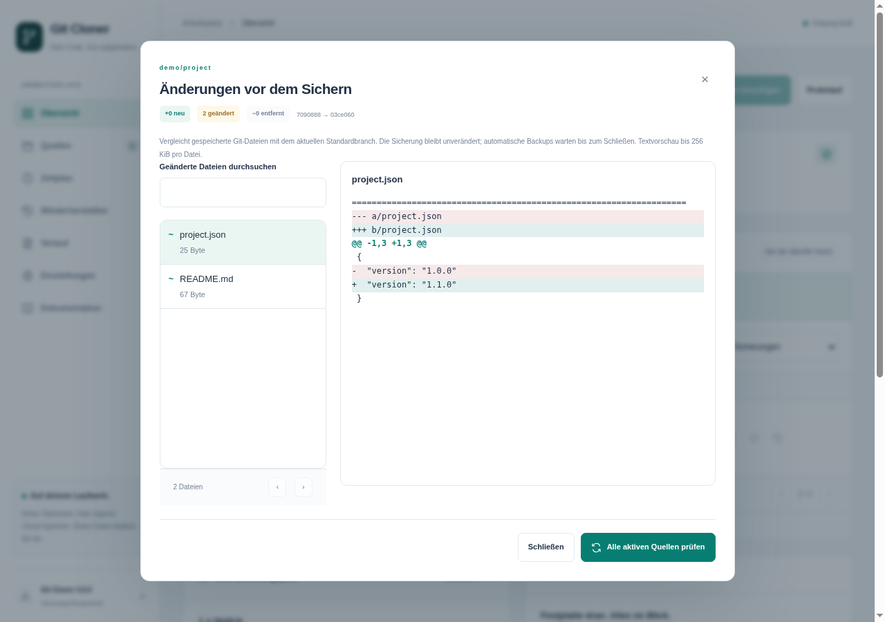

**Moved drives:** enable automatic path reassignment under Schedule or search connected drives from Sources. The saved folder marker and relative path identify known destinations. Only unique matches are applied; copied markers require manual selection. Current records and paused queues are updated without repeating completed work. No replacement directory is created at a missing old path. Folder markers are not physical hardware serial numbers.

**Notifications:** Settings → Notifications offers all completed checks, errors only, changes and errors, or no backup notices. Version notices have a separate setting. Daily quiet hours can span midnight. Backup notices are not queued; a pending version notice can appear after quiet hours while the app is active. In-app status remains available. Skipped versions stay hidden until a higher official version is released.

## New in 3.2: GitLab and Forgejo

In **Sources → Add source**, choose GitHub, GitLab or Forgejo and the matching HTTPS server. No repositories are preconfigured. GitLab supports subgroup paths: explicitly select **Account / organization / group** for `example-group/subgroup`; use **Individual repository** for `example-group/subgroup/project`. Group discovery includes subgroups and excludes externally shared projects. Forgejo accepts accounts/organizations and `owner/project`.

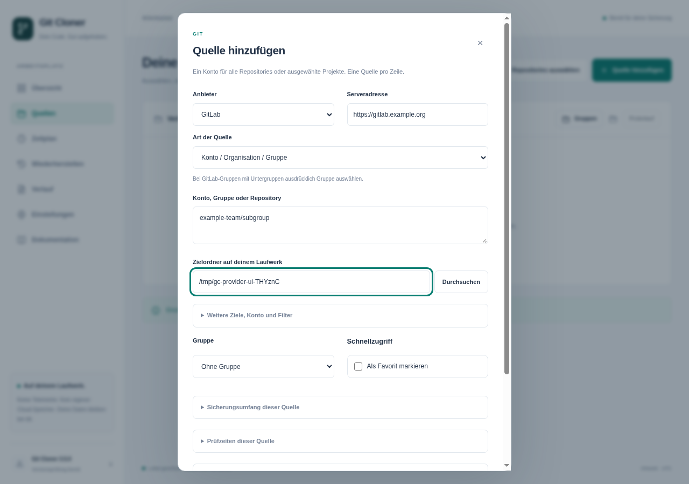

For private sources, add an account under **Settings → Accounts** with the same provider and exact server, then assign it to the source. Forgejo also needs your username. GitLab tokens need suitable API/repository read access; Forgejo scopes depend on selected data. Tokens require a secure OS key store. **Public · no token** never borrows the default GitHub token for another provider. Device sign-in remains specific to GitHub. Other providers receive a stable server-specific parent folder, preventing identical repository names on different hosts from colliding.

Snapshots, mirrors, LFS, HTTPS submodules, encryption and restoration apply to all three providers. GitLab metadata includes issues/notes, merge requests/notes/diffs, releases/assets and wiki. Forgejo includes issues/comments, pull requests/reviews/files, releases/assets and wiki. Server permissions and API truncation still apply. This is not an export of every CI, registry or administration resource. Forgejo 17.0.1 is tested with a real private HTTPS service; GitLab uses controlled API scenarios and real public API checks. Private SSO/proxy installations need their normal server permissions.

## Search and export history

Open **History**, search repositories, filter errors/changes and choose inclusive dates in local time. **Details** retains the repository search and pages through results. Select runs and export them anonymously; without a selection, export all matching saved runs. An individual export includes the complete retained run. Repository names become neutral IDs; private paths, credentials and raw errors are removed. Retention remains 100 completed runs and at most 500 detail results per run; truncation is displayed.

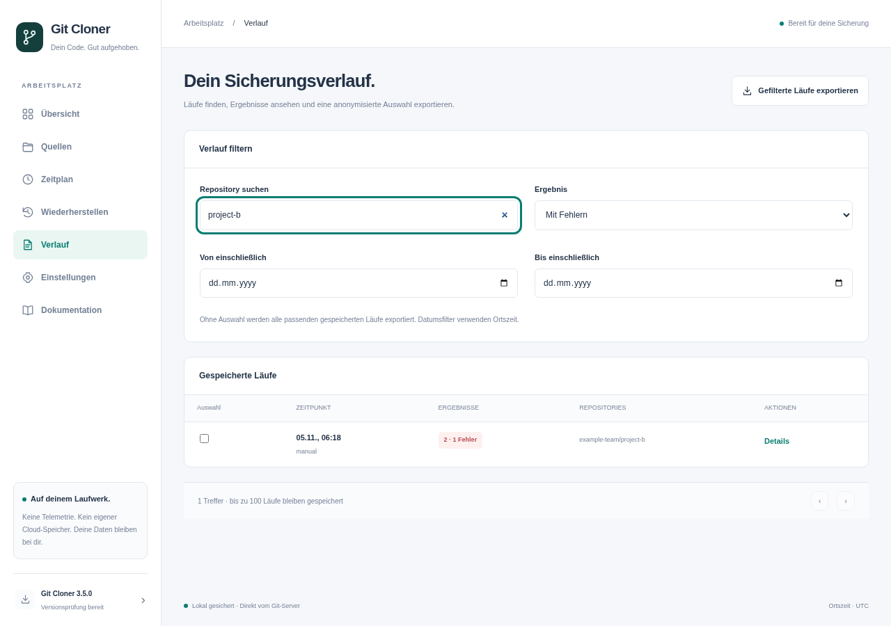

## Wait for space and troubleshoot

A full drive pauses the persistent queue, retaining successful backups and completed jobs. While the app runs, free space is checked about every 30 seconds without repeating Git/API requests. Once every blocked destination meets its saved requirement, the queue resumes. With the app closed, a configured native worker or a later app start performs the next check; sleeping computers are not woken. A deliberate user pause remains manual. No existing backups are deleted to create space.

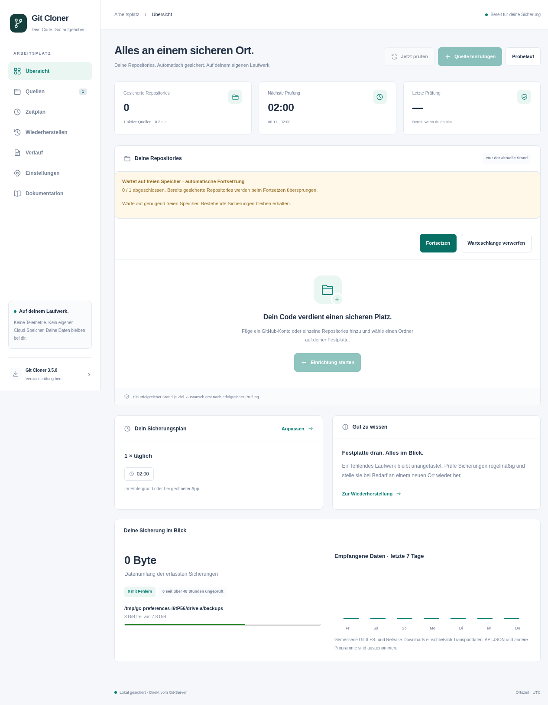

**Troubleshoot** in the overview, history details or an error toast provides targeted steps for credentials, network, API limits, drive identity, permissions, space, Git/LFS and archive passwords. It changes no system settings. A redacted diagnostic export can accompany an issue report.

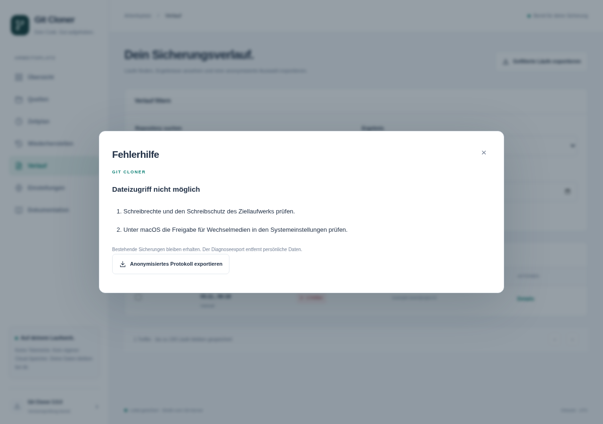

## Change archive passwords

Under **Settings → Backup → Password change assistant**, select available encrypted backups. The inventory pages through 100 archives; up to 1000 can be changed per run. Enter an old password if needed, a new password of at least 12 characters and its confirmation. Known saved keys may make the old field unnecessary. The app authenticates an archive before adopting the new active password.

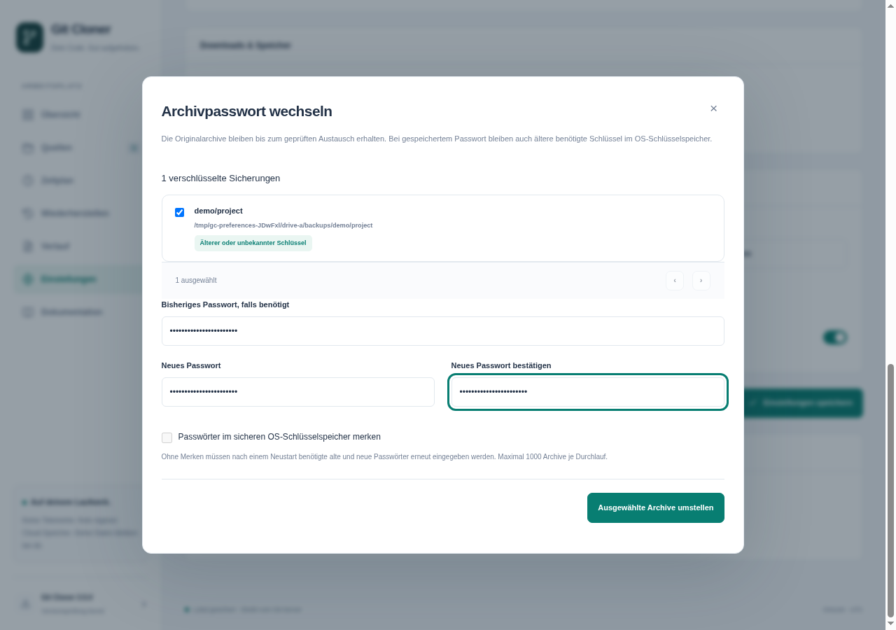

Remembering passwords is optional and retains older required keys in the secure OS key store. Without remembering, old/new passwords must be re-entered after restart; the management file stores identifiers only. Each archive is decrypted privately, verified, re-encrypted and then exchanged. A persisted transaction can complete or recover an interrupted swap. Missing/unselected drives keep their previous passwords. **Stop after current archive** finishes the active archive and stops between items. External GCB copies outside the managed selection are unchanged.

The process requires space for old/new ciphertext and authenticated/extracted temporary data. Regular cleanup removes temporary plaintext; a hard termination can leave OS temporary files. Lost passwords cannot be recovered, and deletion is not forensic erasure. The ordinary unlock action authenticates an available archive rather than silently changing its password; use the assistant for a change.

## Recommend LFS and submodule options

Use **Recommend content** for a saved source. For an account/group, enter one repository belonging to it. The app reads Git trees and small attribute files without cloning or executing project code. It reports LFS rules, submodule links and local Git LFS availability. Incomplete inspections cannot establish absence. Review the checkboxes, then explicitly **Apply selection to this source**. Global options stay unchanged. Group choices affect all repositories in that source; submodules require snapshot mode. Closing without applying changes nothing.

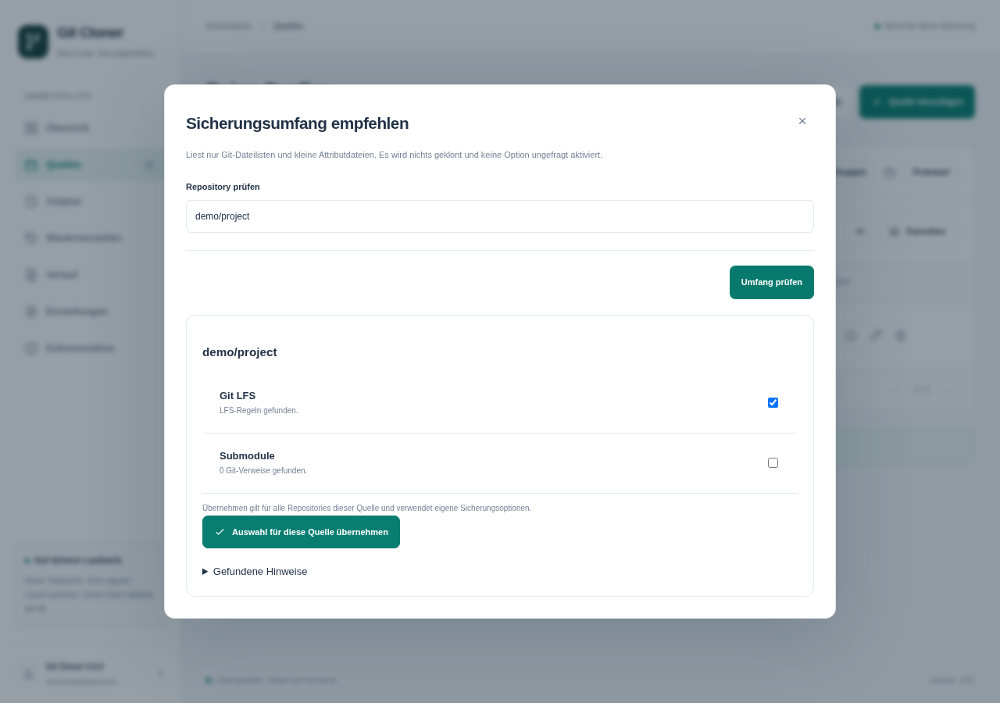

## 28. Choose repositories with checkboxes

Open **Sources → Choose repositories**, select a provider and HTTPS server, choose compatible credentials and enter your own owner, organization or group. Names start empty. GitLab subgroup paths such as `example-group/subgroup` are supported. **Load** only reads repository metadata; it does not clone repositories or create destination markers.

Pages contain up to 50 entries. Search runs on the provider. Selections survive searches and page changes within the current session; the header checkbox selects only the current page. Existing individual sources are marked. GitHub limits search results to 1,000; a limited search is labelled and should be narrowed. Private repositories require appropriate read access.

Choose an existing shared destination and optionally an existing group or favorite status, then add the sources. Each repository remains independently editable. The existing limit of 100 sources applies; inactive browser sessions expire after 15 minutes. Changed provider, credential or owner fields require an explicit reload. Cancel does not save any sources.

**Paste GitHub URLs:** `https://github.com/example-owner/example-project` immediately becomes `example-owner/example-project`. Repository `.git` endings, trailing slashes and common navigation paths are recognized. Owner/organization pages such as `https://github.com/orgs/example-team/repositories` automatically open the repository list with **Automatically include new repositories** enabled. **Add owner source** saves one dynamic source that discovers matching current and future repositories on every check. Explicit repository rules take priority, including paused rules. Options, filters and schedules from the source form are retained.

Entering the same owner page again retains the existing source and settings without duplicates. Newly created repositories are already covered by it. **Show repositories** opens its current list. An existing paused owner source remains paused until explicitly enabled. Uncheck automatic inclusion for a fixed selection. **Select all missing** scans further pages and skips existing individual sources; overflowing the 100-source limit never partially imports a list. A dynamic owner source can cover a large owner with one source.

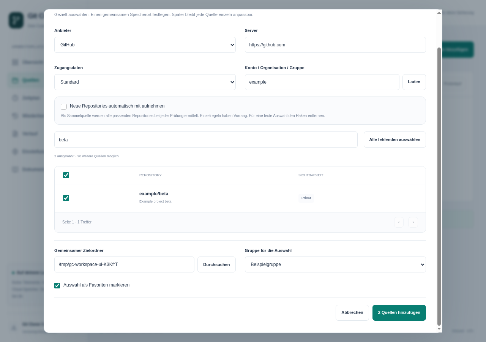

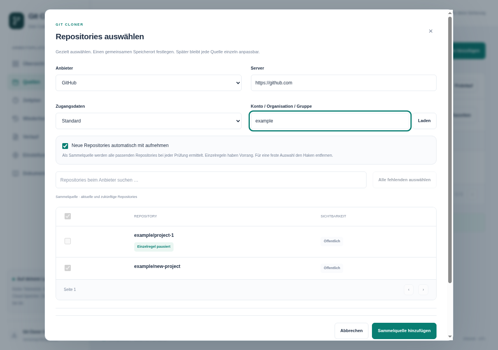

## 29. Groups, favorites and source selection

**Sources → Groups** manages up to 30 groups with your own names. Removing a group retains all its sources and backup files. No groups are created on first launch. Stars toggle favorites. Search, group filtering and the favorites filter combine; source pages contain up to 25 rows.

Checkbox selections survive filters and pages. The selection bar shows their total. Assign a group or mark/unmark favorites directly, including while a backup runs or the destination is disconnected. These organizational changes do not alter backup content or the active queue. Clear selection only removes the checkmarks.

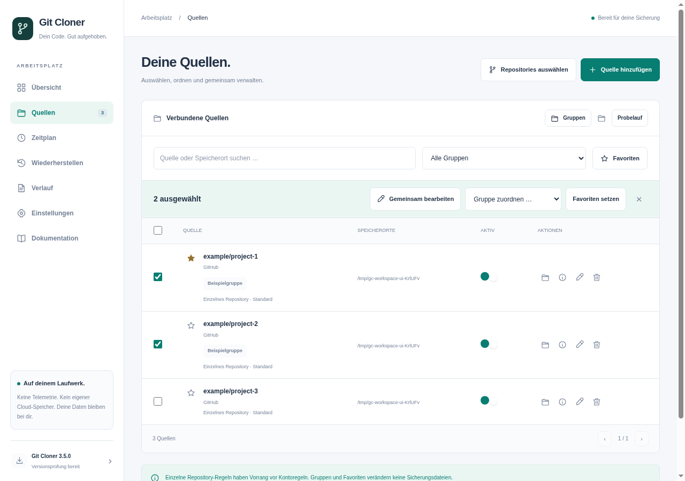

## 30. Edit selected sources together

Select sources and open **Edit together**. Every field initially keeps its existing value. Only explicit changes replace values; source-specific differences remain intact. Supported changes include group, favorite, enabled state, destination, compatible credentials, filters, backup content and daily schedules. Global backup/schedule inheritance can be restored. Selected backup changes merge with each source's existing effective options. An explicitly enabled empty pattern field clears those patterns.

**Review changes** displays **Before / After** for each affected source, up to ten sources per preview page. Preview writes no backup files or drive markers. Apply saves the reviewed configuration together. An intervening configuration edit invalidates the old preview; previews expire after five minutes. Cancel saves nothing. New destinations apply to future backups and retain existing backups at their current location. Running or paused backup queues must finish or be discarded before content changes. Encryption still requires an unlocked password and secure remembering for independent OS tasks.

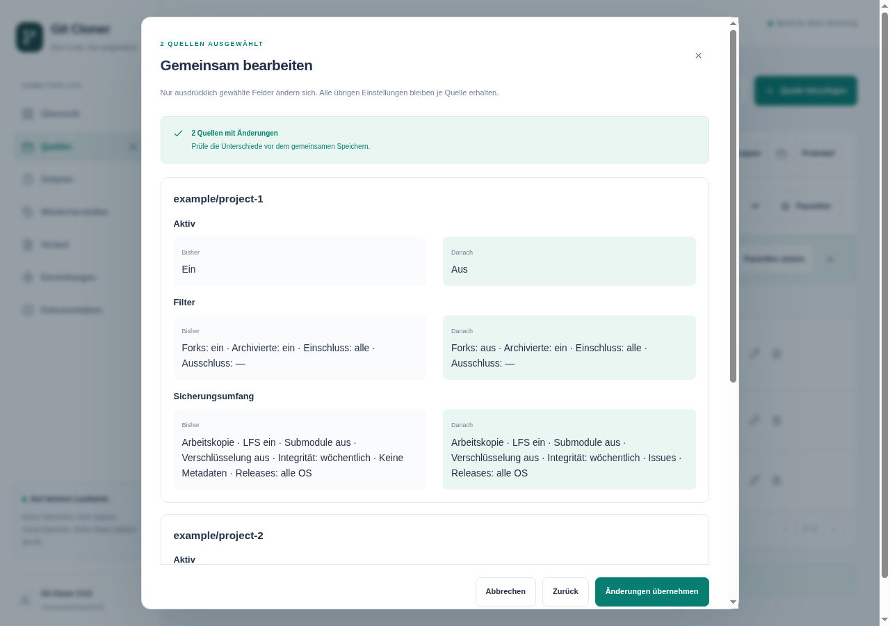

## 31. Resume large release downloads

Optional release-asset backups retain verified parts after network interruptions and can resume after a new attempt or application restart. HTTP Range, strong ETags or sufficiently old canonical HTTP modification dates, and available SHA256 checksums are validated. Unsupported or inconsistent responses cause a controlled restart; unsuitable parts cannot silently become a successful backup. Progress shows the file, byte counts and **Resumed from …** when applicable. Complete cached assets are verified before reuse.

The temporary `.git-cloner-downloads` folder lives in the configured destination, separate from the successful repository backup. Encrypted backups also encrypt persistent download parts with AES-256-GCM; the archive password is required and is never saved in the cache. Unencrypted backups use restricted file permissions. Cache, staging and atomic replacement temporarily require additional space.

Owned cache entries are removed after a successful backup. Unused entries older than seven days are checked and removed when that repository cache is next used. Foreign files, links and invalid ownership markers remain untouched. A hard process termination can still leave temporary plaintext working data, as with previous encrypted-backup operations; deletion is not forensic secure erasure.

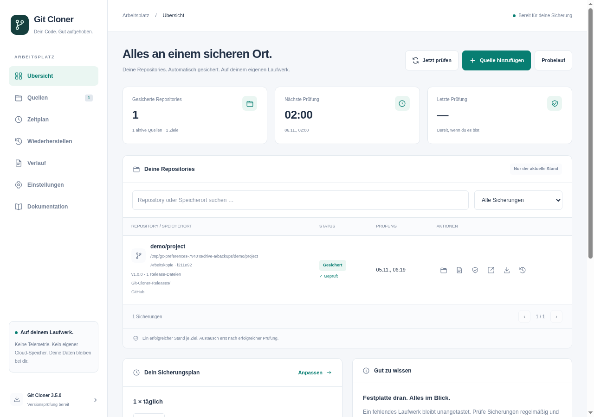

The planned layout of further detail views is documented separately in the German [UI concept](DETAILANSICHTEN.md). Those additional views are not implemented features of version 3.3.


## 32. Reuse existing release assets

Reuse is automatic when Git or metadata changes but selected assets remain identical. Stored manifests, asset identities and copied bytes are verified, using upstream SHA256 when available. Damaged or changed files are downloaded again. Download counters alone do not change backup identity. Unchanged backups retain their normal fast path. Encrypted old archives are authenticated and temporarily decrypted for reuse; failures fall back to a fresh download. Temporary plaintext is removed afterwards, subject to the documented crash and secure-erasure limitations.

## 33. Architecture and file types

Under **Settings → Backup → Release assets**, enable release downloads and choose OS and architecture. **My architecture only** follows the running application's architecture; explicit ARM64/x64/x86/ARMv7 options are also available. Universal packages match multiple CPUs. An explicit architecture filter excludes unclassified names. Under **Choose file types**, mark multiple formats or leave all unchecked to allow all types. OS, architecture and format filters combine; shared checksums and matching signature sidecars are retained.

For an ARM64 Mac example, choose your OS, ARM64 and DMG. Source-specific backup options provide the same controls. Filter changes replace old files only after a successful checked backup and reuse matching existing bytes locally.

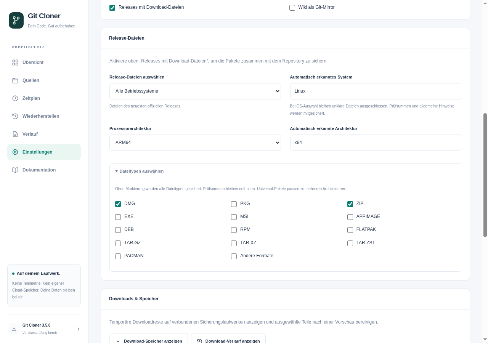

## 34. Downloads and storage

Open **Settings → Backup → Downloads & storage → View download storage**. Inspect owned temporary parts, their size, source where identifiable, part count, completeness and encryption. Encrypted caches do not store plaintext asset names. Select entries and **Review cleanup**. Back cancels without changing files; **Clean selected parts** removes reviewed temporary parts, which must be downloaded again. Completed backups and installed programs remain intact.

Active writes are protected by application and per-cache locks. Changed files or destinations invalidate the preview. Foreign files, links, unknown markers and replaced drives are retained. Inventory is bounded to 1,000 entries and 10,000 parts per entry; unreadable areas produce warnings.

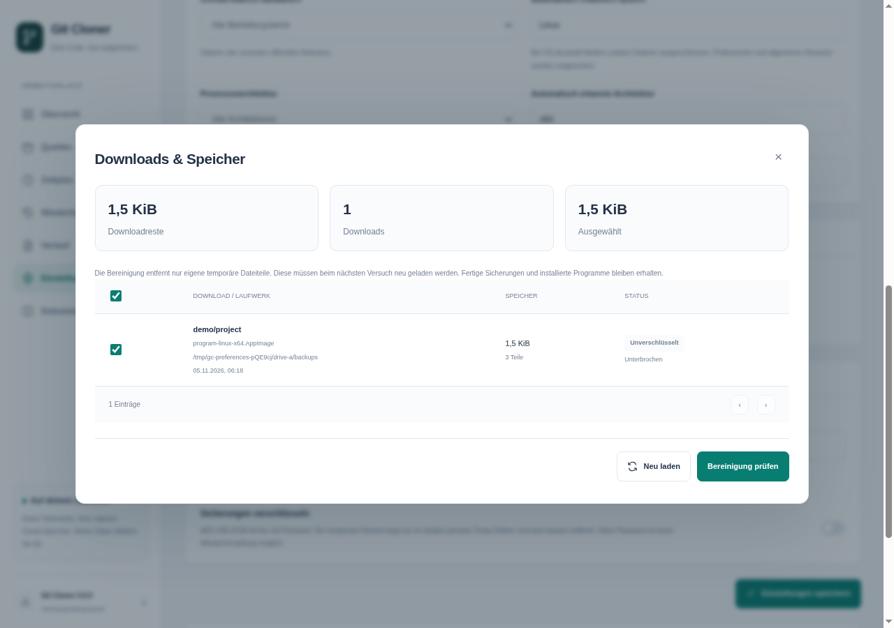

## 35. Automatically install a repository program

This option updates the program from your selected repository. Git Cloner itself retains notification-only updates. Installation starts disabled and is limited to explicitly chosen individual repositories; owner sources never install newly discovered programs automatically.

1. Add or edit an individual source such as `example-owner/example-program`.
2. Expand **Automatically install this program** and enable **Install and replace with the latest release**. Source-specific release backups are enabled; newly enabled downloads initially select your OS, while existing active filters are retained.
3. Choose an existing program destination separate from backup destinations. Managed copies live under `owner/repository`; other providers use their own namespace.
4. Optionally select a filename pattern, such as `*.dmg`, `*portable*.exe` or `*.AppImage`. The best supported candidate is chosen when unambiguous.
5. Save and run **Check now**, or wait for the schedule.

After a successful backup, actual asset integrity is checked and a separate program copy is prepared. Only then is the previous managed copy replaced. Current version/content is skipped. Failure preserves the previous program and is shown alongside backup status. The overview provides **Open program folder**. Installation never launches downloaded apps.

macOS supports one signed/ad-hoc `.app` from DMG/ZIP, validating its signature and actual CPU; running apps are deferred. Windows supports portable EXE/ZIP, validating PE headers and CPU and retaining packaged companion files. Linux supports AppImage with matching ELF/AppImage headers and CPU. System installers (MSI/NSIS, PKG, DEB, RPM), arbitrary installation scripts and automatic administrator elevation are excluded. Missing permissions or locked files retain the old copy. Importing settings disables installation until enabled locally again.

Trust the selected publisher and keep personal data outside managed program copies. Additional files in the managed root and foreign staging directories block replacement. Changing destinations retains old installations at their current location. Interrupted swaps recover through ownership markers on the next installation attempt; hard termination can leave temporary working data.

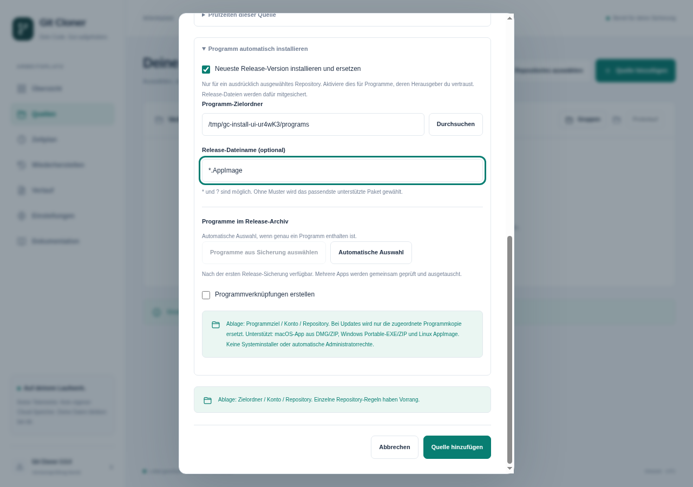
## 36. Program shortcuts

All examples are anonymous, such as `example-owner/program-suite`, a backup folder and a separate program folder. No example repository is preconfigured.

Open **Sources → Edit source → Automatically install this program**, enable the program installation and select its folder. Enable **Create program shortcuts**, choose the desktop suggested by the operating system or another existing folder, save the source and run **Check now**. Shortcuts must be outside backup folders and the concrete managed installation.

macOS creates Finder symlinks to `.app` bundles, Windows creates real `.lnk` files using built-in PowerShell, and Linux creates `.desktop` launchers. No downloaded program is launched during creation. Some Linux desktops require explicitly allowing a desktop launcher before its first use.

Shortcuts follow managed program updates. Folder changes create the new links before removing unchanged owned old links. Unrelated or user-modified files remain untouched and produce a warning. Keep the hidden ownership folder alongside the shortcuts. Disabling shortcuts and running another check removes unchanged owned shortcuts; disabling the entire installation or source retains existing programs and shortcuts. Old program copies at previous destinations are retained.

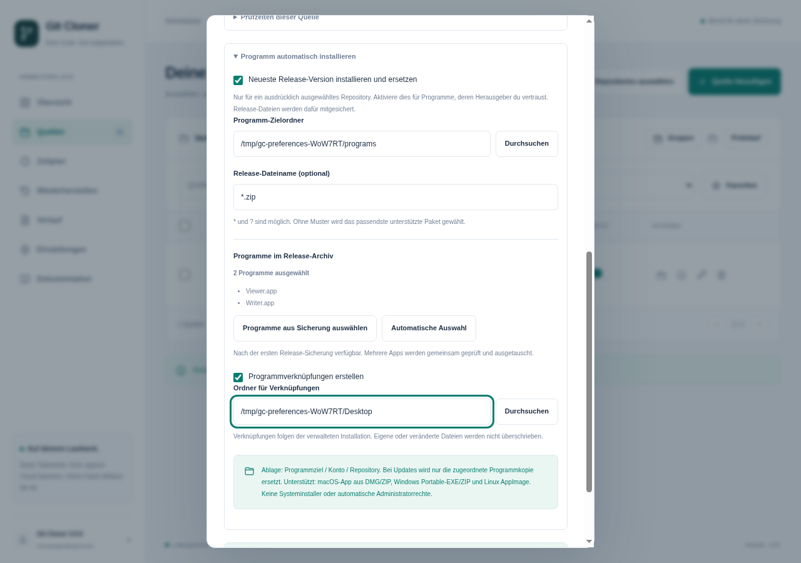

## 37. Select multiple programs inside a release archive

1. Back up a single repository with release assets. An ambiguous first installation may report that program selection is required while retaining the successful backup.
2. Edit the saved source and open **Automatically install this program → Choose programs from backup**. Narrow the release filename, for example `*suite*.zip`, if several packages match equally.
3. Inspect the backed-up release file and choose one to 64 compatible programs. macOS supports `.app` bundles from DMG/ZIP, Windows supports main executables in portable ZIPs. Signatures/program format and architecture are checked. Incompatible entries are disabled. Linux AppImages and individual portable EXEs remain single programs.
4. Click **Apply selection**, then **Save changes** and **Check now**. Canceling does not change the selection. **Automatic selection** restores the earlier behavior requiring exactly one recognizable program.

All chosen programs are prepared and verified before the managed installation is replaced together. A selection change can update an otherwise unchanged release. Saved archive paths apply to future releases. Missing or renamed members retain the previous installation and require selecting the programs again. Running managed Mac apps defer the update to a later check.

Windows portable folders retain shared DLLs and companion files; additional EXEs may be present as companions. The selection defines managed main programs and shortcuts, rather than deleting every other executable from a portable distribution. System installers and arbitrary installation scripts are still excluded.

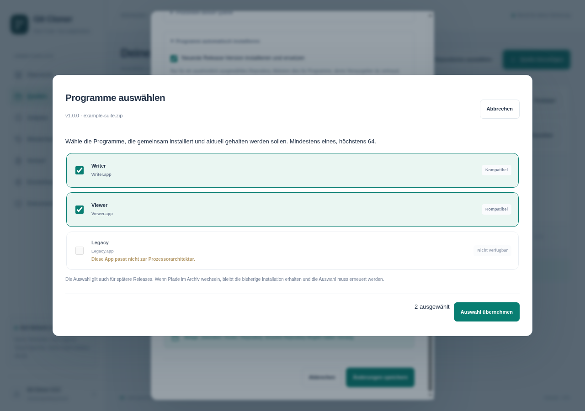

## 38. Download history and measured savings

Open **Settings → Backup → Downloads & storage → View download history**. History is read on demand without a GitHub request. Search by repository, filename or tag, filter by result or period, and browse pages of 50 entries. Totals include all filtered matches. At most 2,000 events are retained locally across app restarts.

- **Received release payload:** actual bytes consumed from release response streams, including failed attempts. HTTP/TLS headers, Git traffic and metadata requests are excluded. Compressed HTTP responses count decoded file bytes.
- **Transfer avoided:** content-verified local files and successfully used parts that existed before that transfer began. A retry cannot count newly received parts from the same attempt as savings. Unchanged repository checks do not invent saved bytes.
- **Cache file bytes removed:** measured sizes of successfully removed owned temporary files, including cache metadata, through automatic or manual cleanup. This is not a prediction of physically free drive capacity: filesystem blocks, compression and shared extents can differ.

No historical values are backfilled and no time savings are presented as measurements. Writes are batched; the first event and state/run checkpoints flush pending data. A hard process termination can lose unwritten events. Encrypted asset filenames are omitted from persisted history; repository names and tags remain visible as in the existing backup status. Failed transfers count received payload without crediting successfully avoided downloads.

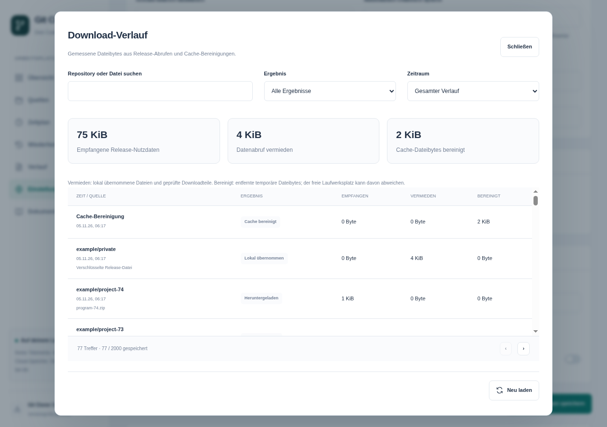

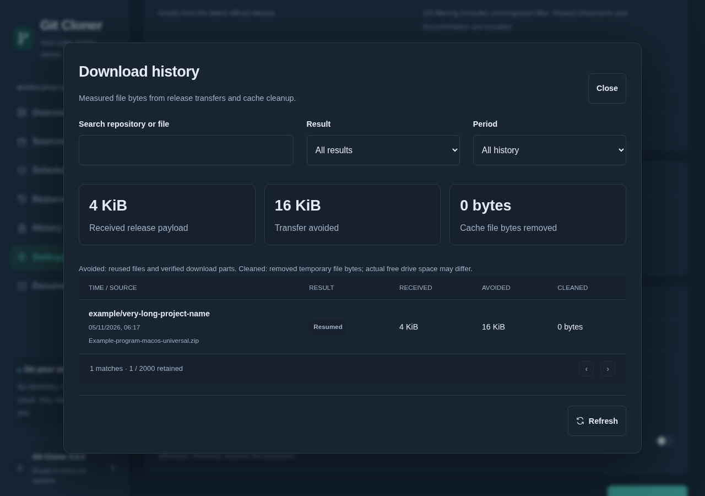
