# Git Cloner 3.7 user guide

All account, repository and drive names in this guide are placeholders. The app adds **no default sources**. The images show real application windows with an isolated test profile and the English interface; the app can be switched between English and German at any time. Credentials are neither required nor shown.


## Contents

1. [Installation](#1-installation)
2. [Set up a drive and sources](#2-set-up-a-drive-and-sources)
3. [First check and status](#3-first-check-and-status)
4. [Choose the backup content](#4-choose-the-backup-content)
5. [Integrity and encryption](#5-integrity-and-encryption)
6. [Schedule, start at sign-in and drives](#6-schedule-start-at-sign-in-and-drives)
7. [Several accounts and sign-in](#7-several-accounts-and-sign-in)
8. [Restore](#8-restore)
9. [New version notices](#9-new-version-notices)
10. [Appearance, settings and diagnostics](#10-appearance-settings-and-diagnostics)
11. [Setup assistant and dry run](#11-setup-assistant-and-dry-run)
12. [Pause and resume](#12-pause-and-resume)
13. [Performance, download limit and resource rules](#13-performance-download-limit-and-resource-rules)
14. [Backup content per source](#14-backup-content-per-source)
15. [Restore selected files or folders](#15-restore-selected-files-or-folders)
16. [Dashboard, high contrast and keyboard](#16-dashboard-high-contrast-and-keyboard)
17. [Check times per source](#17-check-times-per-source)
18. [Back up releases for selected operating systems](#18-back-up-releases-for-selected-operating-systems)
19. [Review changes before a backup](#19-review-changes-before-a-backup)
20. [Find drives after a path change](#20-find-drives-after-a-path-change)
21. [Notifications and quiet hours](#21-notifications-and-quiet-hours)
22. [GitLab and Forgejo sources](#22-gitlab-and-forgejo-sources)
23. [Search and export the history](#23-search-and-export-the-history)
24. [Wait automatically when space is low](#24-wait-automatically-when-space-is-low)
25. [Contextual help for errors](#25-contextual-help-for-errors)
26. [Change the archive password](#26-change-the-archive-password)
27. [Recommendations for LFS and submodules](#27-recommendations-for-lfs-and-submodules)
28. [Choose repositories with checkboxes](#28-choose-repositories-with-checkboxes)
29. [Groups, favorites and source selection](#29-groups-favorites-and-source-selection)
30. [Edit several sources together](#30-edit-several-sources-together)
31. [Resume large release downloads](#31-resume-large-release-downloads)
32. [Reuse existing release assets](#32-reuse-existing-release-assets)
33. [Architecture and file types](#33-architecture-and-file-types)
34. [Clean up download storage](#34-clean-up-download-storage)
35. [Install programs from a repository automatically](#35-install-programs-from-a-repository-automatically)
36. [Program shortcuts](#36-program-shortcuts)
37. [Several programs from one release file](#37-several-programs-from-one-release-file)
38. [Download history and measured savings](#38-download-history-and-measured-savings)
39. [When program updates are installed](#39-when-program-updates-are-installed)
40. [Restore the previous program version](#40-restore-the-previous-program-version)
41. [Reminder for paused backups](#41-reminder-for-paused-backups)
42. [API quota](#42-api-quota)
43. [Bandwidth time window](#43-bandwidth-time-window)
44. [Exact macOS DMG variants](#44-exact-macos-dmg-variants)
45. [Missing downloads and Electron program archives](#45-missing-downloads-and-electron-program-archives)
46. [Snap and ARM64 Flatpak packages](#46-snap-and-arm64-flatpak-packages)

## 1. Installation

Use only the [official GitHub releases](https://github.com/Ujap1994/Git-Cloner/releases) and compare the download with its checksum in `SHA256SUMS.txt`. A prepared package type does not mean that a matching release has already been published.

The packaged app needs no separate Node.js. **Git must be available**, plus **Git LFS** for the optional LFS backup. Flatpak contains both. Restart the app after installing Git.

| System         | Package and installation                                                                                                                                      |
| -------------- | ------------------------------------------------------------------------------------------------------------------------------------------------------------- |
| macOS          | Universal for Intel and Apple silicon, or x64 or ARM64. Open the DMG and drag the app to Applications. Install Git with `xcode-select --install` if needed.   |
| Windows        | Install Git for Windows with the PATH option for other programs. Then start the x64 or ARM64 installer or the portable version.                               |
| Ubuntu / Mint  | Install Git, then `sudo apt install ./FILENAME.deb`.                                                                                                          |
| Fedora         | `sudo dnf install git ./FILENAME.rpm`.                                                                                                                        |
| Arch / CachyOS | `sudo pacman -U ./FILENAME.pkg.tar.zst`. The package manager resolves the dependencies.                                                                       |
| AppImage       | Install Git, make the file executable (`chmod +x ./FILENAME.AppImage`) and start it. Some distributions require FUSE; alternatively use `--appimage-extract`. |
| Linux TAR.GZ   | Extract it to a permanent location and start the included application; Git and the desktop runtime libraries must be installed.                               |

`FILENAME` stands for the actual file name from the release. Choose an ARM64 package for ARM64 computers. CachyOS mostly uses x86_64; Linux aarch64 packages are meant for compatible ARM systems.

The packages have no verified publisher signature. macOS uses a technically required ad-hoc signature and is not notarized. After checking source and checksum, an approval under **System Settings → Privacy & Security** may be needed; Windows may show SmartScreen. Signing certificates and automatic self-updates are not part of the app.

Move portable and AppImage files to their final location before enabling start at sign-in or the system schedule. After moving them, turn these options off and on again. The portable version still stores its settings in the normal user profile.

### Flatpak

Releases include x64 and ARM64 bundles. A bundle is not yet a public Flathub entry:

```sh
flatpak remote-add --user --if-not-exists flathub https://flathub.org/repo/flathub.flatpakrepo
flatpak install --user ./FILENAME.flatpak
flatpak run io.github.Ujap1994.GitCloner
```

The home folder and the usual mount paths `/media`, `/run/media` and `/mnt` are shared. Allow other paths explicitly, for example:

```sh
flatpak override --user --filesystem=/backups io.github.Ujap1994.GitCloner
```

Flatpak uses the app schedule and start at sign-in, not an independent systemd worker. Saved credentials need a working Secret Service. The application keeps its Chromium sandbox enabled; if an AppImage causes problems, prefer a native package or Flatpak.

## 2. Set up a drive and sources

Connect the external drive and create a backup folder, for example:

| System  | Neutral destination path     |
| ------- | ---------------------------- |
| macOS   | `/Volumes/BackupDisk/GitHub` |
| Windows | `E:\GitHub-Backups`          |
| Linux   | `/media/backup-disk/GitHub`  |

The folder must exist and be writable. macOS may ask for access to removable volumes. The app stores a random drive identity in `.git-cloner-volume.json` there. Keep this file: a missing or replaced drive must never be replaced silently by a new local folder.

Open **Sources → Add source** and enter your own accounts or repositories, one source per line:

```text
example-account
other-account/tool
```

`example-account` backs up the repositories of this account or organization that your credentials can see. `other-account/tool` backs up only this repository. Complete GitHub HTTPS addresses work as well. The examples are never added automatically.

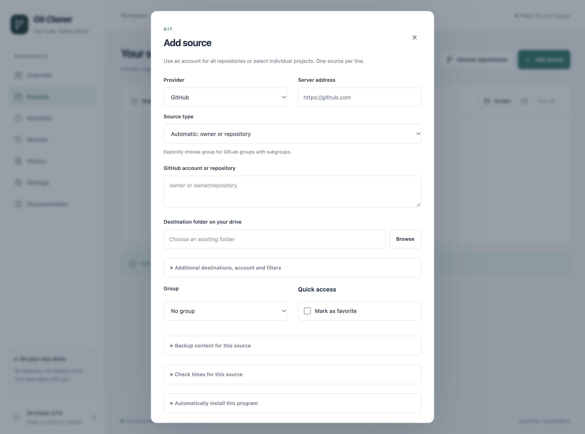

Choose the destination folder. Sources entered together share it at first; afterwards each source can be edited on its own. The layout is `destination/account/repository`. An active single-repository rule takes priority over an account rule for the same repository.

**Additional destinations, account and filters** offers further options:

- Up to nine more locations, ten per source in total. Each destination receives an independent backup and drive identity.
- An account from your saved credentials. "Default" also works without a token for public sources.
- Include or exclude forks and archived repositories.
- Name patterns to include or exclude: `web-*`, `*-old` or `example-account/project?`. `*` stands for any number of characters, `?` for exactly one. Exclusions take priority.

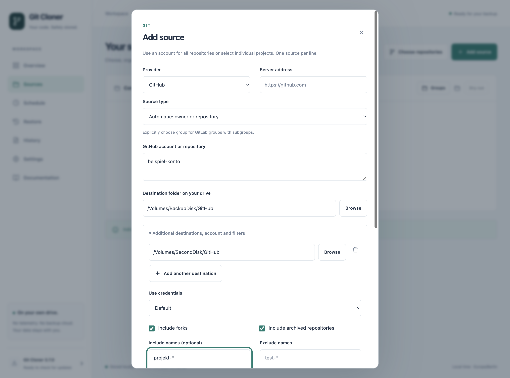

Sources can be paused or removed. Existing backups are kept. Repositories deleted or renamed on GitHub are not removed locally.

## 3. First check and status

Choose **Check now**. New states are built and verified separately first; only then do they replace the previous state. An error keeps the previous state and other sources continue. After a run each destination holds exactly one successful state; there is no rotation of historical folders.

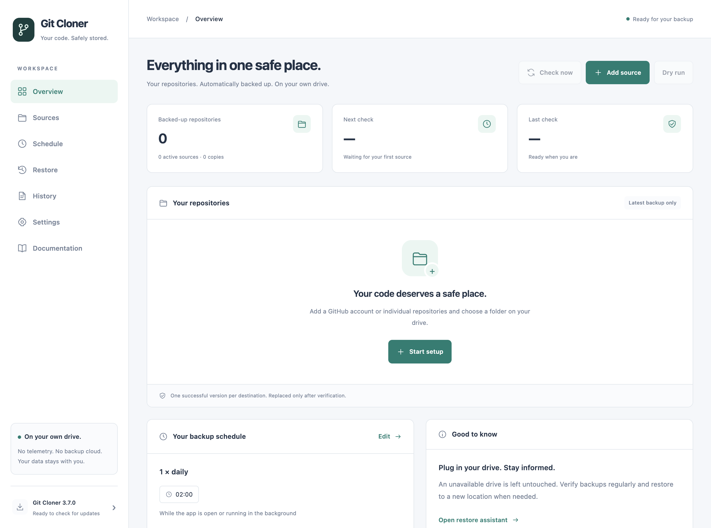

| Status    | Meaning                                                      |
| --------- | ------------------------------------------------------------ |
| Backed up | First backup created.                                        |
| Updated   | Changed Git data or metadata applied.                        |
| Current   | The checked remote state matches the backup.                 |
| Repaired  | A damaged managed backup was rebuilt successfully.           |
| Empty     | The Git repository has no commit yet.                        |
| Error     | The operation did not succeed; check the message in History. |

Search and status filters help with many repositories. The list shows up to 75 rows per page. Entries offer integrity checks and restore. An integrity error stays visible and forces another check or repair in the next backup run.

By default the app processes up to two small repositories in parallel. Demanding backups run one at a time; the limits can be changed under **Performance & rules**. During a backup, navigation, search and status stay usable; changes to sources and backup settings wait until the run ends. Temporarily there must be space for the previous and the new state.

## 4. Choose the backup content

Additional content is off by default under **Settings → Backup**:

| Option        | Effect                                                                                                                                  |
| ------------- | --------------------------------------------------------------------------------------------------------------------------------------- |
| Working copy  | Fast shallow working copy of the current default branch. No complete Git history.                                                       |
| Mirror        | Bare repository with the complete Git history, all branches and tags. No checked-out working folder. Changes are fetched incrementally. |
| Git LFS       | Downloads the actual LFS content; requires Git LFS to be installed.                                                                     |
| Submodules    | Checked out recursively in the working copy. Only safe HTTPS remotes; GitHub SSH addresses are converted to HTTPS. Not with Mirror.     |
| Issues        | Issues and comments as JSON.                                                                                                            |
| Pull requests | Pull requests, reviews, comments and change information as JSON.                                                                        |
| Releases      | Release data and their files. Large files need corresponding space and time.                                                            |
| Wiki          | Separate Git mirror of the wiki. An inaccessible wiki is reported explicitly.                                                           |

Release files are stored visibly under **`destination / account / repository / Git-Cloner-Releases`** with their original file names. The overview names this folder and offers **Open release folder**. If the repository already contains a folder with that name, the app uses a free numbered name and keeps the repository files. For encrypted backups the release folder is inside `backup.gcb`; choose **Restore release assets** and unlock it to access the files. Older backups with files in the hidden `.git/git-cloner-metadata/release-assets` stay restorable and move to the visible location at the next successful check.

Metadata is stored in the `git-cloner-metadata` folder inside `.git` or inside the bare mirror. It is an export, not an automatic re-import into GitHub. Wiki access can fail for wikis that were never created. If an existing backup already contains a wiki, a later retrieval error prevents replacing that state.

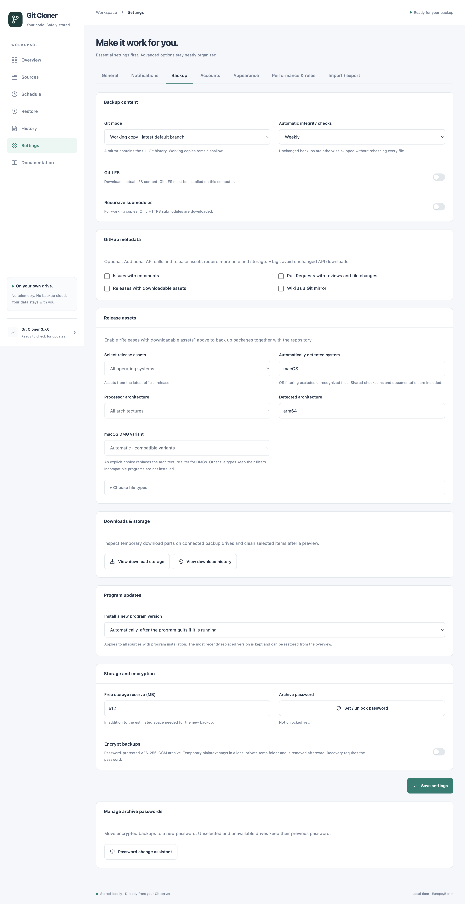

The storage reserve is kept in addition to the estimated repository size. The size reported by GitHub is an estimate; very large LFS and release files can exceed it. When space runs out, no existing backup is deleted in advance.

## 5. Integrity and encryption

New backups receive a Git check and a SHA256 file manifest. Unchanged backups are fully verified once a week by default. Alternatively choose **every check** or **manual only**. A manual check is available in the overview and in Restore.

For encrypted backups:

1. Set your own archive password with at least twelve characters under **Settings → Backup**.
2. Optionally remember it in the operating system's secure key store.
3. Enable encryption, save the settings and choose **Check now**.
4. Afterwards test a restore to a different location.

The destination then holds `backup.gcb` and a management file. Git content, file names and metadata inside the archive are encrypted with AES-256-GCM and scrypt. The surrounding path still reveals account and repository names, and the management file contains status data. Use drive encryption to protect the whole volume.

**A forgotten password cannot be recovered.** Keep it independently of the app. After a password change, archives that have not been replaced successfully yet still need the old password. Without "remember", the password applies to the current session only and must be entered again after a restart. The independent worker needs a securely saved password and an unlockable key store.

During processing, decrypted data is kept in a private local temporary folder that is removed afterwards. This is not forensic deletion. The regular check of encrypted archives verifies their SHA256 value; the manual check also decrypts them and verifies Git and every file. A wrong password or modified archive data prevents extraction.

## 6. Schedule, start at sign-in and drives

Under **Schedule**, enable automatic checks and set **1 to 24 checks per day**. Each check has its own time field, for example 02:00, 10:00 and 18:00. Duplicate or invalid times are rejected. All times use the local time zone.

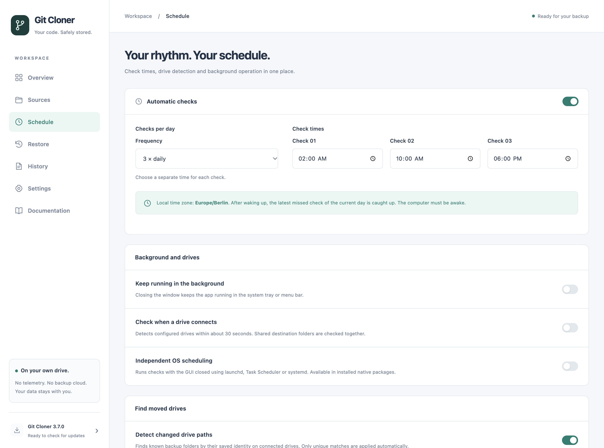

**Keep running in the background when closed** keeps the app schedule active in the tray or menu bar. Without an available tray the window stays open. **Start at sign-in** sets up start at sign-in for the installed app; it is disabled in development builds.

Optionally enable **Independent system scheduling**: native installed packages register a macOS LaunchAgent, a Windows task or a systemd user timer on Linux. A worker without a window then checks even when the interface is closed. A running interface and a worker never overwrite each other thanks to a shared lock. Turning the option off removes the entry created by the app. Development builds and Flatpak do not support this option.

**The computer must be on and awake, and the user signed in.** The app does not wake it. After waking up or starting, the app schedule catches up on the last missed check of the current day once; earlier days are not processed one by one. Native services may also catch up on missed times according to their own rules.

**Check when a drive is connected** detects previously configured destinations within about 30 seconds while the app runs. Only reconnected destinations are checked. A missing drive causes an error, never a fallback folder. This detection does not start a closed app.

## 7. Several accounts and sign-in

Public sources work without signing in. GitHub typically allows 60 anonymous API requests per hour. Private repositories or many repositories need suitable read access. Section [42](#42-api-quota) explains how the app uses this quota.

If the API quota is used up, the queue pauses with **Waiting for API limit · resumes automatically** and shows the expected reset time. Completed repositories stay completed. After the reset the app continues automatically and makes no new automatic requests before. After saving a read token, **Resume** can be chosen immediately. This also applies when the limit is reached while downloading a release file; parts that were already downloaded are kept for resuming.

While the app runs, also only in the tray or menu bar, it checks every 30 seconds and continues on its own after the reset time. The worker without a window also waits for the reset if it is at most about one hour away and then continues the queue. Longer waits are taken over by the next scheduled run. If the app window is opened during a worker run, it appears once the worker has finished; a running wait is then ended and continued by the app.

Under **Settings → Accounts** you can create several named accounts. Each source chooses its account in the advanced settings.

### Personal access token

Create a token with the minimum read permissions using the GitHub link in the app. Fine-grained tokens need `Contents: Read` for source code, plus the read permissions for issues and pull requests if that metadata is backed up. Organizations can require approval or SSO. Paste the token only into the password field of the app and save it. It is never shown again.

### Device flow

The app supports GitHub's device flow. It requires the public **client ID of a GitHub OAuth app with device flow enabled**; no client secret is needed. This project does not provide a general OAuth app. Without such a client ID, use public sources or a personal access token.

After entering the client ID, start the device sign-in for the account, confirm the displayed code on GitHub and return to the app. Sign-ins can be cancelled; expired codes can be renewed.

Tokens and optionally the archive password are stored encrypted with Electron `safeStorage`. An insecure plain-text fallback on Linux is refused. A missing or locked keyring can prevent saving. Tokens never appear in repository URLs, process arguments or exported settings. "Remove token" deletes the saved credential; existing backups are kept.

## 8. Restore

Open **Restore**, choose a backed-up entry or an existing `.gcb` archive and an existing parent folder. Enter a **new folder name**. An existing folder is never overwritten.

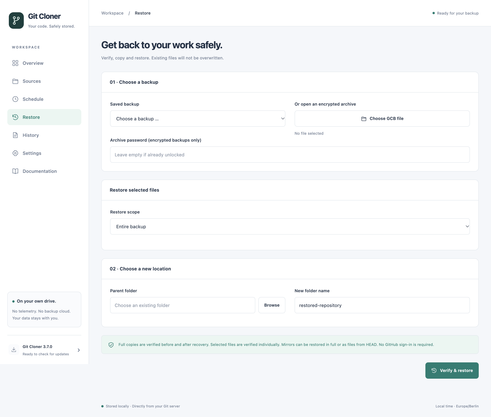

The assistant checks the source, copies or decrypts it and verifies the result before the final rename. An archive needs the password it was created with. No GitHub sign-in is needed to restore locally. A mirror is restored as a bare repository; a working copy can be cloned from it afterwards:

```sh
git clone /PATH/TO/RESTORED-MIRROR /NEW/WORKING/FOLDER
```

Develop only in a separate working folder. Changes inside a managed backup can be lost at the next replacement. A shallow working copy contains only the backed-up default branch; more history can only be fetched while a reachable original still provides it.

## 9. New version notices

The sidebar shows the running version. At start and every six hours the automatic version check compares it with the latest official stable release of Git Cloner. It reads the redirect of the public release page and needs no API request, so it never competes with backups for the API quota; only if that page changes does it use the API. Under **Settings → General** you can check manually or turn the automatic check off. If the API is needed and its limit is used up, the sidebar shows **Version check waits for API limit** and checks again automatically after the reset.

A newer version appears as a notice with a link to the official release page. With notifications enabled there is one system notification. **Skip this version** keeps this choice permanently; the same or a lower version produces no further notice, also after a restart. Only a higher version triggers a notice again. **Reset skipped version** removes the choice.

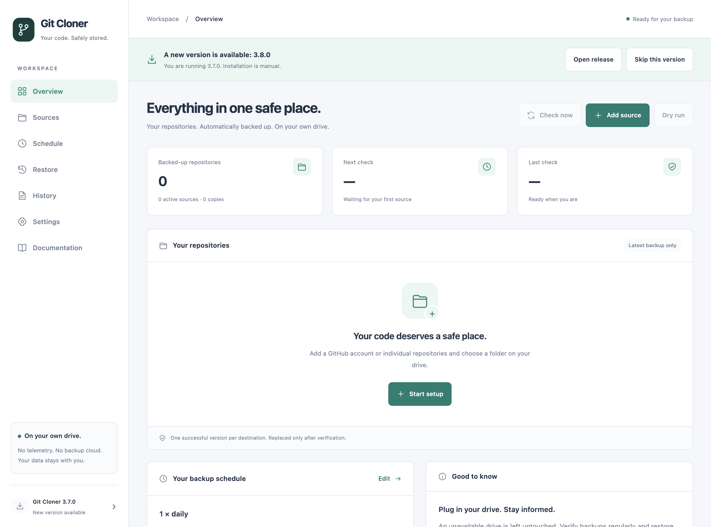

The image uses a simulated release response. The app does not download or install its own updates. To update, download the matching official package, let running backups finish and install the new version yourself. If no official release exists yet, the app shows this as a separate state.

## 10. Appearance, settings and diagnostics

New profiles use German on German-language systems and English otherwise. Existing language preferences remain unchanged. Closing an idle window quits the app by default; background tray operation can be enabled in Settings. Existing tray preferences remain unchanged.

**Settings → Appearance** offers English and German, light, dark or system theme and three text sizes. Selection fields have the same height; larger text scales the whole interface. The choices are kept after restarts.

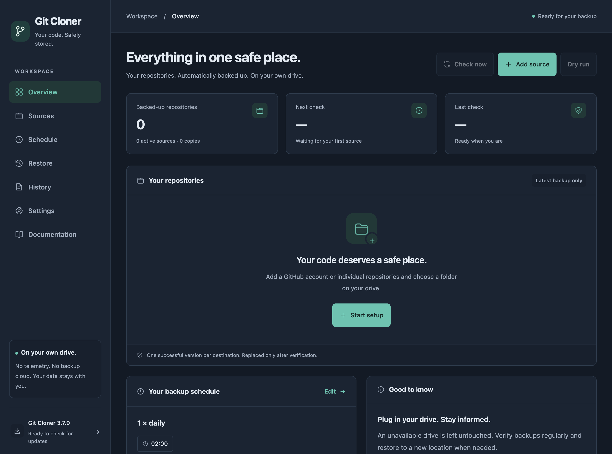

**Settings → Import / export** exports or imports sources, options and allowed Wi-Fi names. Tokens and passwords are excluded. **Names and paths are still contained in settings files**, so do not share such files without checking them. An import shows a preview and binds destination folders again; start at sign-in and independent scheduling are never taken over from another computer.

The diagnostic export removes account and repository names, paths, commit IDs and raw error messages. The history keeps up to 100 runs and at most 500 single results per run, errors first. Totals are kept. Never send `settings.json`, `state.json`, `history.json` or the encrypted `secrets.enc` as a supposedly anonymous support export.

| Problem                      | Next step                                                                                                                                                                                                                                                                                                                                                                                          |
| ---------------------------- | -------------------------------------------------------------------------------------------------------------------------------------------------------------------------------------------------------------------------------------------------------------------------------------------------------------------------------------------------------------------------------------------------- |
| Git missing                  | Install Git, check PATH and restart the app. On macOS the Finder environment can differ from the terminal.                                                                                                                                                                                                                                                                                         |
| Drive identity missing       | Connect the correct drive. For an intentionally new destination, set up the source again. Never copy a foreign identity.                                                                                                                                                                                                                                                                           |
| Foreign folder blocks target | Choose a new destination folder or move the existing data yourself.                                                                                                                                                                                                                                                                                                                                |
| Not enough space             | Free space for the old and new state plus the reserve; metadata and LFS can exceed the estimate.                                                                                                                                                                                                                                                                                                   |
| GitHub 401 / 403             | Check validity, repository access, organization SSO and the API limit.                                                                                                                                                                                                                                                                                                                             |
| Waiting for API limit        | Wait for the reset; the queue continues automatically and keeps completed repositories. Section [42](#42-api-quota) explains the request budget. A read token under **Settings → Accounts** raises the limit; **Resume** then works immediately.                                                                                                                                                   |
| DMG not installed            | Check the overview message: a missing or invalid signature, a program for another CPU or several different packages that match equally block the replacement. In the last case narrow the **release file name**, for example `*arm64.dmg`. The same file under two names (identical SHA-256) counts as one package. Finder layout data in a DMG (`com.apple.FinderInfo`) is not a signature error. |
| LFS missing                  | Install Git LFS or turn the option off; the existing successful state is kept.                                                                                                                                                                                                                                                                                                                     |
| Password missing or wrong    | Enter the password of this archive. After a change, older archives may still need the old password.                                                                                                                                                                                                                                                                                                |
| No automatic run             | Are source and schedule enabled and saved? Is the computer awake? Does the app run in the background or is the system worker active? Is a queue paused by you? See section [41](#41-reminder-for-paused-backups).                                                                                                                                                                                  |
| Token cannot be saved        | Set up the secure key store or keyring of the operating system, or use public sources.                                                                                                                                                                                                                                                                                                             |

[Architecture and data layout](ENTWICKLUNG.md) · [Package repositories](PAKETVERZEICHNISSE.md) · [Roadmap](ROADMAP.md)

## 11. Setup assistant and dry run

On the empty overview choose **Start setup**. The assistant contains no default source. Enter your own sources, choose an existing backup folder and then set frequency and times. Before saving it shows a preview of the planned layout. Only **Save setup** binds the drive and saves the sources.

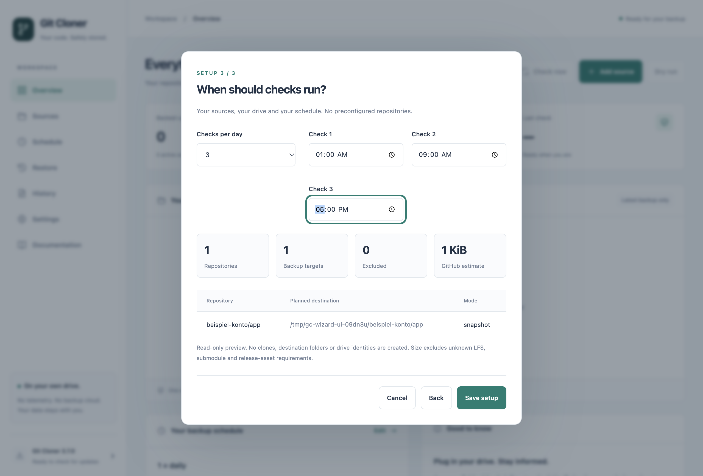

**Dry run** in Overview or Sources only reads repository data and existing destination folders. It creates neither clones nor drive identities. The preview lists found repositories, entries excluded by filters or priority rules, destination paths and GitHub's size estimate. Several destinations on the same detected drive share its free space. LFS, submodules and release files can exceed the estimate. A dry run also uses API requests.

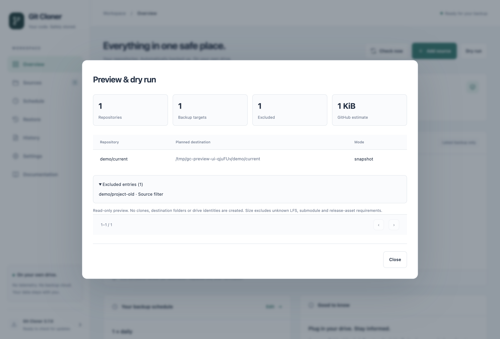

The images use isolated test profiles. Visible `/tmp/…` paths are random temporary test folders; account and repository names are neutral examples.

## 12. Pause and resume

During a run, choose **Pause after active repositories**. Repositories that have already started are completed; no new tasks start. With parallel processing, two or more active small repositories can therefore still finish. Afterwards **Resume** appears. The pending tasks and the run configuration are saved and remain available after restarting the app.

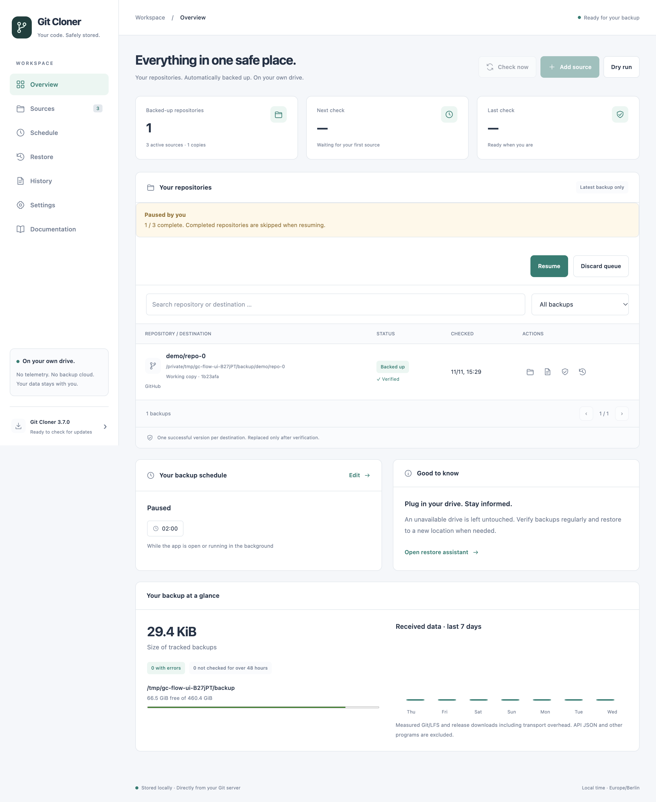

**Resume** skips destinations already completed in this run. A run interrupted by a crash, a forced quit or a shutdown (**Ready to resume after restart**), or stopped by an unexpected error, continues automatically once at each later scheduled time, so scheduled backups never stop unnoticed. Only a pause you chose waits for **Resume**; section [41](#41-reminder-for-paused-backups) describes how the app reminds you or resumes it. **Discard queue** removes only the pending run; existing backups are kept. While a queue waits, sources and backup content stay fixed. Performance rules, appearance and future check times can be changed. To change the backup content, complete or discard the run first.

A pause caused by a power or Wi-Fi rule is checked again about every 30 seconds while the app runs in the background and continues automatically once the conditions allow it. An independent worker checks rule pauses at its next starts; it does not keep watching after the interface has been closed.

State and queue are written in batches and when pausing. After a hard process termination, checks that were not recorded yet can run again; successfully replaced backups remain authoritative. No rotation of historical folders takes place.

## 13. Performance, download limit and resource rules

Under **Settings → Performance & rules**:

| Setting                       | Meaning                                                                                                                                                                                                                                      |
| ----------------------------- | -------------------------------------------------------------------------------------------------------------------------------------------------------------------------------------------------------------------------------------------- |
| Concurrent small repositories | 1–4, default 2. At most two small tasks per detected drive.                                                                                                                                                                                  |
| Small repository threshold    | GitHub size estimate in MiB, default 50. Unknown or larger repositories run exclusively.                                                                                                                                                     |
| Demanding backups             | Mirrors, LFS, submodules, metadata and encryption always run one at a time, regardless of the size estimate.                                                                                                                                 |
| Retries                       | 0–5 additional attempts for each temporarily failed network operation, default 2. Increasing delays and a limited respect for Retry-After. Nested retries do not multiply the number of attempts.                                            |
| Download limit                | KiB/s, 0 = unlimited. A shared limit for Git, LFS and release downloads including transport data. API JSON, uploads and other applications are not included. Section [43](#43-bandwidth-time-window) adds a daily window with its own limit. |
| Back up on AC power only      | On battery or with an unknown required power state the queue waits. Running tasks are completed.                                                                                                                                             |
| Allowed Wi-Fi names           | One exact name per line. Empty allows all networks. With a different or unknown Wi-Fi name the app waits.                                                                                                                                    |

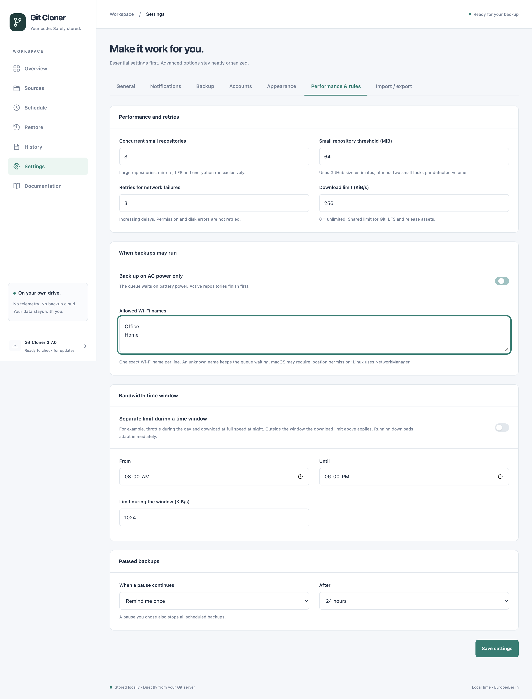

The rules apply before the first repository request of a backup run. A dry run requested manually is a separate read operation. On macOS the Wi-Fi name can be hidden for privacy reasons; check location and system permissions or leave the Wi-Fi list empty. Linux uses `nmcli` from NetworkManager; in Flatpak this host query may be unavailable. Mobile data plans are not detected automatically; a specific Wi-Fi list can, for example, exclude your own hotspot.

Download measurement and limiting use a local HTTPS tunnel without decrypting TLS traffic. A configured HTTP or HTTPS company proxy is respected. Unsupported proxy protocols cause an error instead of bypassing the limit silently. The app needs no certificates for this and never turns off TLS verification.

## 14. Backup content per source

In the source editor, open **Backup content for this source** and enable **Use source-specific backup options**. Mode, LFS, submodules, metadata, integrity and encryption then apply to this source only. The storage reserve is taken over from the general options when enabling it. All destinations of this source use the same content.

Without own options the general backup settings apply. For different rules inside an account, add single-repository rules; they keep priority over the account rule. Encryption requires an archive password. Mirror and checked-out submodules cannot be combined.

## 15. Restore selected files or folders

Under **Restore**, choose a backup or GCB file. Enter an archive password in the first area if needed. Under **Restore scope**, switch to **Selected files or folders** and open **Choose files**. Folders can be opened or selected completely. Several selection paths are possible; overlapping selections copy a file only once.

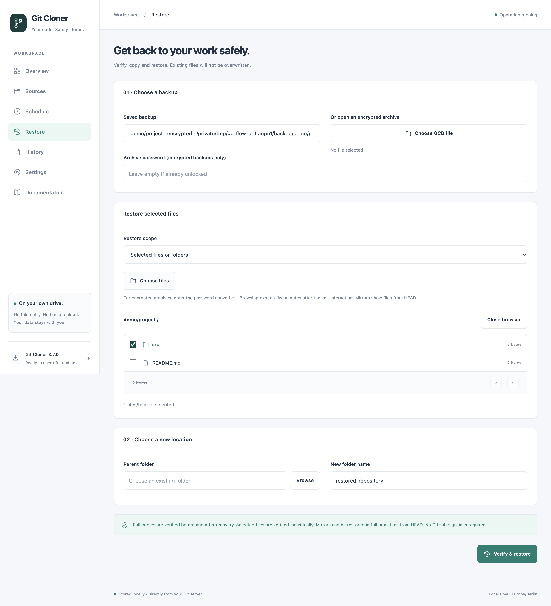

Then choose an existing parent folder and a new output folder name. The relative folder structure is kept. Git management files are hidden in the working copy selection. A mirror shows the files of its HEAD state; exported Git files are verified by their object IDs and existing LFS objects are resolved to their real content. Restoring a complete mirror stays possible as well.

New backups protect the file manifest with a separate hash in the management marker. The selection checks this manifest and the selected files themselves, so intact files can be rescued even if another file is damaged. Older backups without a manifest hash first need the previous complete check. The manual integrity check of the whole backup stays available.

Encrypted archives must be fully authenticated and extracted to a private local temporary folder for the selection. The file selection stays available for five minutes after the last use; closing it, leaving the Restore page or quitting regularly removes the temporary data. It is never removed during a running restore. After a hard process termination, temporary operating system files can remain; there is no forensic deletion.

## 16. Dashboard, high contrast and keyboard

During a run the overview shows the elapsed time, completed tasks, an approximate remaining time and received data. Remaining times are estimates from the run so far; before the first completed task there is no reliable estimate. The dashboard shows the recorded backup size, free space, network data received during the last seven local calendar days, and errors or backups not checked for more than 48 hours. Old status data may not contain byte values yet. Other programs and API JSON are not counted as backup downloads.

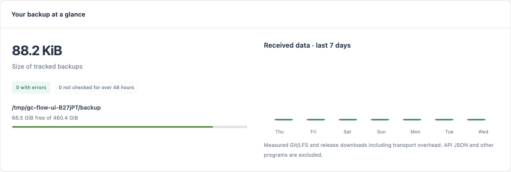

**High contrast** can be enabled under **Appearance**. Keyboard use includes visible focus outlines, a skip link to the content, status announcements and arrow keys, Home and End in settings tabs. The contrast checks of the tests do not replace a complete external accessibility certification.

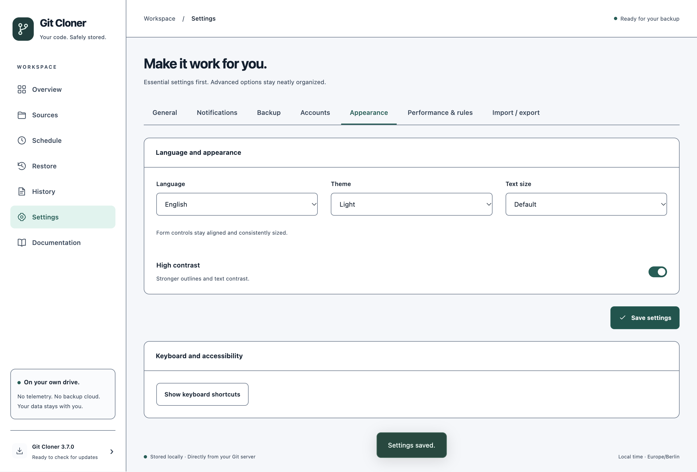

| Shortcut             | Function                                      |
| -------------------- | --------------------------------------------- |
| Cmd/Ctrl + K         | Open the overview and its search field.       |
| Cmd/Ctrl + N         | Add a source when no run is active or paused. |
| Cmd/Ctrl + B         | Start a check when sources exist.             |
| Cmd/Ctrl + Shift + P | Request a pause or resume.                    |
| Cmd/Ctrl + Comma     | Open settings.                                |
| F1                   | Show the keyboard shortcuts.                  |
| Esc                  | Close a dialog.                               |

## 17. Check times per source

Under **Sources → Edit source → Check times for this source**, enable **Use custom check times**. Then choose between one and 24 daily checks and enter each time, for example `01:00`, `09:00` and `17:00` for `example-account/project`. **Manual only** removes this source from automatic checks; manual runs can still back it up.

Without own times the general schedule applies. Pausing the schedule under **Schedule** also pauses the custom source times. **Check now** runs a normal pass for all active sources. Each source keeps its own saved check state; a run for one source does not prevent a due check of another. After waking up, only the last missed time of the current day is caught up per source.

With independent system scheduling enabled, the installed native app takes over the combined times automatically after saving. The computer still has to be on and awake.

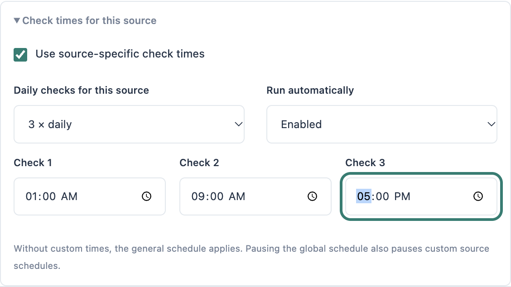

## 18. Back up releases for selected operating systems

Under **Settings → Backup**, enable **Releases with download files**. In the **Release assets** area choose:

- **All operating systems:** back up all files the project offers for its latest official release.
- **My operating system only:** back up the files for the automatically detected **Windows, macOS or Linux**. The detected system is shown next to the choice. All architectures and Linux package formats of this system are included.

The app assigns packages by their names and file extensions. Files without a clear assignment are left out in this mode; shared checksums and general notes are kept. If needed files have unclear names, use **All operating systems**. The actual selection, including left-out files, is documented with the backup. GitHub's automatically generated source code ZIP and TAR archives are not downloaded in addition; the Git content is covered by the repository backup. Use Mirror for all Git tags and the history.

The setting can be overridden per source under **Backup content for this source**. A download becomes part of the new backup state. The app checks reported file sizes and available SHA256 digests while downloading; on errors the previous successful state is kept. The space check adds known release file sizes to the repository.

The files of the latest official, stable release are backed up per repository. When a new release appears, the new backup state replaces the files of the older release; old download files are not kept in addition. Earlier release metadata can be part of the JSON export. Managed program installations retain the current and the most recently replaced version for rollback (see sections 35 and 40). The selection applies to your backup sources; the update check of Git Cloner itself only informs and never installs a version of Git Cloner automatically.

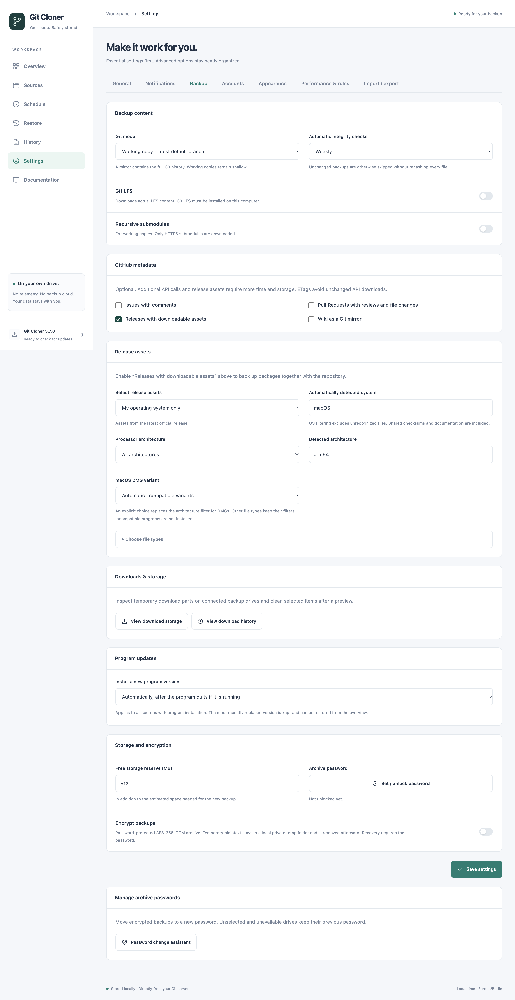

In the **Overview**, a backup with release files shows the saved tag and the number of files. **Restore release assets** opens the restore assistant. Choose **Choose files**, select the packages and enter a new output folder, for example the parent folder `/Volumes/Workspace` and the new name `project-release`. Existing output folders are refused. The assistant copies only the selected release files and verifies their integrity. This also works with encrypted backups and mirrors. Downloaded programs are never started automatically.

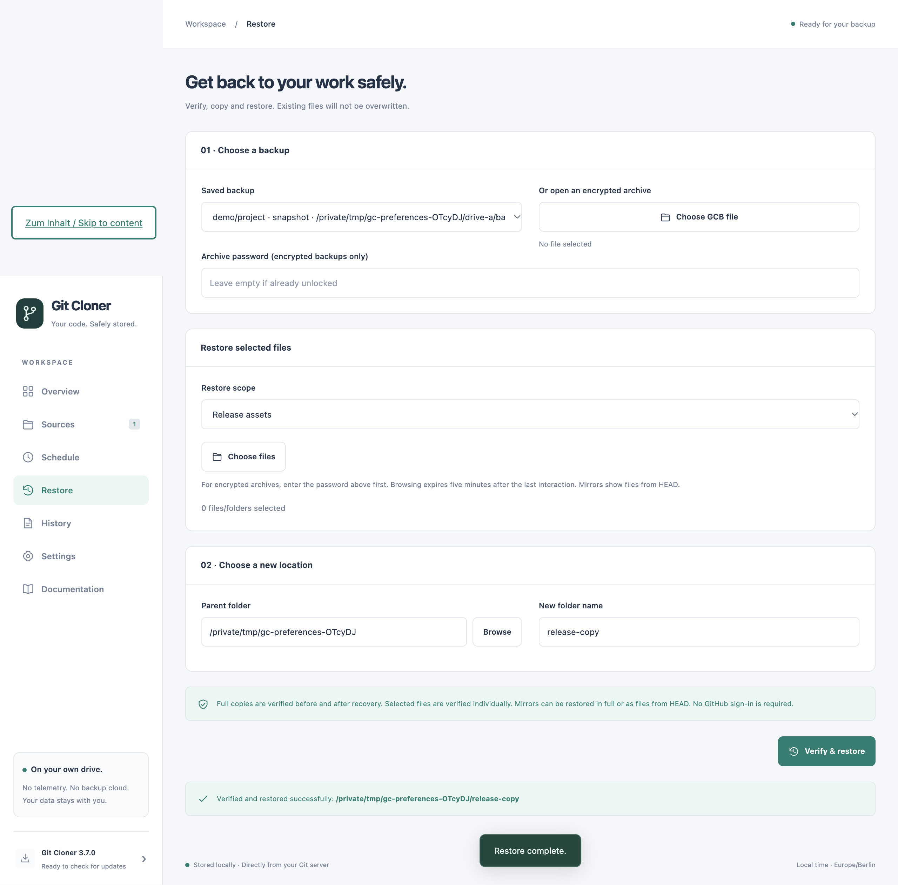

## 19. Review changes before a backup

In the **Overview**, choose **Review changes** for an existing backup. The app compares the saved Git state with the current default branch on GitHub. The list separates new, changed and removed files. The search filters file paths; larger lists are paged.

Click a file to load its text diff. Text files are shown up to 256 KiB per version. Large files and submodules stay in the file list; binary and LFS files have no text view. A very large file list, or one shortened by GitHub, can prevent the preview; the normal backup run stays available.

The preview never changes the saved backup and runs no project code. For encrypted backups, enter the archive password first if needed. Automatic backups wait during the preview. Closing it releases the backup; an unused session expires after about five minutes. **Check all active sources** closes the preview and starts the normal run for all active sources.

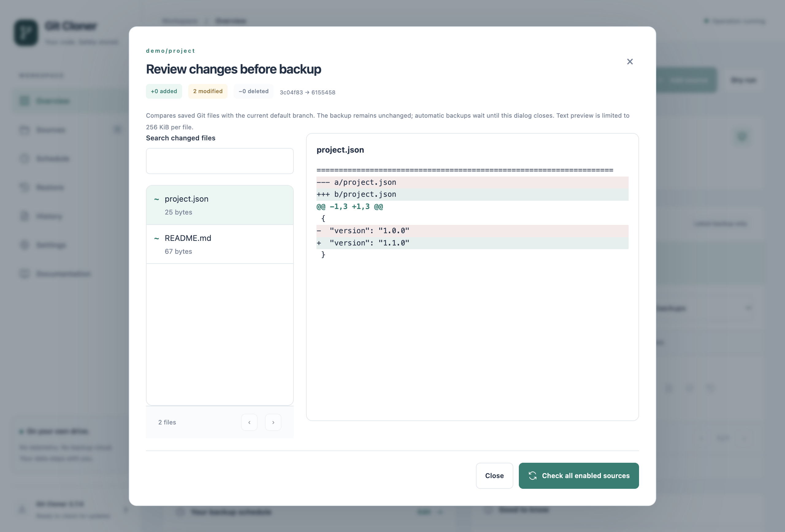

## 20. Find drives after a path change

**Schedule → Find drives** enables automatic matching. The app looks for known backup folders on connected drives by their saved folder identity and relative location. It checks about once a minute and before a new backup run. A search can also be started directly under **Sources → Find drives**.

Example: a known drive moves from `/Volumes/Archive` to `/Volumes/Archive 1`, or on Windows from `E:` to `F:`. With exactly one match the app updates the assignment. The existing backup is reused; it is neither moved nor cloned again. Completed tasks of a paused queue stay completed.

With several identical identities, nothing is chosen automatically. This can happen after copying a complete backup drive; then choose the intended folder in the source deliberately. The folder identity is not a hardware serial number. If a drive is missing, the search never creates a replacement folder at the old path.

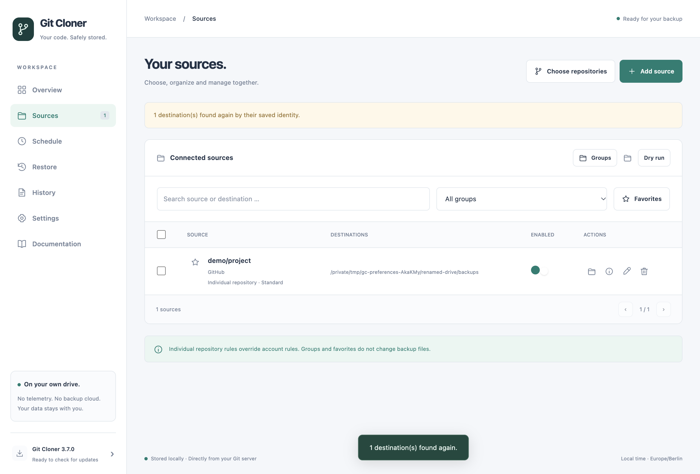

## 21. Notifications and quiet hours

Under **Settings → Notifications** system notifications can be turned off completely or set in detail:

- **All completed checks** reports every completed run.
- **Errors only** reports runs with errors.
- **Changes and errors** reports new or updated backups and errors.
- **No backup notifications** runs backups without system notifications.

These rules apply to manual and automatic runs. Status and history stay visible in the app. Notifications name what changed: installed program versions such as "Editor v2.0.0 installed.", versions that are ready to install or wait until a program is closed, and the repositories to review. **Program updates** has its own rule: it reports installations that happen after a program was closed and versions waiting for **Install now**, also when backup notifications are off. **New application versions** turns the notice about new Git Cloner versions on or off; a notice stays visible in the app. "Skip this version" keeps its effect across restarts.

For quiet hours, enable **Daily quiet hours** and enter for example `22:00` to `07:00`. The local time applies; periods across midnight are supported. During this time no system notifications appear and backup notifications are not collected for later. A new version notice that has not been shown yet can appear after the quiet hours while the app is running. Permissions and focus or do-not-disturb settings of the operating system apply in addition.

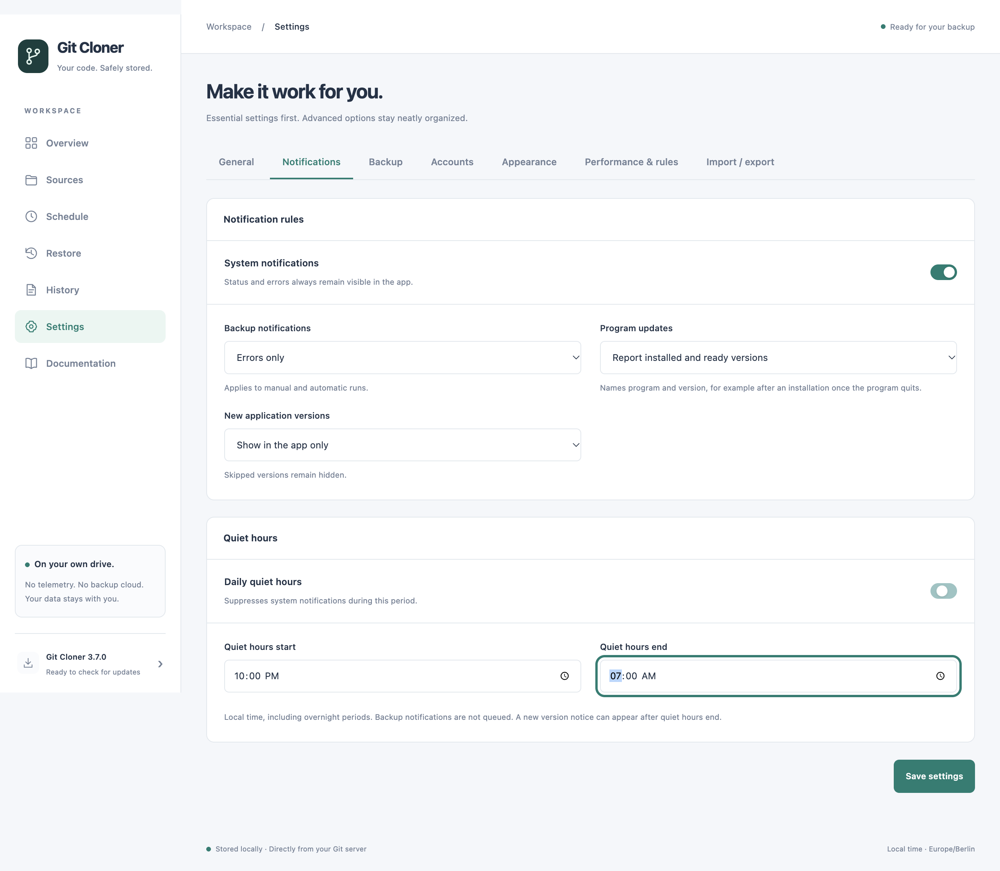

## 22. GitLab and Forgejo sources

Under **Sources → Add source** choose the **provider**. GitHub uses `https://github.com`. For GitLab enter for example `https://gitlab.example.org`, for Forgejo `https://git.example.org`. HTTPS servers are supported, also with a fixed installation sub-path. Credentials, query parameters and fragments do not belong in the server address.

Under **Source type** choose whether a whole account, organization or group or a single repository is meant. For GitLab subgroups choose **Account / organization / group** explicitly: `example-group/subgroup` is a group, `example-group/subgroup/project` a repository. The group backup includes subgroups and leaves out projects shared from elsewhere. Forgejo supports accounts, organizations and `account/project`. One source per line; the chosen provider and server apply to these lines.

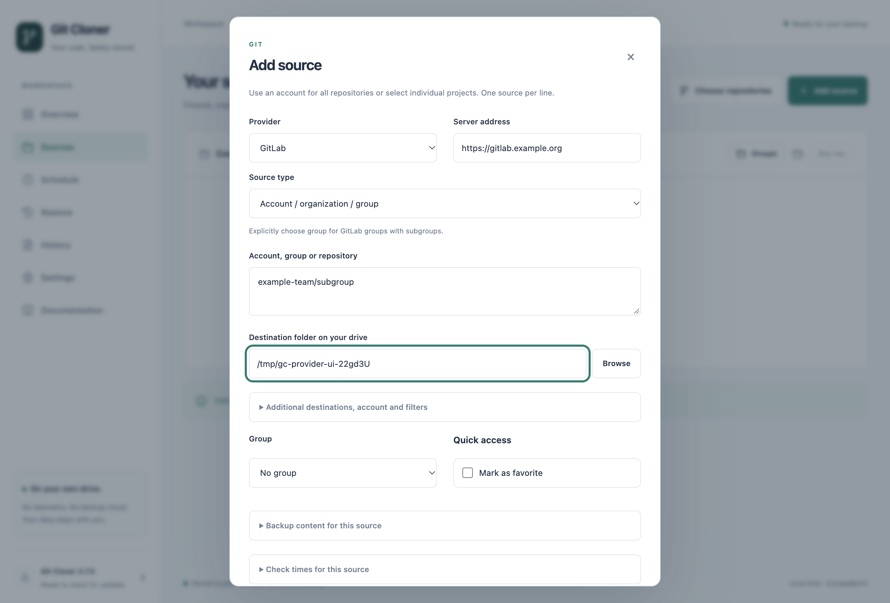

For private sources, add an account with the same provider and exactly the same server under **Settings → Accounts**. For Forgejo, also enter your own user name. Save a matching read token and select it in the source under **Additional destinations, account and filters → Use credentials**. GitLab needs permissions to read the API and the repository, for example `read_api` and `read_repository`. For Forgejo the required read permissions depend on the chosen repository, issue, organization and account functions. Tokens are saved only with an available secure key store. **Public · without token** never uses the GitHub default token for other providers.

An account stays bound to its server. Remove saved credentials before changing this assignment; the app never passes tokens to other servers or external asset redirects. The GitHub device sign-in applies to GitHub only; GitLab and Forgejo use a matching token.

GitHub keeps the layout `destination/account/repository`. Other providers receive a stable folder with provider, server and a short server ID in front, so `example-account/project` on two different servers never overwrites another backup. The dry run shows the complete destination path. Working copies, mirrors, LFS, HTTPS submodules, encryption and restore work for these sources as well.

GitLab metadata includes issues and notes, merge requests with notes and file diffs, releases with files and the wiki. Forgejo exports issues and comments, pull requests with reviews and files, releases with files and the wiki. API permissions and data limited by the server, such as shortened merge request diffs, still apply. GitLab has no pre-release flag like GitHub: upcoming releases and tags recognizable as SemVer pre-releases are left out when choosing files. Automatic source code archives are not downloaded in addition here either.

The app uses GitLab API v4 and Forgejo API v1. Forgejo is additionally tested with a real private HTTPS test server. GitLab is tested with controlled API scenarios and real public API calls; a private GitLab installation with its own SSO or proxy configuration needs its usual server permissions. This support is not a complete export of all CI, package registry or administration data of a Git server.

## 23. Search and export the history

Open **History** in the sidebar. Search by repository, set **Result** to all checks, errors or changes and optionally enter **From** and **Until** (both inclusive). The date limits use local time. Search and details are paged so that large histories never block the interface.

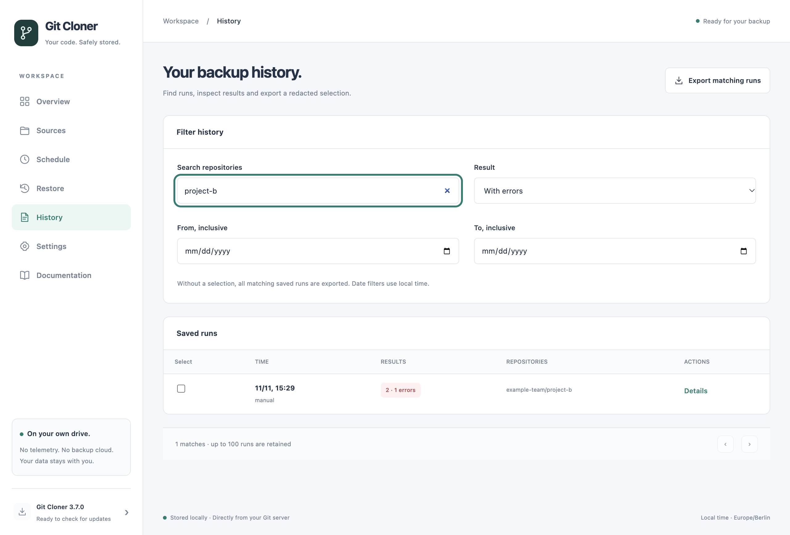

**Details** opens the results of a run; a repository search is carried over. For errors, the matching **Troubleshoot** help opens directly. Select checkboxes and use **Export filtered runs**: with a selection, these runs are exported, without a selection all matching saved runs. In the details dialog, **Export this run anonymously** exports the complete saved run.

The export replaces repository names with neutral identifiers and removes personal paths, raw error messages and credentials. It contains the saved results, no backup files. The last 100 completed runs and at most 500 detailed results per run are kept; a truncation is shown. Details that were not kept cannot be reconstructed later.

## 24. Wait automatically when space is low

If the free space including the reserve is not enough, the queue switches to **Waiting for space · resumes automatically**. The previous successful backup state is kept. Completed destinations stay saved as completed; the affected task is not marked as successful.

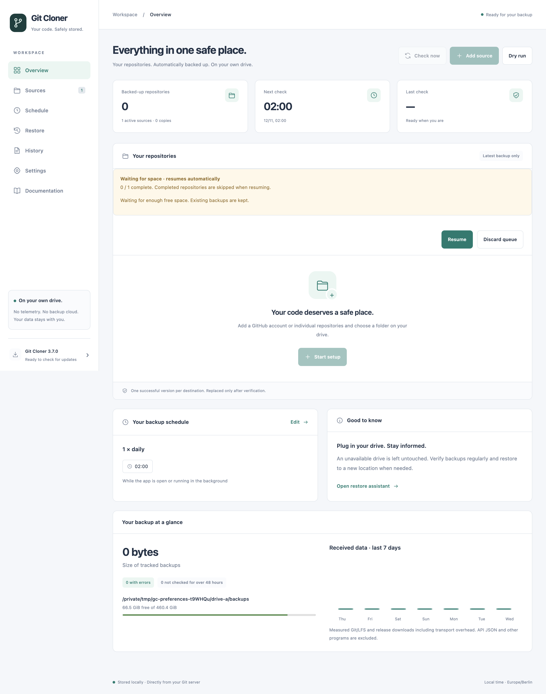

Free space outside existing backups and keep the correct drive connected. While the app runs, it checks about every 30 seconds whether the saved space requirement is met. No Git or repository API requests are repeated for this. The queue then continues automatically. **Resume** starts a check immediately. If space is still missing, the queue is kept.

With the app closed, the next check happens at a configured native worker time or when the app is opened and resumed. A computer that is off or asleep is not woken. A queue you paused yourself follows section [41](#41-reminder-for-paused-backups). If the drive path changed, drive matching can also assign the waiting task.

The app never deletes other backups to make room. To change the backup content or the reserve while a queue is held, discard it deliberately and then change the options; existing backup files are kept. A new run still skips unchanged successful states.

## 25. Contextual help for errors

Choose **Troubleshoot** in the overview or in the history details. An error toast offers it too. The help suggests steps for the type of error: token and read permissions, network, VPN and proxy, API waiting times, drive assignment, write protection, free space, Git and LFS, or archive passwords.

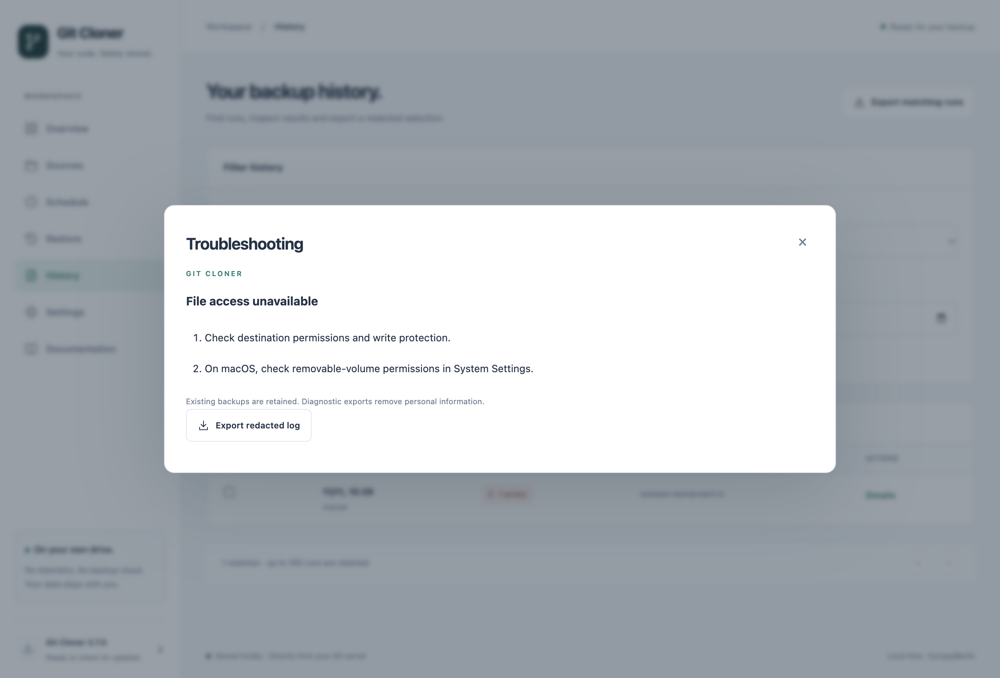

The help changes no system settings and removes no data. An anonymized diagnostic log can be exported for a bug report. With integrity or password errors, keep the originals and restore to a new location first.

## 26. Change the archive password

Open the encrypted backups under **Settings → Backup → Password change assistant**. The list shows up to 100 archives per page with their availability and known password assignment. Select available archives; up to 1000 archives can be changed in one run. Archives that are not selected or on missing drives keep their previous password for now.

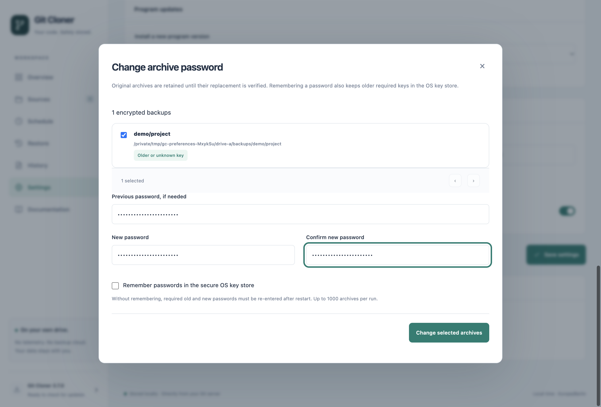

Enter the **current password** if needed, choose a **new password** with at least twelve characters and **confirm** it. If matching older passwords are already saved securely, the current password field can stay empty. The app authenticates a selected archive before it takes over the new active password.

**Remember passwords in the secure key store** is optional and keeps your previous choice. With independent encrypted scheduling enabled, remembering is required. Saved older passwords stay available for archives that have not been changed yet. Without remembering, the old and new passwords that are still needed must be entered again after a restart; the management file then contains identifiers only, never passwords.

**Change selected archives** decrypts and verifies each archive in a private temporary folder, creates the new encrypted state and then replaces the archive. Content and Git history are kept. The recovery data contains no passwords. If a replacement is interrupted, it is completed from the saved state after the next start or before another archive operation, or returned to the intact old archive. If the drive is missing, this state is kept.

**Stop after current archive** stops between two archives; an archive in progress is completed. The result area shows successful, failed and remaining archives with an older assignment. After reconnecting a drive, open the assistant again; known old keys or the previous password allow the change. Older external GCB copies that are not part of the managed selection are not changed automatically.

The process needs additional space for the previous and the new encrypted state and for authenticated and extracted temporary data. Temporary plain-text data is removed regularly; after a hard process termination, operating system temporary files can remain. A forgotten password cannot be recovered, and there is no forensic deletion. The simple **Set or unlock archive password** checks the matching password for reachable existing archives; use the assistant for an actual change.

## 27. Recommendations for LFS and submodules

Under **Sources**, open **Recommend content** for a saved source. For an account or group source, enter a repository of this source. **Check content** reads the Git file tree and small `.gitattributes` files. No project is cloned and no project code runs.

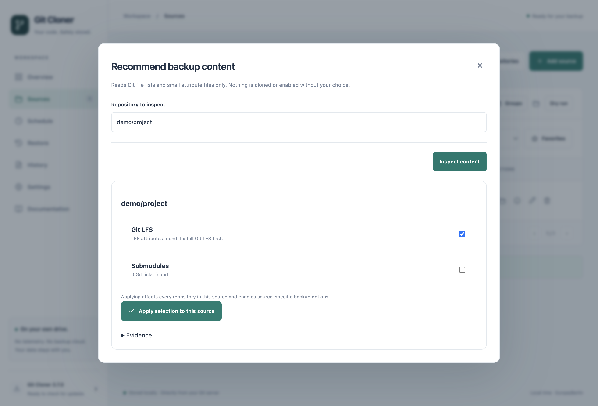

The app detects LFS attribute rules and submodule references, shows the paths found and, for LFS, checks whether Git LFS is available locally. Incomplete or limited API results are marked; missing hints are then no proof that the project contains no such content.

Check the boxes and only then choose **Apply selection to this source**. This uses source-specific backup options; the global settings are kept. For a whole account or group source the selection applies to all its repositories. Submodules need the working copy mode and reachable HTTPS destinations; with Mirror this recommendation stays disabled until the mode is changed deliberately. Install Git LFS separately if needed. Closing without applying changes no options.

## 28. Choose repositories with checkboxes

Under **Sources → Choose repositories**, first set the provider and HTTPS server, choose matching credentials and enter your account, organization or group name. The fields start without preset accounts or repository names. GitLab also supports subgroups such as `example-group/subgroup`. **Load** only reads the repository list; nothing is cloned or created on the backup drive yet.

The list loads up to 50 entries per page. The search is sent to the provider. Checkboxes stay selected when paging and when searching again within the same selection. The checkbox in the table header affects the current page only. Repositories already added as single sources are marked. GitHub limits its search API to at most 1,000 results; a shortened search is shown and should be narrowed. Private repositories need matching read permissions.

Then choose an existing shared destination folder, optionally a group you created and the favorite status, and choose **Add sources**. Each selected repository becomes its own source that can be adjusted later. At most 100 sources are possible in total. A selection expires after 15 minutes without use. Changed provider, account or owner details must be loaded again before adding. **Cancel** saves no sources.

**Pasting GitHub addresses:** an address such as `https://github.com/example-account/example-project` is cleaned up to `example-account/example-project` in the source field immediately. `.git`, trailing slashes and common sub-pages such as releases or branches are recognized. Entries can still be typed line by line.

An account or organization page such as `https://github.com/orgs/example-team/repositories` opens the repository list automatically and enables **Include new repositories automatically**. **Add owner source** saves one source for all matching current and future repositories. The list is determined again at every check, so new projects are backed up as well. Single-repository rules take priority, also when paused. Existing filters, backup options and check times from the source form are taken over.

Entering the same page again creates no duplicate owner source and overwrites no existing settings. New repositories are already covered by the owner source. **Show repositories** in its source entry opens the current list again. A paused existing owner source stays paused; it can be enabled explicitly under Sources.

For a fixed selection, turn **Include new repositories automatically** off. **Select all missing** also covers further pages and skips repositories already added as single sources. If the selection exceeds the limit of 100 sources, nothing is added partially; an owner source covers large accounts with a single source. Checkboxes and search still allow a specific subset.

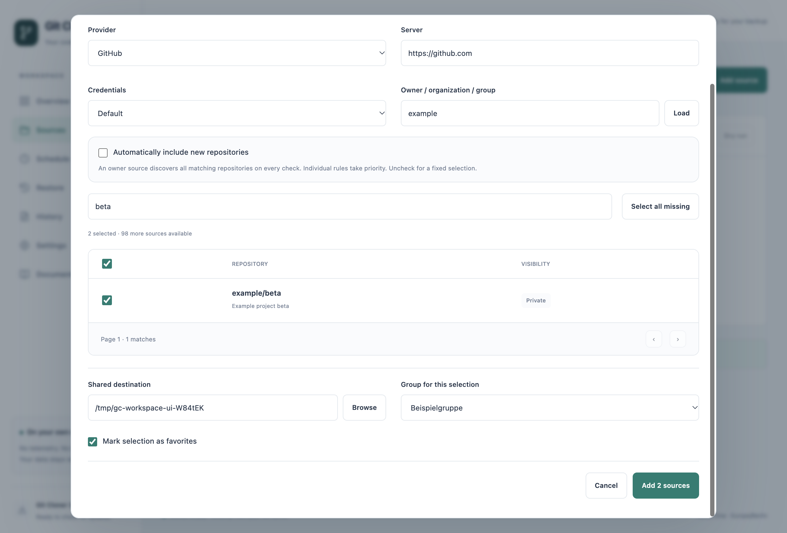

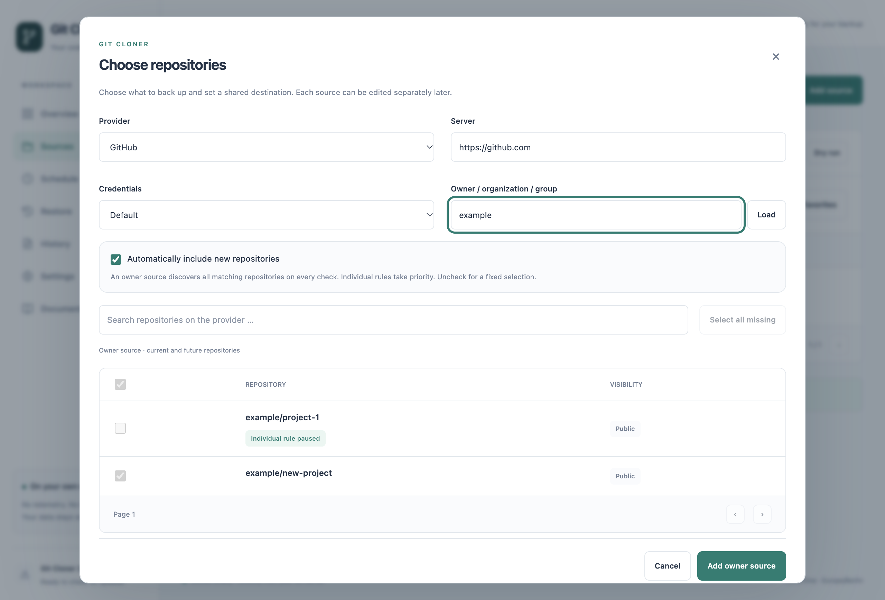

## 29. Groups, favorites and source selection

**Sources → Groups** manages up to 30 named groups. Create, rename or remove groups there. Removing a group keeps its sources and backup files; these sources are then without a group. On first start no groups exist.

The star next to a source toggles its favorite status. Search, group filter and **Favorites** combine. Each page shows at most 25 sources. Checkboxes select sources across pages and filters. The action bar shows the total; **Clear selection** removes only the selection. **Assign group** and **Add or remove favorite** organize the selection directly. Organization and favorites also work with a disconnected drive or during a running backup; backup content and active queues stay unchanged.

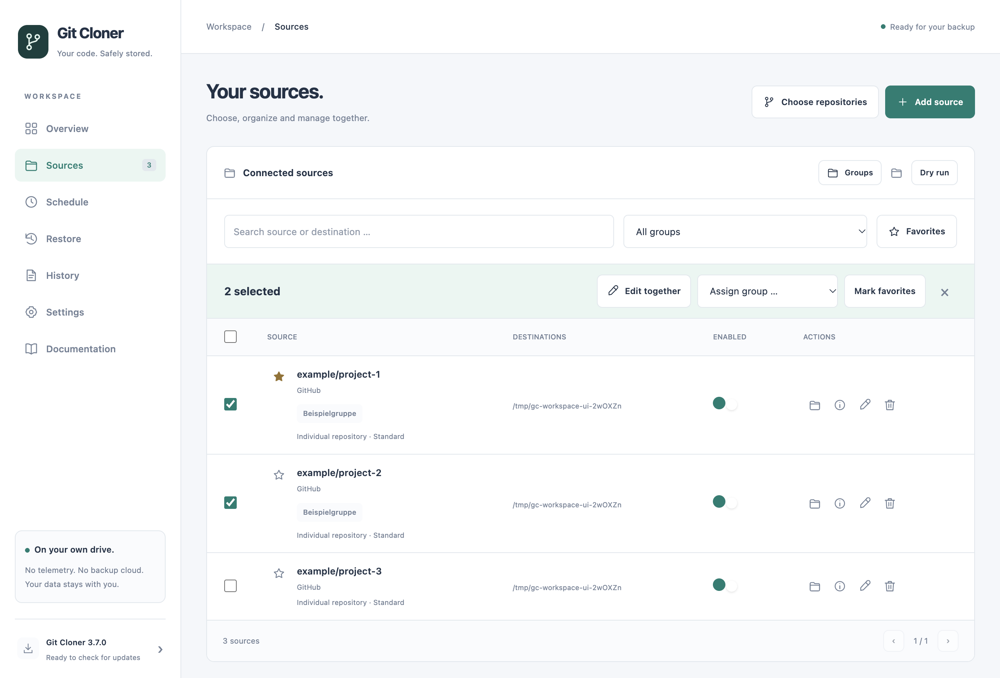

## 30. Edit several sources together

Select sources with their checkboxes and open **Edit together**. All fields start with **Leave unchanged**, so differences between the selected sources are kept and only explicitly chosen values are replaced.

Besides group, favorite and activation, shared changes to destination folder, compatible credentials, fork and archive filters, name patterns, backup content and custom daily check times are possible. Backup content and schedule can also return to the global options. With targeted backup changes, all other options of each source are kept. An enabled pattern field left empty on purpose removes the previous patterns. Mirror and submodules stay incompatible.

**Review changes** shows **Before** and **After** for each affected source, with up to ten sources per preview page. The preview writes neither backups nor drive identities. Only **Apply changes** saves the reviewed configuration. If the configuration changes in the meantime, the preview must be created again; an old preview never overwrites newer settings. A preview is valid for at most five minutes.

A changed destination folder applies to future backups. Existing backup folders stay at their previous location. Sources and backup content cannot be changed during running or paused runs. New encryption options need an unlocked archive password; independent system tasks also need this password to be remembered securely.

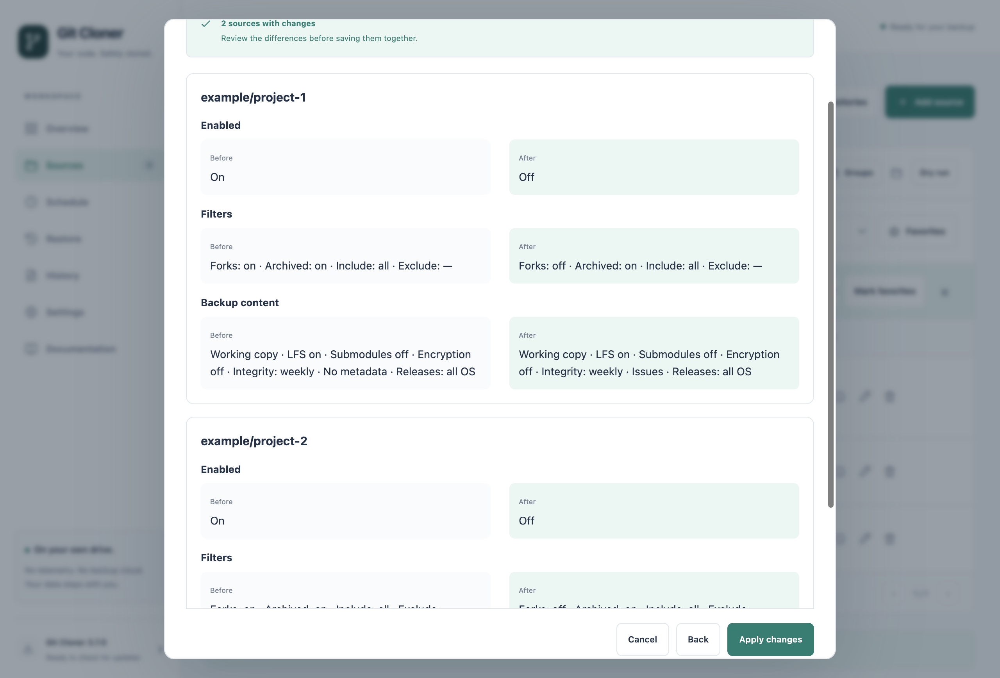

## 31. Resume large release downloads

When release files are backed up, the app keeps verified parts after a network interruption. At the next attempt or after a restart it resumes matching downloads with HTTP Range. A strong ETag or sufficiently old, reliable HTTP modification date is checked with `If-Range`; available SHA256 values are verified in addition. Without a suitable identifier or checksum, the download starts again safely. If the server ignores Range or its identifiers change, the previous file is never replaced by parts that do not belong together.

The progress shows file, downloaded amount and, if applicable, **Resumed from …**. Files already cached completely are verified again before use. After an error the previous successful repository state is kept.

The temporary folder `.git-cloner-downloads` is in the configured destination and separate from the successful backup. With backup encryption enabled, saved download parts are also encrypted individually with AES-256-GCM; this requires the archive password, which is never stored in the cache. Unencrypted backups use download parts with restricted file permissions. Cache, new backup and replacement temporarily need additional space.

After a successful backup the own cache files are removed. Unused parts older than seven days are checked and cleaned up when this repository cache is used again. Foreign files, links or invalid identifiers are never deleted. As with encrypted backups, temporary plain-text data can remain in the working folder after a hard process termination; there is no forensic deletion.

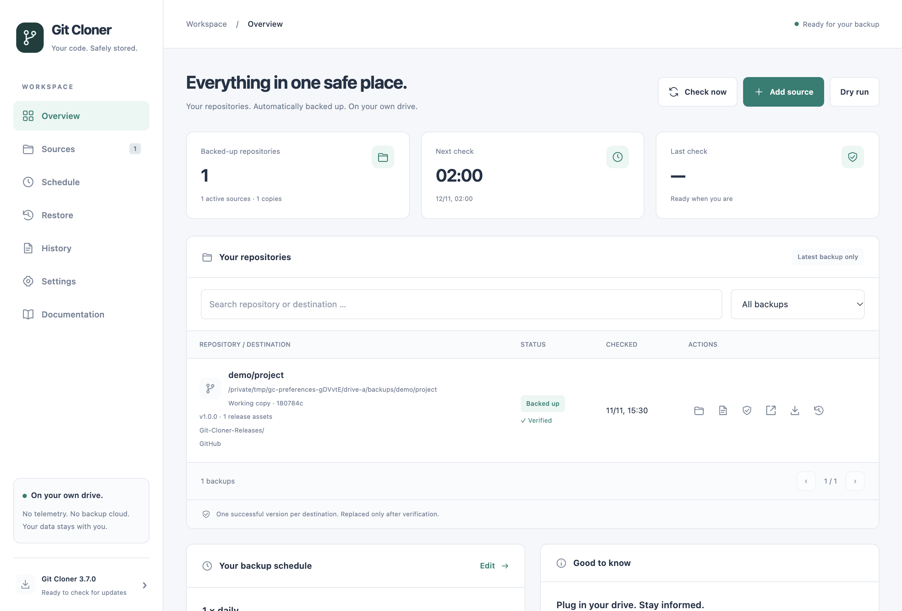

Further detail views are described as a [separate interface concept](DETAILANSICHTEN.md); the features named there are not implemented yet.

## 32. Reuse existing release assets

Reuse is always active. When Git files, release descriptions or other metadata change, already saved unchanged release files are taken over locally into the new state. Before that, the app checks the existing file manifest, the file identity and the copied content. SHA256 values from the provider take priority; otherwise file name, ID, size and available modification data or URL are bound. Damaged or changed files are downloaded again.

Download counters are not part of the change comparison, so other people's downloads never trigger a new backup. With a completely unchanged state the normal unchanged backup is kept. The progress names a local takeover explicitly.

For encrypted backups the app authenticates the previous archive and unlocks it temporarily for reuse; the matching archive password is needed. If the old state cannot be read safely, the file is downloaded again. Temporary plain-text data is removed afterwards; a hard process termination and forensic deletion remain technical limits.

## 33. Architecture and file types

Under **Settings → Backup → Release assets**, first enable **Releases with download files**. Then choose the operating system and **processor architecture**. **My architecture only** uses the architecture of the running application; a specific choice such as ARM64 or x64 is possible as well. Universal packages count as matching. Files with an unclear architecture are left out when a specific architecture is chosen.

Under **Choose file types**, select the formats you want. Without a selection all formats are allowed. Several selections combine, for example DMG and ZIP. Operating system, architecture and file type work together. For an ARM64 Mac, for example, choose **My operating system only**, **ARM64** and **DMG**. Shared checksums and matching signature files are still backed up.

The selection applies globally or, under **Edit source → Backup content for this source → Use source-specific backup options**, to one repository. Changing the filter rebuilds the current state and takes over matching existing files locally. Files that are no longer selected disappear only with a successfully verified replacement backup. The selection describes the provider's file names; it never runs any program.

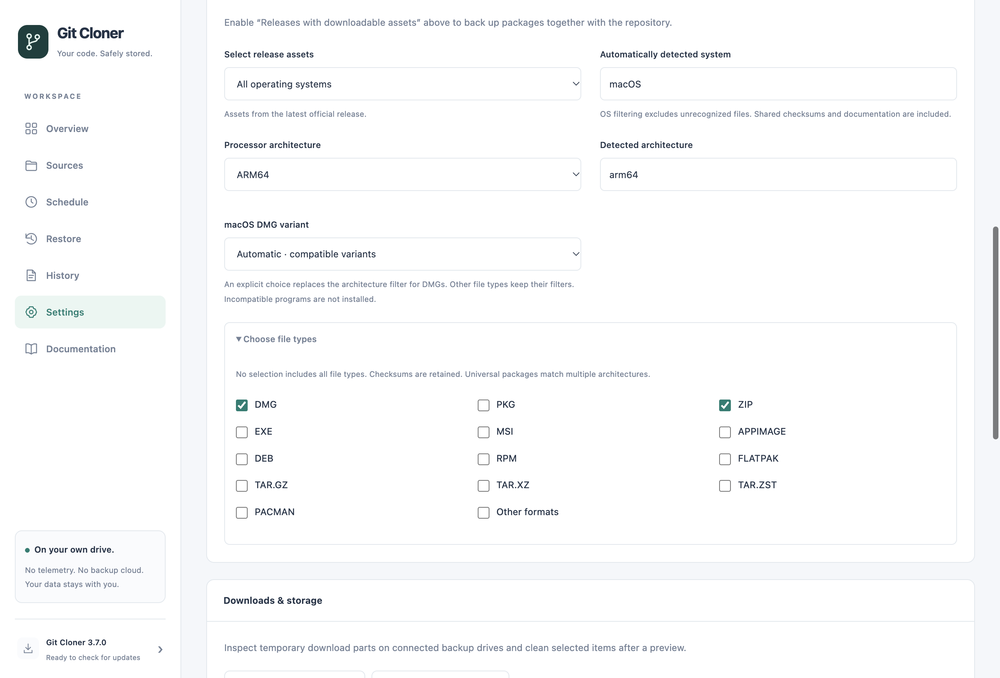

## 34. Clean up download storage

**Settings → Backup → Downloads & storage → Show download storage** reads the connected configured backup destinations. The view shows used bytes of detected temporary files, number of parts, time, completeness and encryption. Where possible, the source is shown. Encrypted leftovers store no unencrypted release file names, so the view can be more general.

Select entries with their checkboxes and open **Review cleanup**. The preview names number and size. **Back** changes no files. Only **Clean up selected parts** removes the reviewed own temporary parts; they must be downloaded again next time. Completed backups and installed programs are kept.

Nothing is cleaned up during own write operations. Additional locks protect active downloads of other app processes. After changes to the files or backup destinations, a new preview is required. Foreign files, links, invalid identifiers and replaced drives are never deleted. The view is limited to 1,000 entries and 10,000 parts per entry; warnings explain areas that could not be checked.

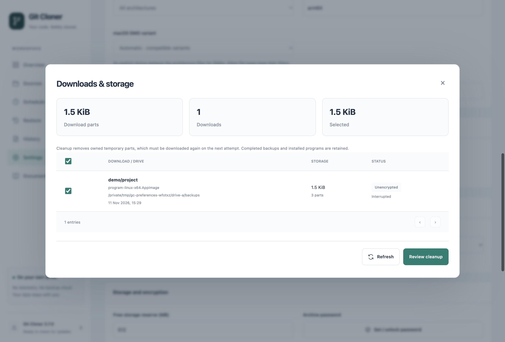

## 35. Install programs from a repository automatically

This option updates **the program from your chosen source**, not Git Cloner itself. It is off by default and applies to single repositories only. An owner source never installs newly discovered programs automatically.

1. Open **Sources → Add source / Edit source** and enter a single repository of your own, such as `example-account/example-program`.
2. Expand **Install program automatically** and enable **Install and replace the latest release**. This enables source-specific backup options with release files. If release files were off before, your own operating system is chosen first. Release filters that are already active are kept.
3. Choose an existing **program destination folder**, separate from all backup folders. The app creates an assigned location `account/repository` inside it. Other providers add their own provider and server folder.
4. Optionally narrow the **release file name**, for example `*.dmg`, `*portable*.exe` or `*.AppImage`. `*` and `?` are possible. Without a pattern a suitably classified supported package is preferred; with several equal candidates a narrower choice is required. The same file published under two names (identical SHA-256) counts as one candidate.
   By default the backup then keeps **only the file of the latest release that is installed**, for example exactly one DMG. The other files of this release and older releases are removed from the backup state at the next run; matching existing files are taken over locally instead of being downloaded again. To keep all matching release files in addition, enable **Keep all matching release files**. If no single program file can be determined, the filtered files are kept.
5. Save the source and choose **Check now**, or wait for the next scheduled run.

After a successful backup, the app checks the actual release files again and prepares the program separately. Only then is the existing assigned program copy replaced; the replaced version is kept as the previous version (section [40](#40-restore-the-previous-program-version)). If version and content are already current, the existing installation stays. Errors keep the previous program state and appear in addition to the backup status, in the error counter, the history and the configured error notifications. The overview shows the installed tag and offers **Open program folder**. Installation never starts a program. Section [39](#39-when-program-updates-are-installed) explains what happens while a program is running.

| System  | Supported automatic installation                                                                                                                                                                                                                                                                                                                                                                                                                                                                                                                                                                                                                                                                                                                                                                           |
| ------- | ---------------------------------------------------------------------------------------------------------------------------------------------------------------------------------------------------------------------------------------------------------------------------------------------------------------------------------------------------------------------------------------------------------------------------------------------------------------------------------------------------------------------------------------------------------------------------------------------------------------------------------------------------------------------------------------------------------------------------------------------------------------------------------------------------------- |
| macOS   | One clearly recognizable `.app` bundle from a DMG or ZIP. Signature, bundle and actual processor architecture are checked. Ad-hoc signed bundles are possible; no signing certificates are set up. Finder layout data that many DMG tools store on every file (`com.apple.FinderInfo`) is not part of the signature: the app is checked inside the image with every other strict rule, and the installed copy is cleaned of this data and must pass the full `codesign --strict` check. DMGs with a license agreement open without a prompt through a read-only copy; by enabling installation you accept the terms of this publisher. A DMG already open in Finder is read and stays open. On Apple silicon, Intel-only programs are chosen only if no native package exists; they run through Rosetta 2. |
| Windows | A portable EXE or ZIP with one clearly recognizable main program and companion files. PE header and actual architecture are checked. A running program is detected because Windows refuses write access to it.                                                                                                                                                                                                                                                                                                                                                                                                                                                                                                                                                                                             |
| Linux   | An AppImage with matching ELF and AppImage header and processor architecture. The file is saved as executable in the assigned location. A running AppImage keeps working while it is replaced.                                                                                                                                                                                                                                                                                                                                                                                                                                                                                                                                                                                                             |

MSI or NSIS system installers, PKG, DEB, RPM and arbitrary installation scripts are never run automatically. There is no automatic elevation of privileges. If permissions are missing or Windows locks a file in use, the previous state is kept. After importing settings, installation is turned off again and must be enabled locally per source.

Use this option only for publishers you trust. Keep personal data and settings outside the managed program copy. Additional files directly in the managed destination or foreign temporary folders block the replacement; a `.DS_Store` file created by Finder is the only exception. Changing the destination keeps existing installations at the old location; they are never moved or deleted without asking. A hard termination can leave own temporary working data; an interrupted replacement is resumed at the next installation attempt using its identifiers.

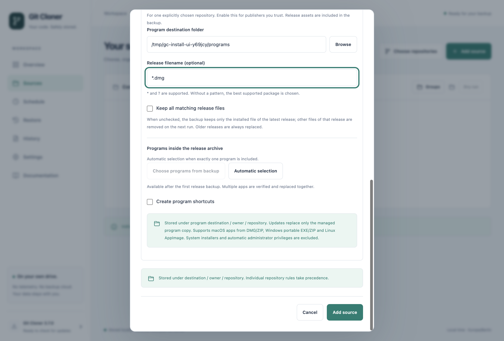

## 36. Program shortcuts

The examples stay anonymous: `example-account/program-suite`, a backup folder of your choice and a separate program folder. No example repository is added automatically.

1. Open **Sources → Edit source → Install program automatically**.
2. Enable installation and choose an existing program destination folder if not done yet.
3. Enable **Create program shortcuts**. The desktop folder reported by the operating system is suggested; **Browse** chooses another existing folder. It must be outside the backup and the program location.
4. Choose **Save changes** and **Check now**, or wait for the scheduled run.

After a successful installation every chosen program receives a shortcut: on macOS a symbolic Finder link to the `.app`, on Windows a real `.lnk` file, on Linux a `.desktop` launcher. No downloaded program is started. Some Linux desktops require allowing a desktop file once. Windows shortcuts are created through the native Electron interface without running program code.

Shortcuts point to the current managed program state, also after restoring the previous version. With a changed selection only own unchanged shortcuts are removed; after a folder change the new ones are created first. A file edited by the user or a foreign file is never overwritten or deleted; a message appears in addition to the successful installation. The assignment is stored in a hidden companion folder in the chosen shortcut folder. If this assignment is removed, the app treats remaining files carefully as foreign.

To remove own shortcuts, turn the option off, save and check once more. Simply turning off the whole program installation or a source removes no existing programs or shortcuts. Old program copies at earlier destinations are kept as well.

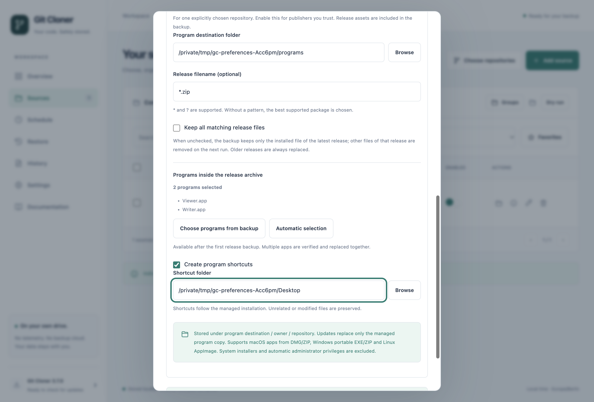

## 37. Several programs from one release file

1. Back up a single repository with **release files**. If the archive contains several programs, the installation can report that it is not unambiguous; the release backup stays successful.
2. Edit the saved source and open **Install program automatically → Choose programs from backup**. With several equal release packages, narrow the **release file name** first, for example `*suite*.zip`.
3. The app opens only the existing verified release file. On macOS it shows `.app` bundles from DMG or ZIP, on Windows possible main programs from a portable ZIP. Signature or program format and CPU are checked before the selection; entries that do not match stay disabled. Linux AppImages and single portable EXE files stay single programs.
4. Choose between one and 64 programs, **Apply selection** and then save the source with **Save changes**. **Cancel** applies no selection. **Automatic selection** returns to the previous behavior with one clearly recognized program.
5. Choose **Check now**. The selected programs are prepared together and the assigned installation is replaced only after a complete check. A changed selection with an identical release also triggers the required replacement.

The selection uses the paths inside the archive and applies to later releases. If a publisher changes these paths or a chosen app is missing, the previous installation is kept; open the selection from the new backup again. If one of the managed programs is still running, section [39](#39-when-program-updates-are-installed) applies.

Windows portable programs often need shared DLLs and helper files: the portable folder is copied with its companion files. Further EXE files can therefore remain as companion files; you choose the main programs to manage and their shortcuts. MSI, NSIS or PKG system installers and arbitrary installation scripts are still never run.

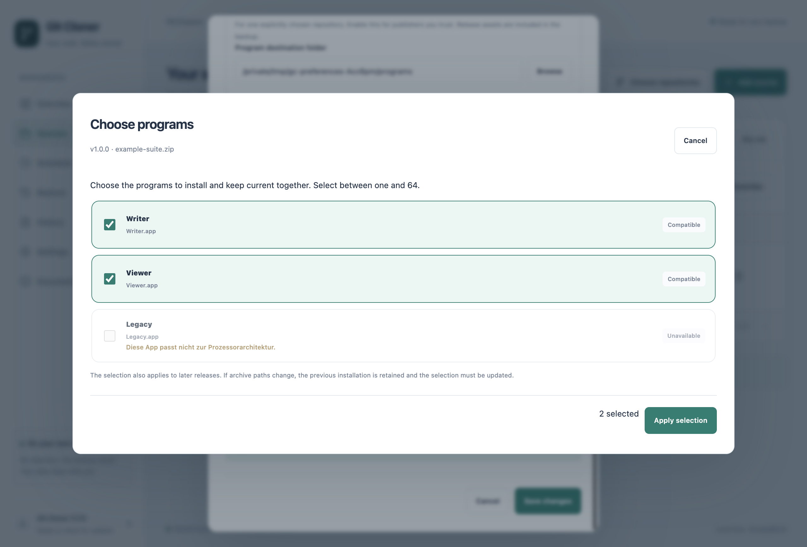

## 38. Download history and measured savings

**Settings → Backup → Downloads & storage → Show download history** opens the overview. It reads the history only when opened or refreshed and needs no request to GitHub for this.

| Value                       | Basis of measurement                                                                                                                                                                                                                                                                   |
| --------------------------- | -------------------------------------------------------------------------------------------------------------------------------------------------------------------------------------------------------------------------------------------------------------------------------------- |
| Received release payload    | File bytes actually read from the response streams, including failed attempts. HTTP and TLS headers and other protocol traffic are not included; compressed responses are counted after decoding. Git clone and metadata traffic is not part of this value.                            |
| Download avoided            | Files taken over locally after a content check and download parts that existed before this download and were used successfully. Parts received again within the same attempt are never counted as savings, also with retries. Unchanged repository checks produce no invented savings. |
| Cache file bytes cleaned up | Sizes of own temporary files including cache identifiers, measured before they were removed successfully. Automatic cleanup after a backup and manual cleanup are included. Physically free capacity can differ because of file system blocks, compression and shared blocks.          |

Search by repository, file name or tag and filter by **Result** or **Period**. The figures always apply to all filtered entries, not only the visible page. Each page holds at most 50 entries; the history keeps at most 2,000 events. No historical values are invented afterwards and no supposedly measured time savings are estimated.

The history is stored locally in the app profile and kept after restarts. Writes are batched; the first entry and state and run completions save pending entries. After a hard process termination, events not written yet can be missing. A cleanup cannot reconstruct lost old entries either. For encrypted backups, file names of release files are not written to the history; repository names and tags stay visible as in the existing backup status. Entries marked **Failed** count received payload but no successfully avoided downloads.

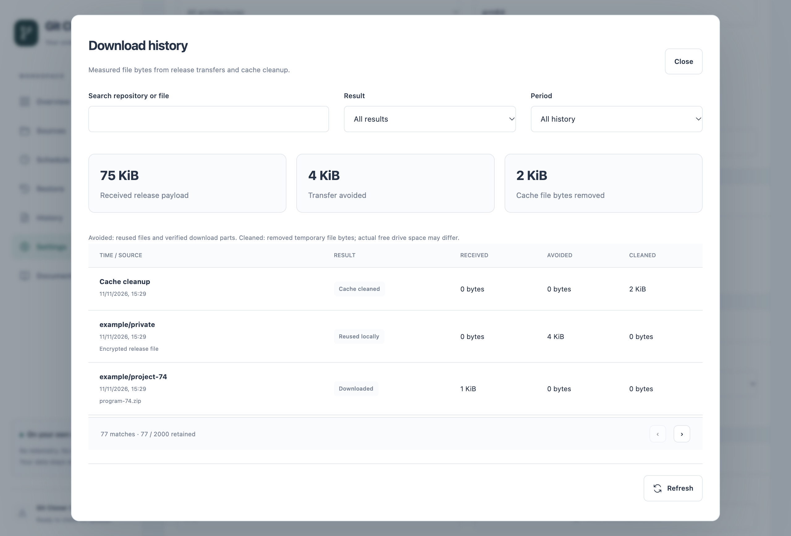

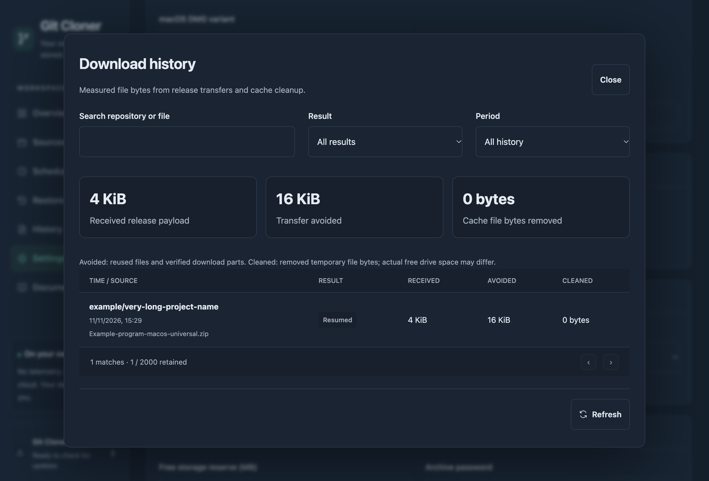

## 39. When program updates are installed

**Settings → Backup → Program updates** decides how a newer program version from a backed-up release is installed. The setting applies to all sources with program installation:

| Choice                                                            | Behavior                                                                                                                                                                                                                                                                                       |
| ----------------------------------------------------------------- | ---------------------------------------------------------------------------------------------------------------------------------------------------------------------------------------------------------------------------------------------------------------------------------------------- |
| Automatically, after the program quits if it is running (default) | The new version is installed right after the backup. If the program is open, the overview shows **Program running · update after it quits** and Git Cloner installs the update within about 30 seconds after you close the program, as long as Git Cloner itself is running, also in the tray. |
| Automatically, at the next check if the program is running        | As before version 3.7: a running program is left alone and the installation is tried again at the next check.                                                                                                                                                                                  |
| Notify only and install with “Install now”                        | A newer version appears as **Update ready** with **Install now** in the overview and, if allowed, as a notification. Nothing is installed until you choose **Install now**. If the program is still running then, it is installed once it quits.                                               |

Only programs that wait for their installation are watched; an idle Git Cloner starts no process for this. A running program is detected on macOS from the list of running applications and on Windows because its executable cannot be opened for writing. Linux AppImages can be replaced while running. With the installation-related notifications enabled (section 21), a notification names the installed program and version.

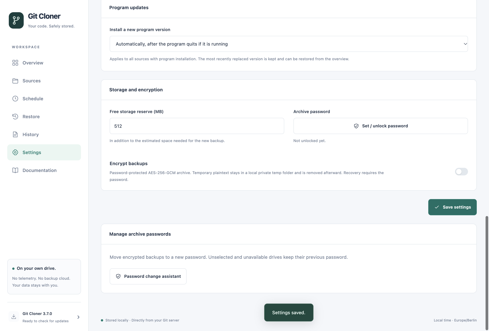

## 40. Restore the previous program version

When an update replaces a program, the replaced version is kept as the only previous version next to it, in a hidden folder `.repository.gc-previous-version`. Older versions are deleted, so at most two versions use disk space.

If a new version does not work, choose **Roll back to v…** in the program line of the overview and confirm. Git Cloner swaps both versions: the previous version becomes active again and the replaced version is kept as the previous version, so this step can be undone the same way. The program must be closed for this. Shortcuts keep pointing to the active version.

The release that was rolled back is held: the overview shows **Previous version active** with **skipped v…**, and automatic updates do not install this exact release again. As soon as a newer release appears, it is installed normally and the version that was active until then becomes the previous version.

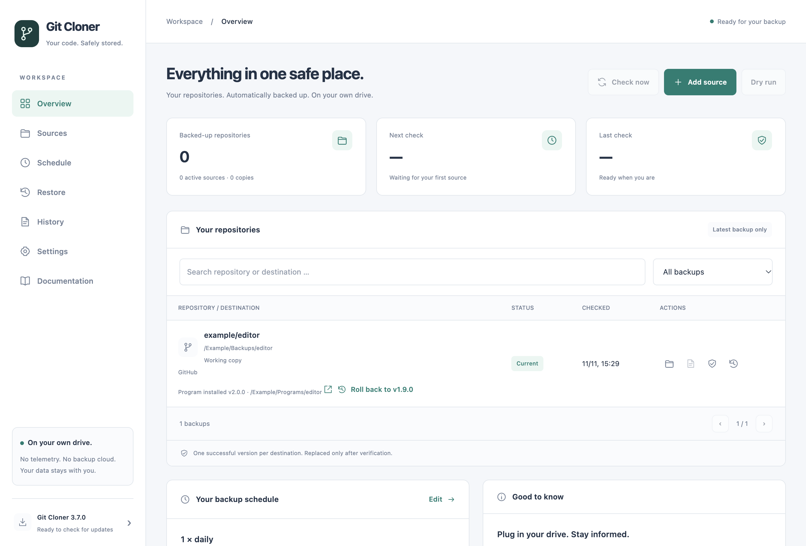

## 41. Reminder for paused backups

A pause you chose yourself also stops all scheduled backups. **Settings → Performance & rules → Paused backups** decides what happens when such a pause lasts longer than the chosen time (1 to 72 hours, default 24 hours):

- **Remind me once** (default) shows one notification, for example "Paused for 25 hours, 3 of 10 done. Scheduled backups wait until you resume." The queue stays paused.
- **Resume automatically** continues the queue after the chosen time.
- **Do nothing** keeps the previous behavior.

Pauses caused by rules, the API limit or low space are not affected; they continue on their own as described in sections 7, 12 and 24.


## 42. API quota

Without a token GitHub allows 60 API requests per hour, with a token 5,000. A repository with release backup needs three requests per run: the repository, its release list and the latest release, which already contains the list of its files. Each new release file downloaded adds one request. Ten repositories therefore need about 30 requests per run; two runs within one hour can use up the quota without a token.

Git Cloner reads the remaining quota from every response. Before a repository starts, it checks whether enough requests are left; with fewer than four it pauses the queue until the reset time instead of failing in the middle of a repository. **Settings → Accounts → API quota** shows the remaining requests and the reset time per account after the first check. Unchanged lists are answered from a local cache with HTTP 304 while the app runs, which saves data; with a token GitHub also does not count these answers against the quota.

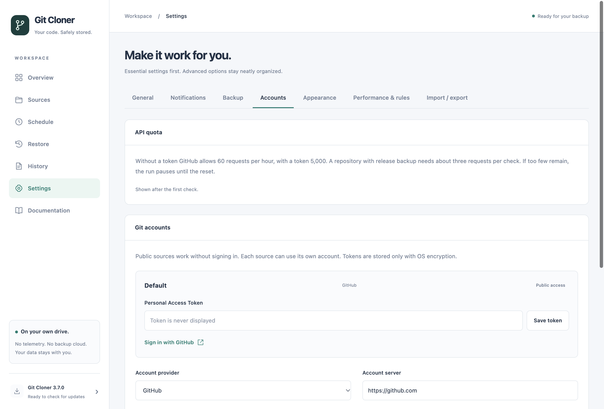

The version check of Git Cloner uses no API request (section 9).

## 43. Bandwidth time window

**Settings → Performance & rules → Bandwidth time window** sets a separate download limit for a daily time window, for example 1024 KiB/s from 08:00 to 18:00 so that downloads do not slow down other work during the day. Outside the window the general download limit applies (0 = unlimited). Windows across midnight such as 22:00 to 06:00 are supported.

The limit applies to Git, LFS and release downloads together, just like the general limit. Running downloads adapt immediately when the window starts or ends. Download timeouts are based on the slower of both limits, so a large download is not cancelled when the window starts during it.

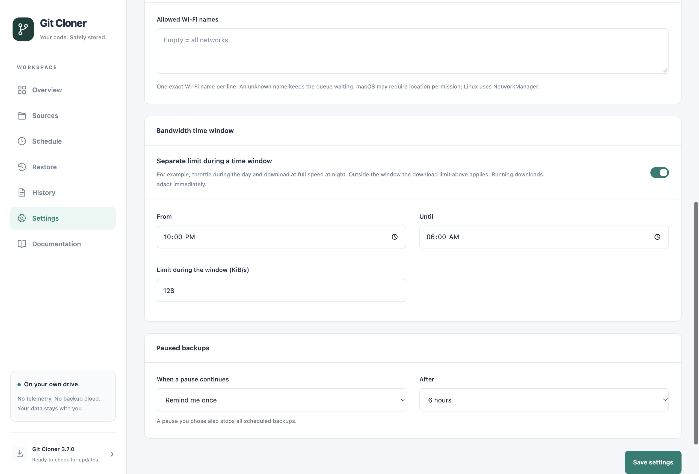

## 44. Exact macOS DMG variants

Under **Settings → Backup → Release assets → macOS DMG variant**, choose **Automatic**, **Universal**, **Apple Silicon only (ARM64)** or **Intel only (x64)**. The same field appears in **Sources → Edit → Backup content for this source**. Source-specific backup settings override the global preference, so change the field on the source when its own options are enabled.

Automatic preserves the existing CPU filter, which can include both native and Universal DMGs. An explicit variant selects only DMGs named for that variant and their corresponding checksum/signature sidecars. Shared checksum lists remain included. The OS and file-type filters still apply. ZIPs and other formats keep their general architecture filter. An unavailable variant does not silently select a different DMG. Clear an architecture-specific installation filename pattern when changing variants.

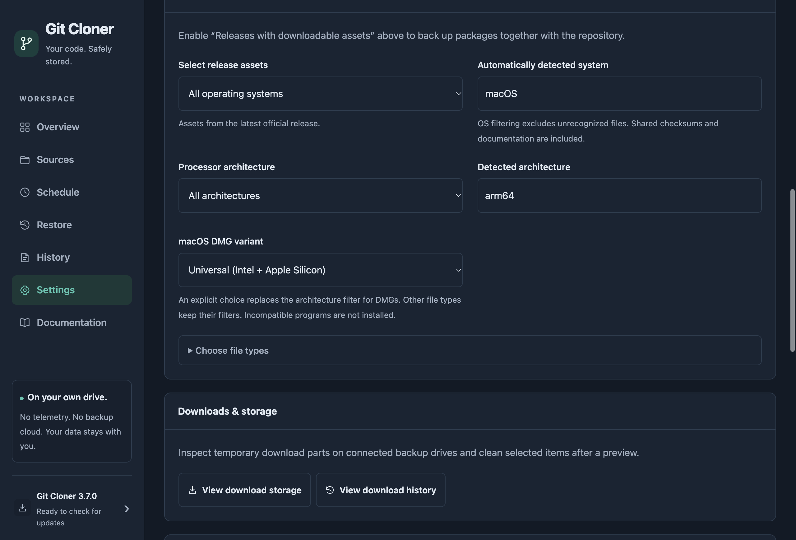

## 45. Missing downloads and Electron program archives

An unchanged Git commit does not prove that every downloaded release file still exists. Every unchanged backup checks the release metadata, file presence, regular-file type and recorded sizes. Missing or truncated downloads trigger a staged repair. Intact downloads are verified and reused; the old backup remains until the replacement passes verification. Full file hashing still follows the configured integrity policy, and installation always verifies its chosen package.

Electron programs contain an `app.asar` archive. Git Cloner copies this file and its unpacked companions without interpreting them as a directory. Signature, path and architecture checks still apply. See [Release repair and DMG selection](RELEASE-REPAIR.md) for the regression details and test coverage.

## 46. Snap and ARM64 Flatpak packages

Linux releases include x64 and ARM64 Flatpak and Snap builds. Choose the package matching your system. Flatpak bundles Git and architecture-matched Git LFS; installation uses `flatpak install --user ./PACKAGE.flatpak` after adding Flathub for the runtime dependencies. Start with `flatpak run io.github.Ujap1994.GitCloner`.

Install a standalone Snap using `sudo snap install --dangerous ./PACKAGE.snap`. The package uses strict confinement. External drives may require `sudo snap connect git-cloner:removable-media`. OS policy still controls access to hidden home folders and external paths; use a supported visible folder and verify a backup/restore before relying on the package. Its browser-support interface requests sandbox permission; the package retains Chromium's sandbox helper. The downloaded package is not a Snap Store listing.
