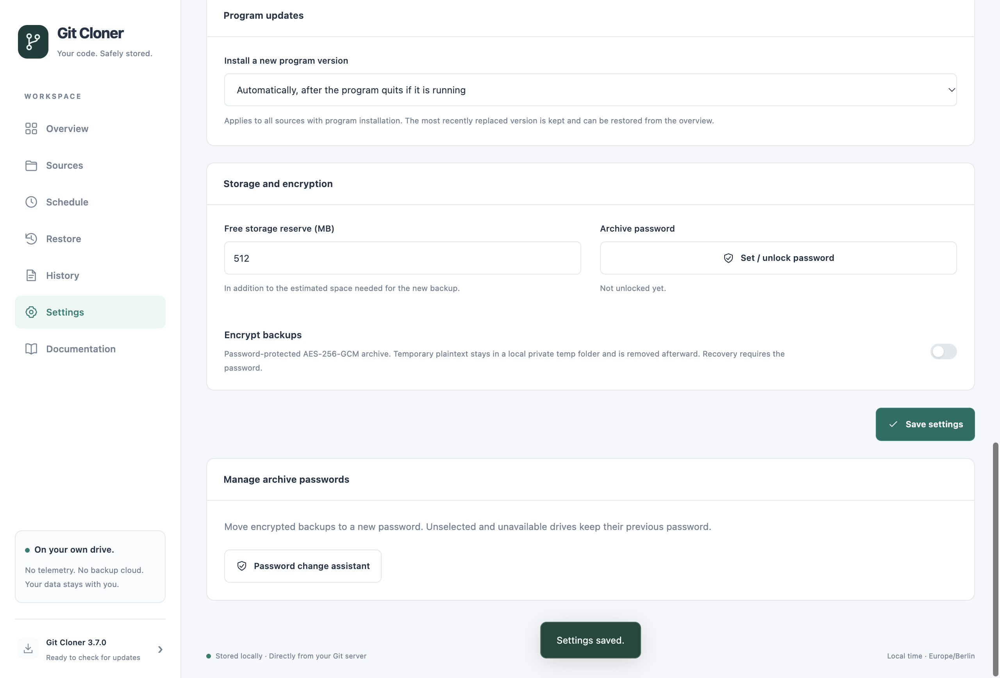
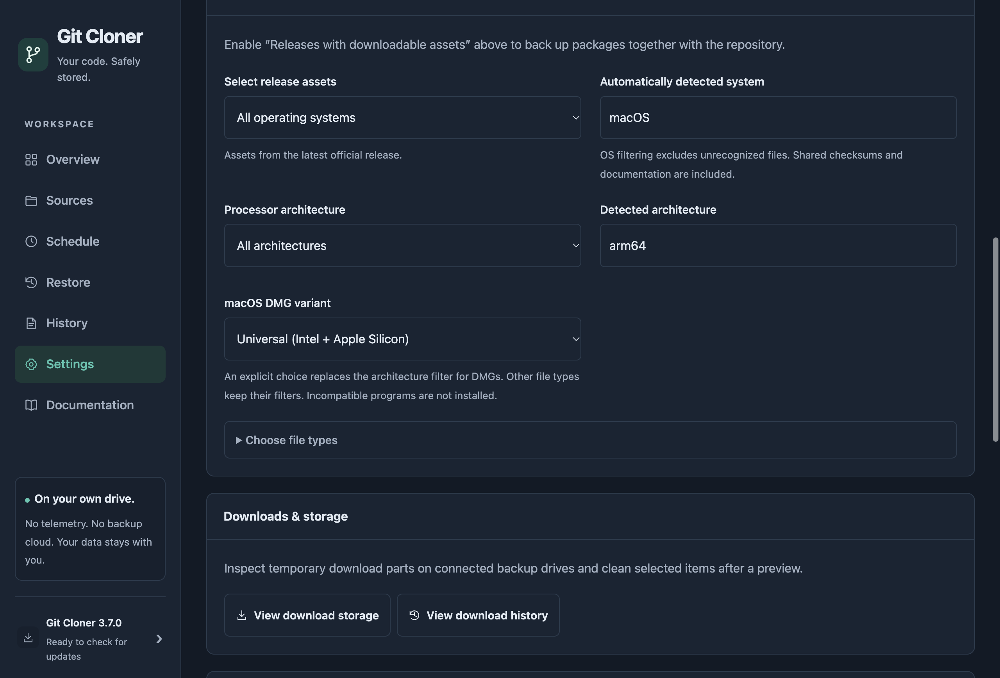

# Git Cloner 3.7.0

Git Cloner 3.7.0 combines managed program updates, rollback, API-aware scheduling and bandwidth windows with repairs for missing release downloads and Electron applications inside DMG/ZIP packages.

## Program installation and recovery

- Choose **after the program quits**, **at the next check**, or **notify only / Install now** under Settings → Backup → Program updates. A running program is left intact; the after-exit watcher checks only installations that are waiting.
- Keep the most recently replaced managed program version. **Roll back to…** swaps it back and holds the reverted release until a newer release appears or installation is explicitly requested. This is program rollback, not historical backup retention.
- Select **Automatic**, **Universal**, **ARM64** or **x64** for DMGs globally or per source. Explicit DMG choices override the general CPU filter for DMGs; OS and file-type filters still apply. Other formats retain their general filters.
- Repair missing or truncated release files even if the Git commit and release did not change. Intact downloads are verified and reused; failed repair downloads preserve the previous backup.
- Install Electron programs correctly by treating downloaded `app.asar` files as physical archives during extraction, validation, copying and cleanup. Native Electron tests reproduce the former `Invalid package` error and verify byte-for-byte copies and intact signatures from DMG and ZIP.

## Scheduling, quotas and notifications

- Configure a reminder or automatic resume for a user-paused queue after the selected number of hours.
- View API quota and reset time per account. A repository waits before starting when its available request budget is too small.
- Check Git Cloner's official release version without consuming a GitHub API request.
- Apply a separate download limit during a daily time window, including overnight windows. Active transfers adapt to the current limit.
- Notifications name the program and version for completed or pending installations and respect existing quiet-hour and notification preferences.

## Documentation, tests and distribution

- The codebase is formatted with Prettier, with the formatting-only commit excluded from Git blame.
- English core-message rendering and the English E2E suite are completed, with dedicated German-language checks.
- Screenshots are regenerated only through `npm run screenshots`; ordinary test runs do not modify tracked images.
- The complete English guide covers setup, every feature, permissions and recovery. README, changelog and supporting documentation are updated for 3.7.0.
- API/cache regression checks protect request counts, reuse of unchanged responses and bounded cache storage.
- The full release matrix includes Windows x64/ARM64 installers and portable apps, macOS x64/ARM64/Universal DMG and ZIP, and Linux x64/ARM64 AppImage, DEB, RPM, Pacman, TAR.GZ, Snap and Flatpak. Git LFS in Flatpak now matches the target CPU.

Existing source settings are preserved. Existing DMG settings use Automatic until changed. If a source has its own backup options, change the DMG preference there. Git Cloner still keeps one successful repository backup per destination. Its own updates remain notification-only. macOS release packages use ad-hoc signing without notarization; verify downloads using `SHA256SUMS.txt`.

Read the [complete illustrated guide](https://github.com/Ujap1994/Git-Cloner/blob/v3.7.0/docs/GUIDE.md) and [verification details](https://github.com/Ujap1994/Git-Cloner/blob/v3.7.0/docs/VALIDIERUNG.md). MIT licensed, without warranty.

New profiles follow the system language (German or English fallback) and close the application with the idle window by default. Existing language and tray preferences are preserved.
