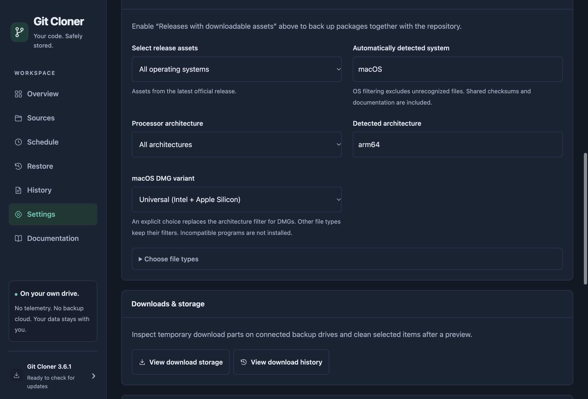

# Release repair and DMG selection

This change is based on Git Cloner 3.6.1. It adds a separate macOS DMG selection and repairs missing release files during otherwise unchanged backups.

## Choose a DMG variant

Open **Settings → Backup → Release assets → macOS DMG variant** for the global preference. For one repository, open **Sources → Edit → Backup content for this source**, enable **Use source-specific backup options**, and change the same field there. Save the settings before starting **Check now**.

| Choice | Download behavior |
| --- | --- |
| Automatic · compatible variants | Retains the existing architecture filtering. ARM64 and x64 filters can include compatible Universal packages. |
| Universal (Intel + Apple Silicon) | Keeps DMGs explicitly named Universal or Universal2. |
| Apple Silicon only (ARM64) | Keeps ARM64/aarch64 DMGs and excludes Universal and Intel DMGs. |
| Intel only (x64) | Keeps x64/x86_64/AMD64 DMGs and excludes Universal and ARM64 DMGs. |

An explicit DMG choice replaces the general architecture filter for DMGs, including their checksum/signature sidecars. The OS and file-type filters still apply. ZIPs and other package types retain the general architecture filter. Shared checksum files remain included. An unavailable variant does not silently select a different DMG.

An individual repository's own backup settings take precedence over the global settings. Existing configurations use Automatic until changed. Settings import/export preserves this preference; importing still requires explicitly enabling program installation again.

## Automatic installation

Enable **Automatically install this program** on an individual repository and choose a separate program destination. After a successful backup, Git Cloner selects a compatible program from the downloaded files, verifies it, and replaces the managed installation. Choosing a download variant does not make an incompatible executable installable: CPU and signature checks still apply. Intel apps on Apple Silicon retain the existing Rosetta fallback.

If **Keep all matching release files** is enabled, all files allowed by the filters are backed up. Otherwise installation narrows the download to the selected program package when possible. **Release filename** remains an additional installation filter; clear an old architecture-specific pattern when switching variants.

## Missing release files

Previously a missing ARM64 DMG could remain recorded in the release manifest while a Universal DMG was still present. The installer selected the preferred ARM64 entry and failed with `ENOENT`, even though the overview reported an unchanged, verified backup. Weekly integrity checks could leave this condition undetected until the next full verification.

Every unchanged backup now verifies the release metadata and checks the presence, regular-file type and recorded size of its release files. Missing or truncated files trigger the existing staged repair. Intact assets are verified and reused locally, while missing files are downloaded again. The repaired backup replaces the previous one only after successful verification. A failed download preserves the existing repository and intact files.

This lightweight check does not hash large DMGs on every scheduled run. Full integrity checks keep their configured cadence, and installation still verifies the selected package's SHA-256. These checks do not determine who removed a missing file.

## Electron applications inside releases

The live repair exposed a second installation failure: `Invalid package .../Contents/Resources/app.asar`. Electron's normal filesystem APIs interpret ASAR archives as virtual directories. Copying a downloaded Electron application with these APIs could fail at the destination archive; ZIP extraction was affected too. Node-only installer tests did not reproduce this behavior.

Installer extraction, validation, copying and cleanup now use Electron's `original-fs` APIs, treating downloaded ASAR archives as physical files. The application's own archive loader stays enabled, and program signature checks remain enforced. This follows the [Electron ASAR documentation](https://www.electronjs.org/docs/latest/tutorial/asar-archives#treating-an-asar-archive-as-a-normal-file).

## Verification

- Integration tests reproduce missing/truncated files with an unchanged Git commit and release, confirm repair and local reuse, preserve the old backup on download failure, and install a repaired program asset.
- Variant tests cover exact Universal/ARM64/x64 selection, aliases, absent variants, migration, OS/format interactions and GitHub/GitLab/Forgejo metadata planning.
- Electron tests save global and source-specific choices, reload the UI, and check German and English with dark mode and large text.
- Native Electron tests install signed macOS bundles containing real ASAR archives from DMG and ZIP files, compare the copied archive bytes and unpacked companion files, and verify the resulting signatures.

Run `npm run check` and `npx playwright test tests/e2e/dmg-variants.spec.cjs`. Existing native macOS tests exercise signed apps inside ZIP and DMG packages.
